<div align="center">


# xtool Painel

**Develop, install and publish iOS and Android apps without a Mac, right from your browser.**

[](#changelog)
[](https://github.com/xtool-org/xtool)
[](https://swift.org)
[](#android-and-google-play)
[](#publish-to-google-play)
[](#build-for-pc-electron)
[](#publish-to-steam)
[](#installation)
[](#requirements)

By **[marco3079](https://github.com/marco3079)**

[Installation](#installation) · [Getting started](#getting-started) · [Troubleshooting](#troubleshooting) · [Changelog](#changelog)

🇧🇷 [Leia em português](README.md) · 🇺🇸 English

<p align="center">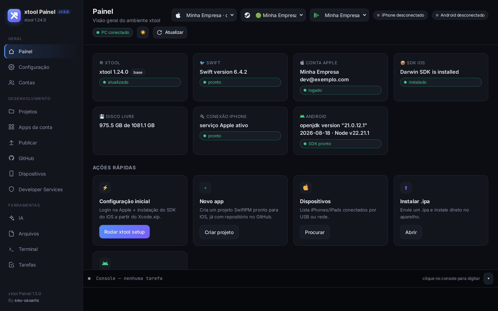</p>
<p align="center"><sub>Panel: versions, Apple account, iOS SDK, Android, disk and iPhone.</sub></p>

</div>

---

## Table of contents

**Start:** [Overview](#overview) · [Highlights](#highlights) · [Features](#features) · [Screenshots](#screenshots) · [Requirements](#requirements) · [Installation](#installation) · [Getting started](#getting-started)

**Use:** [Projects: configure, build and submit](#projects-configure-build-and-submit) · [Per-project database](#per-project-database) · [Manage published stores](#manage-published-stores) · [Connect the iPhone](#connect-the-iphone) · [Android and Google Play](#android-and-google-play) · [Run on an Android phone](#run-on-an-android-phone) · [App version](#app-version) · [AI for release notes](#ai-for-release-notes) · [GitHub](#github)

**Publish:** [Publish to the App Store](#publish-to-the-app-store) · [Publish to Google Play](#publish-to-google-play) · [Build for PC (Electron)](#build-for-pc-electron) · [Publish to Steam](#publish-to-steam)

**Reference:** [Architecture](#architecture) · [Data and volumes](#data-and-volumes) · [Security](#security) · [Known limitations](#known-limitations) · [Troubleshooting](#troubleshooting) · [Frequently asked questions](#frequently-asked-questions) · [Updating](#updating) · [Changelog](#changelog) · [Contributing](#contributing) · [License](#license) · [Credits](#credits)

## Overview

**xtool Painel** brings [xtool](https://github.com/xtool-org/xtool) (an Xcode alternative that runs on any system) and the **Android SDK** into a Docker container and adds a complete web panel. In the browser you manage the whole lifecycle of an app:

- **iOS:** Apple accounts, iPhones, builds, signing, upload to App Store Connect and publishing to the App Store.
- **Android:** Google Play accounts, APK and AAB builds with Gradle, signing key, installation on the phone over Wi-Fi and publishing to Google Play tracks.
- **PC:** web and Capacitor projects become desktop apps with Electron (Windows, Linux and macOS), and the build can be uploaded to Steam.
- **Shared:** projects (including a single Capacitor project with iOS and Android), GitHub repositories, the app version taken from the project itself, and release notes written by AI.

After starting the container, the panel is available at:

```text
http://localhost:8080
```

### Why use it

- **No Mac:** xtool runs in the container, and the panel handles the build, signing and upload to App Store Connect.
- **One place:** accounts, devices, databases, builds and stores live in the same panel.
- **Real terminal:** commands run in a real terminal (PTY). The 2FA code, the password and the path to Xcode.xip are answered in the panel console.
- **Ready environment:** xtool 1.24.0 comes inside the repository (`base/`), and JDK 21, Node 22 and the Android SDK are already in the image. The panel works without depending on xtool's GitHub.

## Highlights

### Projects

Each project has a card with **⚙ Configurar** (Configure), **🔨 Build** and **📤 Enviar para a loja** (Send to store). Configure the platforms, build in debug or release, and send an existing build to the store without rebuilding. Details in [Projects: configure, build and submit](#projects-configure-build-and-submit).

<p align="center">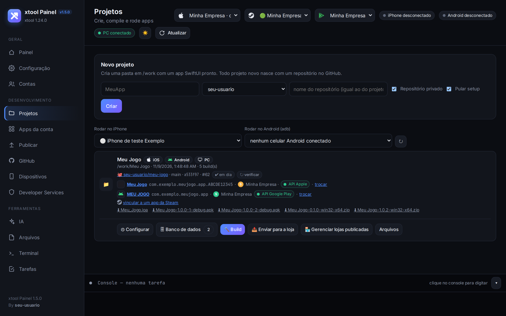</p>
<p align="center"><sub>Project card with the buttons Configurar, Build, Enviar para a loja, Gerenciar lojas publicadas (Manage published stores) and Arquivos (Files).</sub></p>

### Production and development databases

Register **Produção** (Production) and **Desenvolvimento** (Development) databases in each project. Each build uses the recipe of the chosen database, and stores only receive builds made with the production database. Details in [Per-project database](#per-project-database).

<p align="center">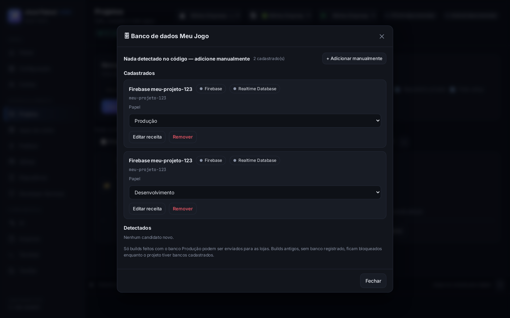</p>
<p align="center"><sub>Banco de dados (Database) popup: detected and registered databases, with the role of each one.</sub></p>

### Published stores

Edit the app listing in the App Store and Google Play tabs, with character counters, languages and images. Send a version for review on the App Store or promote a release on Google Play, always with confirmation. Details in [Manage published stores](#manage-published-stores).

<p align="center">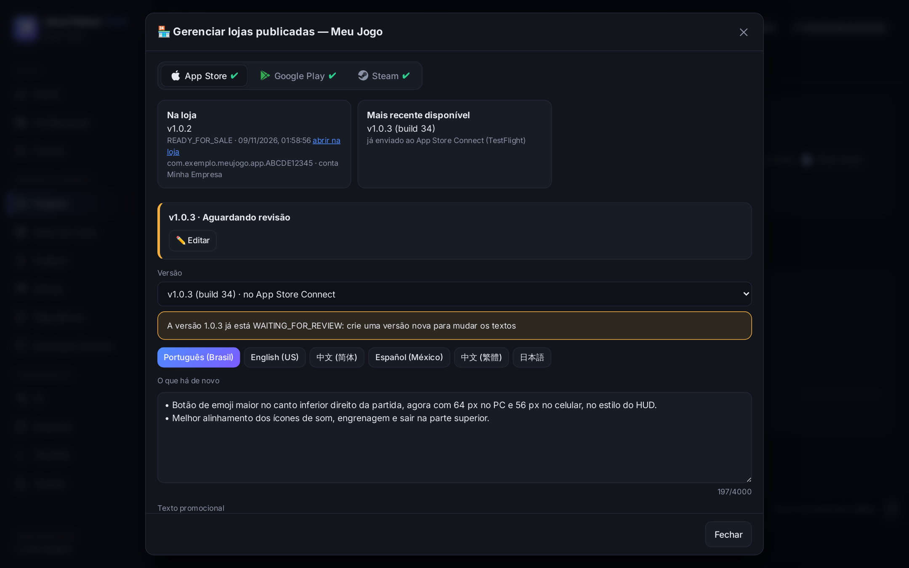</p>
<p align="center"><sub>Gerenciar lojas publicadas, App Store tab: version in the store, latest version and fields per language.</sub></p>

### Store texts with AI

Generate the listing texts with AI from the commits since the last release and the texts already in the store. You review before anything else: nothing is saved to the store until **💾 Atualizar na loja** (Update on store). Details in [Manage published stores](#manage-published-stores).

<p align="center">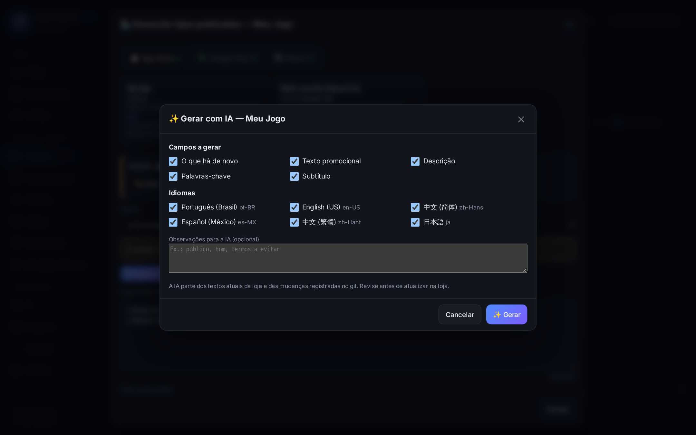</p>
<p align="center"><sub>Gerar com IA popup: choice of fields and languages.</sub></p>

## Features

| Area | What it does |
|---|---|
| **Painel** (Panel) | Xtool and Swift versions, Apple account in use, iOS SDK, Android, disk and iPhone connection. Warns when a new xtool version is released and updates with one click. |
| **Contas** (Accounts) | Apple, Google Play and Steam accounts, in the matching tab of the **Contas** menu. |
| **Apps da conta** (Account apps) | Apps registered in each store, with versions, tracks, bundle IDs and previews. |
| **Barra do topo** (Top bar) | Steam account and Google Play account selectors, and iPhone, Android and PC indicators. |
| **Projetos** (Projects) | SwiftUI, Android and Capacitor apps, with build, generated files and store uploads. |
| **Publicar** (Publish) | Upload to the App Store, Google Play and Steam. |
| **GitHub** | Multiple accounts, repository import and automatic pull from the project card. |
| **IA** (AI) | Providers for release notes and for store texts. |
| **Dispositivos** (Devices) | iPhone, Android and PC, with real-time status. Installs, opens and removes apps. |
| **Configuração** (Setup) | `xtool setup` and iOS SDK from `Xcode.xip`. |
| **Arquivos** (Files) | Browses `/work` and the Windows Downloads; uploads, downloads and deletes files. |
| **Terminal** | Interactive shell inside the container. |
| **Tarefas** (Tasks) | History of all commands, with the full output. |
| **Tema** (Theme) | Dark or light, with the button at the top. |

The official platform icons (Apple, Google Play, Steam and Android) appear throughout the panel.

<details>
<summary><b>Painel</b></summary>

- xtool versions: `base` (from the repository) or `xtool-org` (downloaded by the panel), plus Swift.
- Android: JDK, Node and SDK.
- Disk space and iPhone connection.
- Notice of a new xtool version, with one-click update.

</details>

<details>
<summary><b>Contas</b></summary>

- **Apple:** registers multiple accounts, each with its own login, and switches the active account with one click.
- **Google Play:** registers multiple accounts (service account JSON key) and tests the connection.
- **Steam:** registers accounts (Steamworks build name and user, no password) and logs in through the steamcmd console. Each account shows **Conectada** (Connected), **Sem login** (No login), **Ocupado…** (Busy…) or **Não verificado** (Not verified). The check uses the saved login and the **↻ Verificar** (Check) button. The **★ Principal** (★ Main) button sets the top account.

</details>

<details>
<summary><b>Apps da conta</b></summary>

- **Apple:** registry of all apps from all accounts, App Store Connect apps with the state of each version, bundle IDs with icon and an App Store page preview on an iPhone.
- **Google Play:** apps of each account, versions per track (internal, closed, open and production) and a page preview with the Play Console listing.
- **Steam:** registered apps (from all accounts), with App ID, Depot IDs per platform and default branch. Shows the apps of the selected account and the **Publicar** button, which opens Publicar → 🎮 Steam (PC) with the chosen app.

</details>

<details>
<summary><b>Barra do topo</b></summary>

- Selectors for the **Steam account** (🎮) and the **Google Play account** (▶). The choice becomes the saved main account, used as the default in the Publicar and Apps da conta screens when the project doesn't have its own account yet.
- Three clickable indicators that open the matching Dispositivos tab and refresh every 5 seconds:
  - **iPhone:** connected, disconnected or "abra o iTunes" (open iTunes) when Windows' Apple service is turned off. The tooltip lists the devices and whether they are connected by cable or Wi-Fi.
  - **Android:** connected or disconnected, via `adb devices`.
  - **PC:** connected or disconnected, via `host.docker.internal`. The tooltip also shows whether the Apple service is active.
- The default iPhone device is chosen in **Dispositivos** (★).
- On screens narrower than 860 px, the top bar hides these selectors and indicators.

</details>

<details>
<summary><b>Projetos</b></summary>

- Creates SwiftUI apps, with a GitHub repository created on the spot (see [GitHub](#github)), and recognizes Android and Capacitor projects.
- Builds in debug or release, generates `.ipa` and `.apk`, runs on the iPhone and on the Android phone, and generates the Xcode project.
- Per-project databases, with Production and Development, which define the build and unlock store upload (see [Per-project database](#per-project-database)).
- Labels in **Projetos**:
  - 🍎 iOS and 🤖 Android;
  - 🖥️ PC (projects with `package.json`), with the ⚙ Configurar, 🔨 Build, 📤 Enviar para a loja, 🏪 Gerenciar lojas publicadas and Arquivos buttons;
  - 🎮 Steam, when the project is linked to a Steam app.
- The **Tipo de código** (Code type) of the PC build (automatic or chosen) is saved per project.
- On the card, the Google Play and Steam app lines show the account and the status, with the option to link or switch.
- The store listing (texts, images and AI) is in **🏪 Gerenciar lojas publicadas** (see [Manage published stores](#manage-published-stores)).

For more details, see [Projects: configure, build and submit](#projects-configure-build-and-submit).

</details>

<details>
<summary><b>Publicar</b></summary>

- **App Store:** builds in release, generates the icon (`Assets.car`), signs for distribution, uploads to App Store Connect, fills in **"O que há de novo"** (What's new) and submits for review.
- **Google Play:** generates a signed APK or AAB with the upload key, writes the release notes and sends it to the chosen track.
- **🎮 Steam (PC):** builds the site for Windows, Linux and macOS with Electron, writes the build description and uploads it to Steam through steamcmd. The **Tipo de código** of card 2 fills in the command and the site folder.

</details>

<details>
<summary><b>Dispositivos</b></summary>

- **📱 iPhone (iOS):** registers multiple devices, with real-time status (cable, Wi-Fi or disconnected). Installs, opens and removes apps.
- **🤖 Android:** phones via `adb`, with Wi-Fi pairing, connection, status, APK installation and app launch.
- **🖥️ PC:** Windows status reached from the container, Apple service, steamcmd, Node/npx, Electron cache and the PC builds of the projects.
- **Instalar .apk** card (also on the Home page): drag a `.apk` or choose one from `/work`, pick the phone and install via adb.

</details>

## Screenshots

> [!NOTE]
> Personal data (emails, names, IDs, keys and devices) appears blurred. Click an image to see it at full size.

<table>
<tr>
<td width="50%" valign="top"><b>Painel</b><br><sub>Xtool and Swift versions, Apple account, iOS SDK, disk, iPhone and Android connection.</sub><br><a href="docs/telas/01-painel.png"></a></td>
<td width="50%" valign="top"><b>Painel no tema claro</b><br><sub>Light theme, toggled with the button at the top.</sub><br><a href="docs/telas/02-painel-claro.png">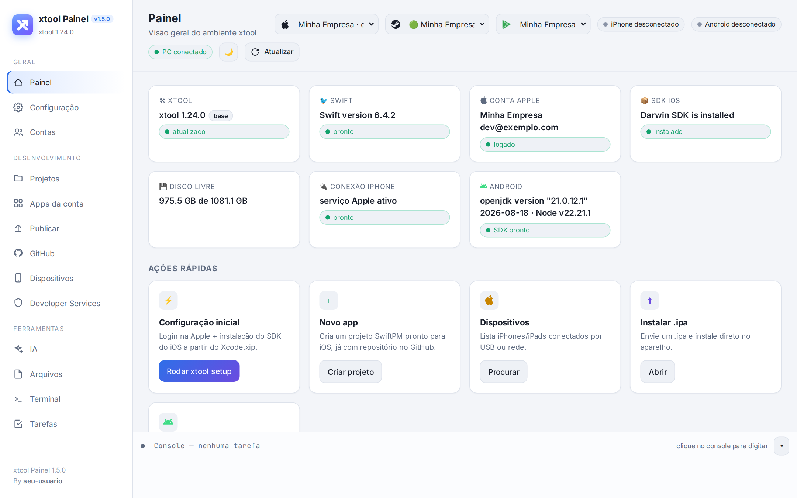</a></td>
</tr>
<tr>
<td width="50%" valign="top"><b>Configuração</b><br><sub><code>xtool setup</code> and iOS SDK from <code>Xcode.xip</code>.</sub><br><a href="docs/telas/03-configuracao.png">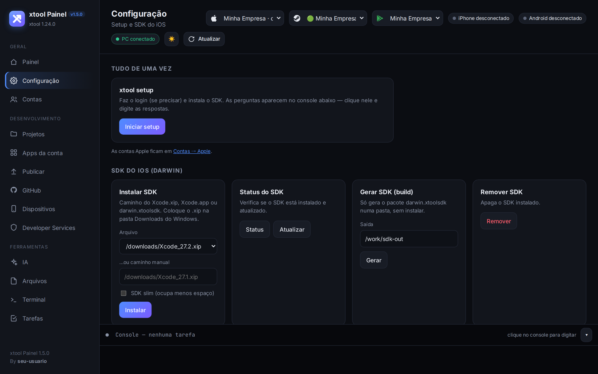</a></td>
<td width="50%" valign="top"><b>Contas · Apple</b><br><sub>Multiple Apple accounts, each with its own login.</sub><br><a href="docs/telas/04-contas-apple.png">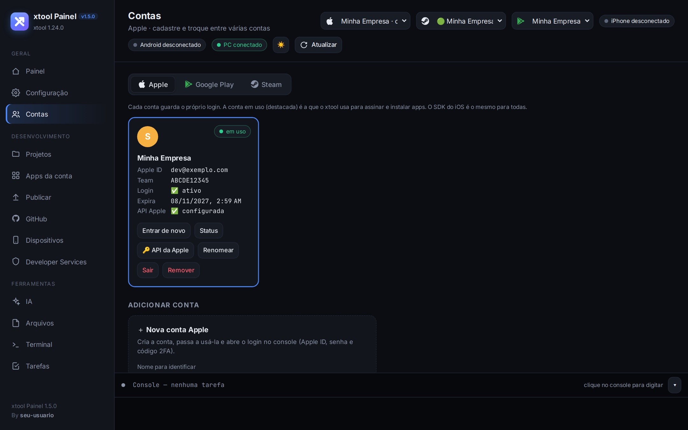</a></td>
</tr>
<tr>
<td width="50%" valign="top"><b>Contas · Google Play</b><br><sub>Google Play service accounts, with JSON key.</sub><br><a href="docs/telas/05-contas-google-play.png">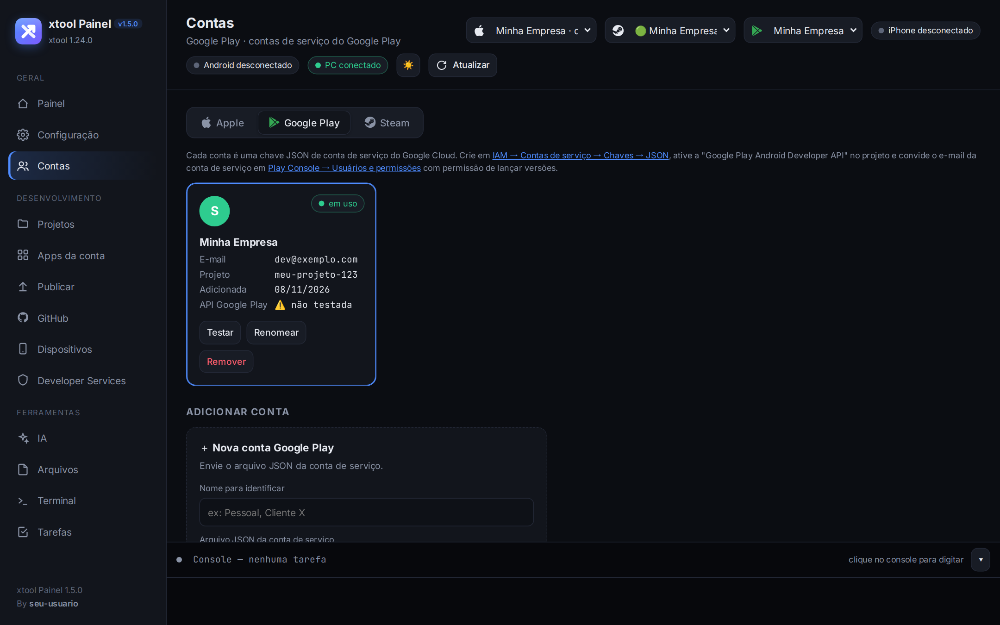</a></td>
<td width="50%" valign="top"><b>Contas · Steam</b><br><sub>Steamworks build accounts and login via steamcmd.</sub><br><a href="docs/telas/06-contas-steam.png">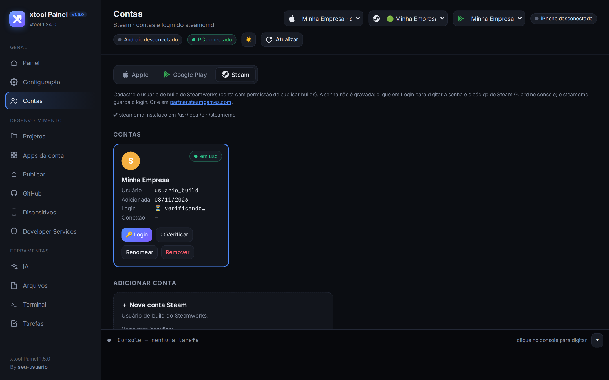</a></td>
</tr>
<tr>
<td width="50%" valign="top"><b>Projetos</b><br><sub>Build, generate .ipa/.apk and run on the iPhone or Android.</sub><br><a href="docs/telas/07-projetos.png"></a></td>
<td width="50%" valign="top"><b>Banco de dados</b><br><sub>Detected and registered databases, with the role of each one.</sub><br><a href="docs/telas/08-banco-de-dados.png"></a></td>
</tr>
<tr>
<td width="50%" valign="top"><b>Build</b><br><sub>Platforms, database, version and store upload.</sub><br><a href="docs/telas/09-build.png">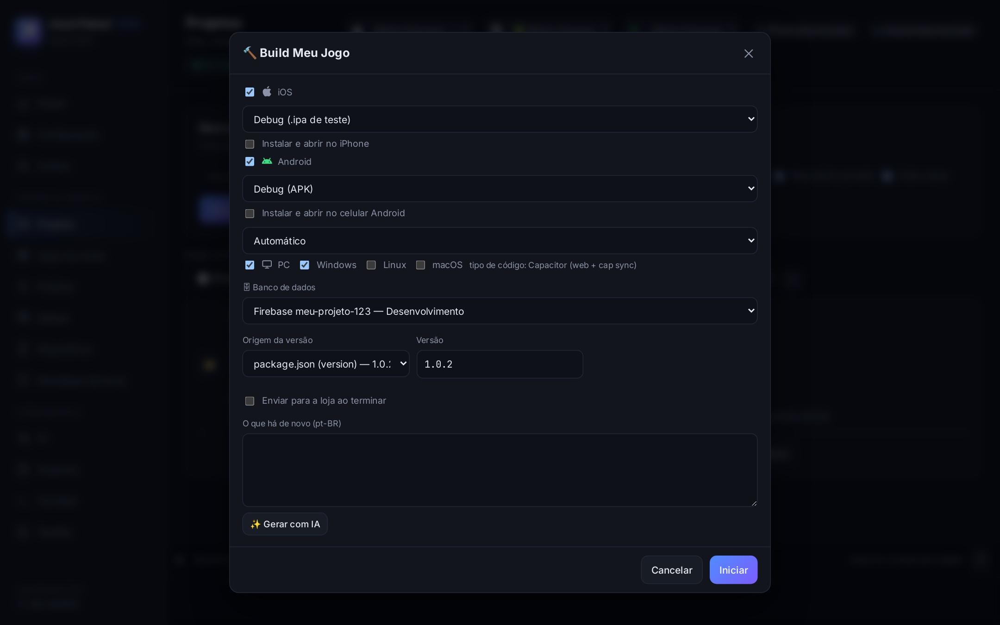</a></td>
<td width="50%" valign="top"><b>Gerenciar lojas · App Store</b><br><sub>Store version, latest version and fields per language.</sub><br><a href="docs/telas/10-lojas-app-store.png"></a></td>
</tr>
<tr>
<td width="50%" valign="top"><b>Gerenciar lojas · Google Play</b><br><sub>App listing on Google Play, with the release track.</sub><br><a href="docs/telas/11-lojas-google-play.png">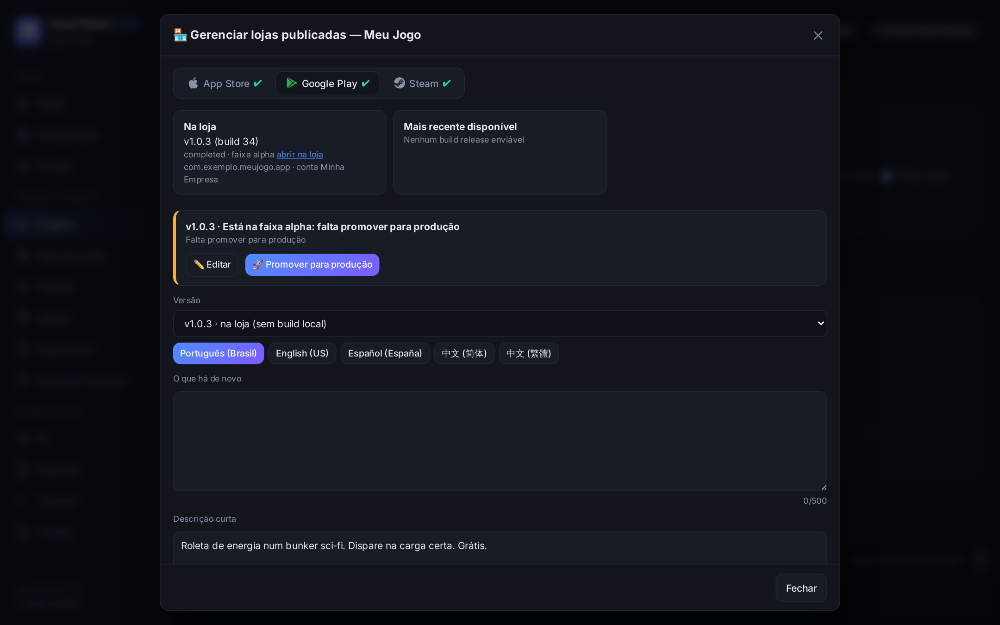</a></td>
<td width="50%" valign="top"><b>Gerenciar lojas · Steam</b><br><sub>Version sent to Steam, branch and available builds.</sub><br><a href="docs/telas/12-lojas-steam.png">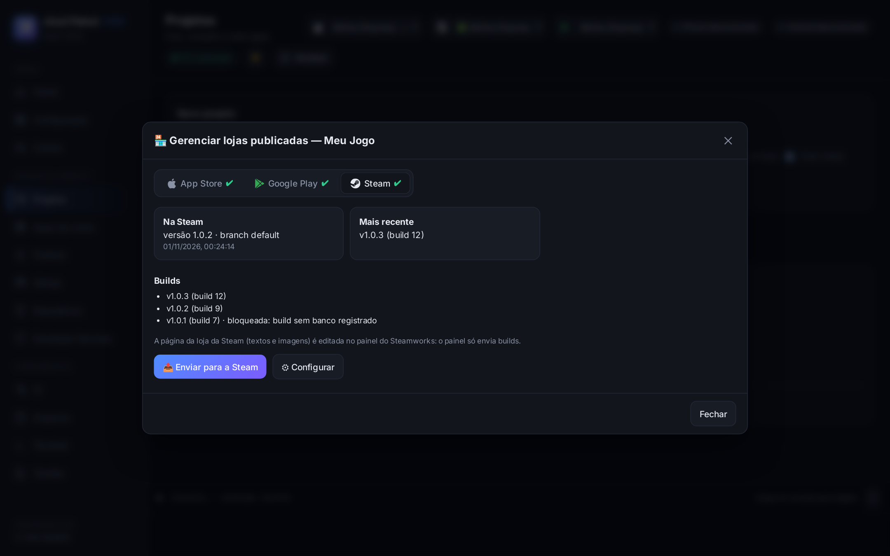</a></td>
</tr>
<tr>
<td width="50%" valign="top"><b>Gerar com IA</b><br><sub>Choice of fields and languages.</sub><br><a href="docs/telas/13-gerar-com-ia.png"></a></td>
<td width="50%" valign="top"><b>Apps da conta</b><br><sub>Apps registered in each account.</sub><br><a href="docs/telas/14-apps-da-conta.png">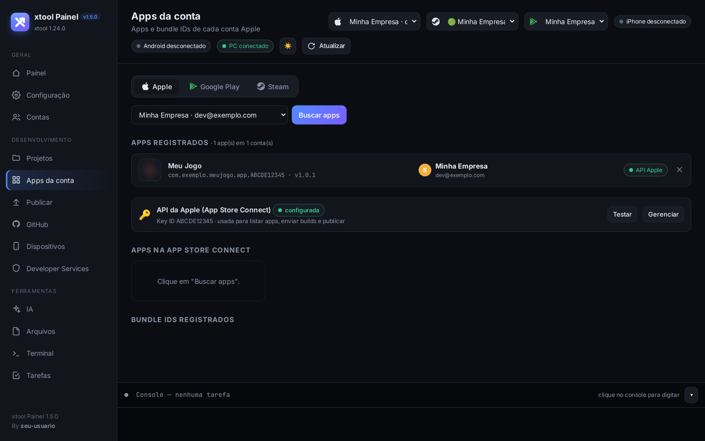</a></td>
</tr>
<tr>
<td width="50%" valign="top"><b>Publicar</b><br><sub>App Store, Google Play and Steam.</sub><br><a href="docs/telas/15-publicar.png">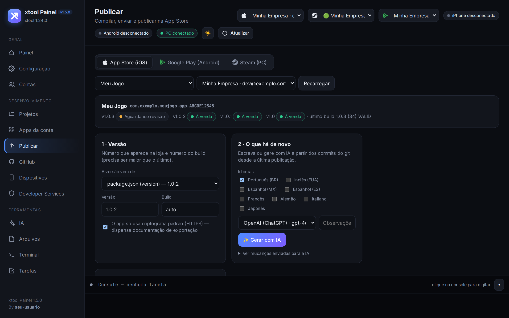</a></td>
<td width="50%" valign="top"><b>GitHub</b><br><sub>Accounts, repositories and links to projects.</sub><br><a href="docs/telas/16-github.png">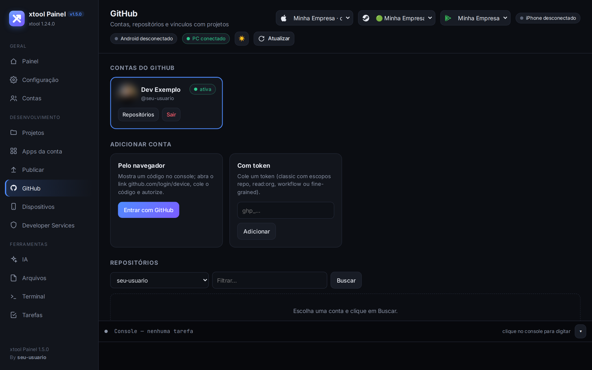</a></td>
</tr>
<tr>
<td width="50%" valign="top"><b>Dispositivos</b><br><sub>Devices with real-time status; install, open and remove apps.</sub><br><a href="docs/telas/17-dispositivos.png">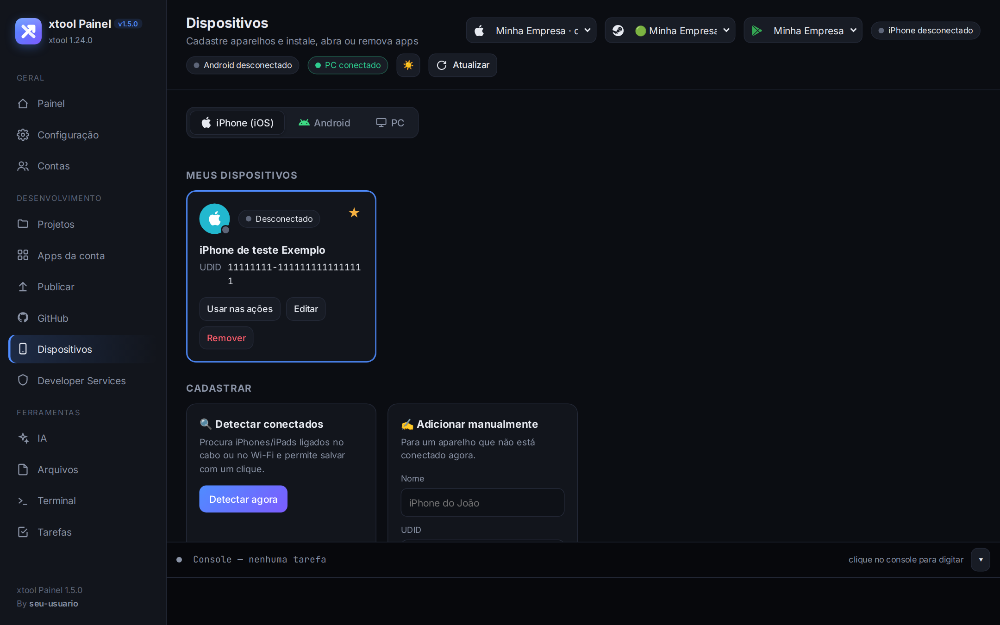</a></td>
<td width="50%" valign="top"><b>Developer Services</b><br><sub>Teams, certificates, bundle IDs, devices and profiles.</sub><br><a href="docs/telas/18-developer-services.png">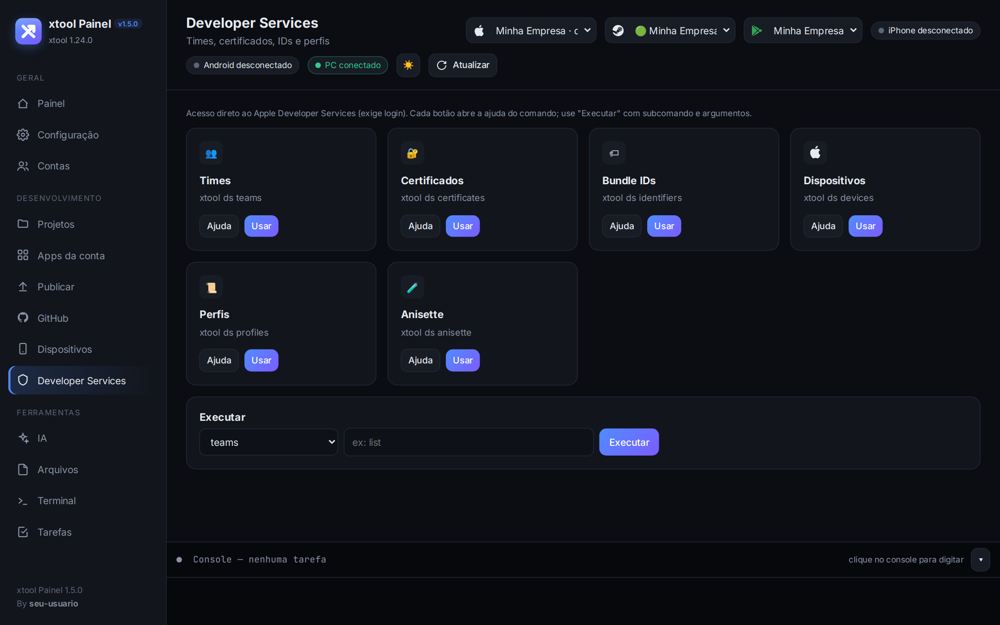</a></td>
</tr>
<tr>
<td width="50%" valign="top"><b>IA</b><br><sub>Providers for writing release notes.</sub><br><a href="docs/telas/19-ia.png">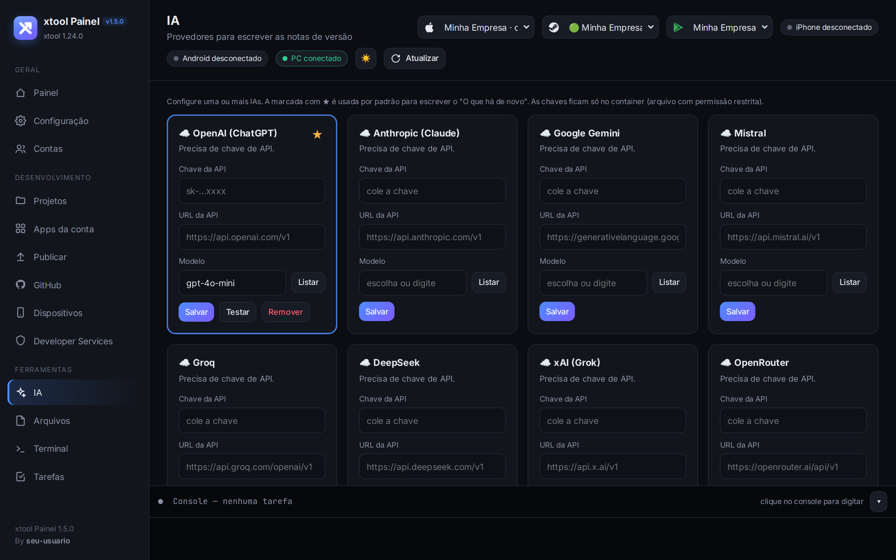</a></td>
<td width="50%" valign="top"><b>Arquivos</b><br><sub>Browse /work and Downloads; upload, download and delete.</sub><br><a href="docs/telas/20-arquivos.png">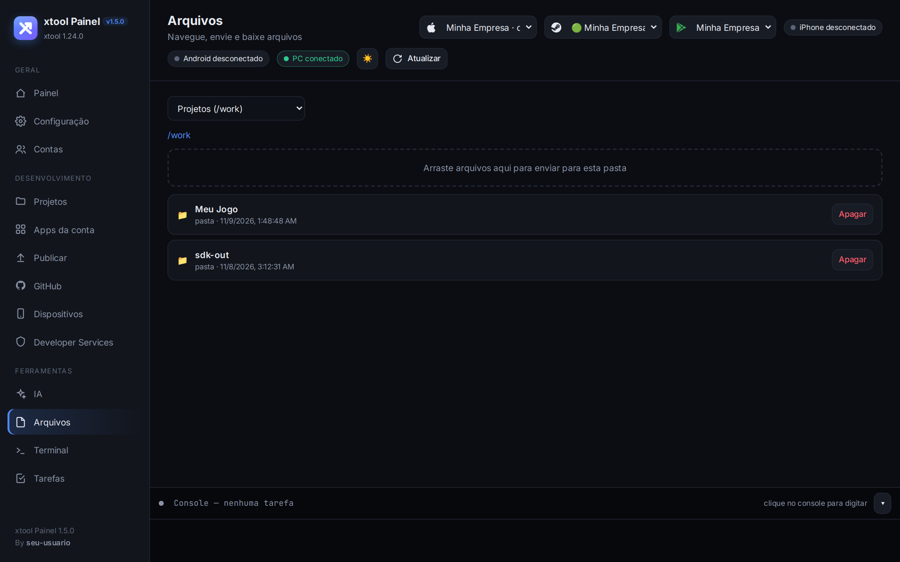</a></td>
</tr>
<tr>
<td width="50%" valign="top"><b>Terminal</b><br><sub>Interactive shell inside the container.</sub><br><a href="docs/telas/21-terminal.png">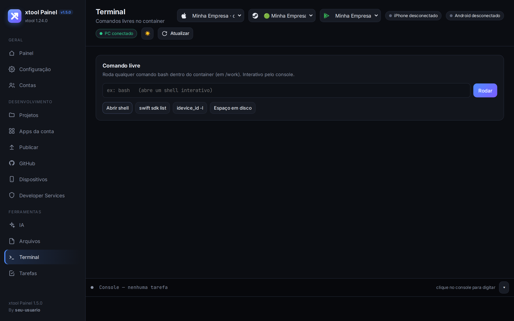</a></td>
<td width="50%" valign="top"><b>Tarefas</b><br><sub>History of all commands, with the full output.</sub><br><a href="docs/telas/22-tarefas.png">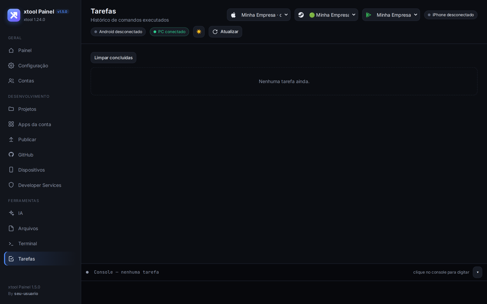</a></td>
</tr>
<tr>
<td width="50%" valign="top"><b>Prévia da App Store</b><br><sub>How the app page looks on the App Store on an iPhone.</sub><br><a href="docs/telas/23-previa-app-store.png">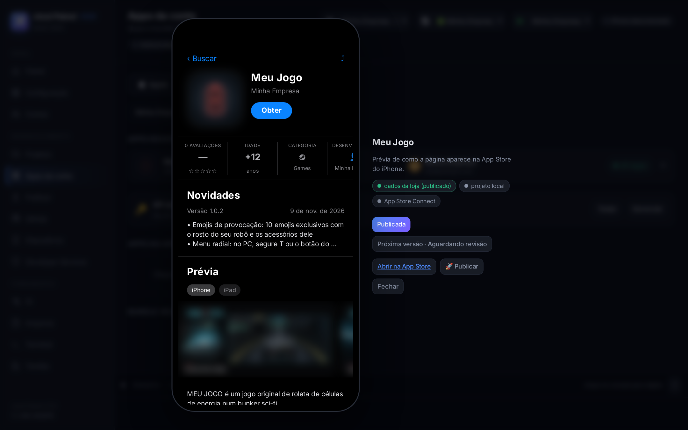</a></td>
<td width="50%" valign="top"><b>Prévia da Google Play</b><br><sub>How the app page looks on Google Play, with the Play Console listing.</sub><br><a href="docs/telas/24-previa-google-play.png">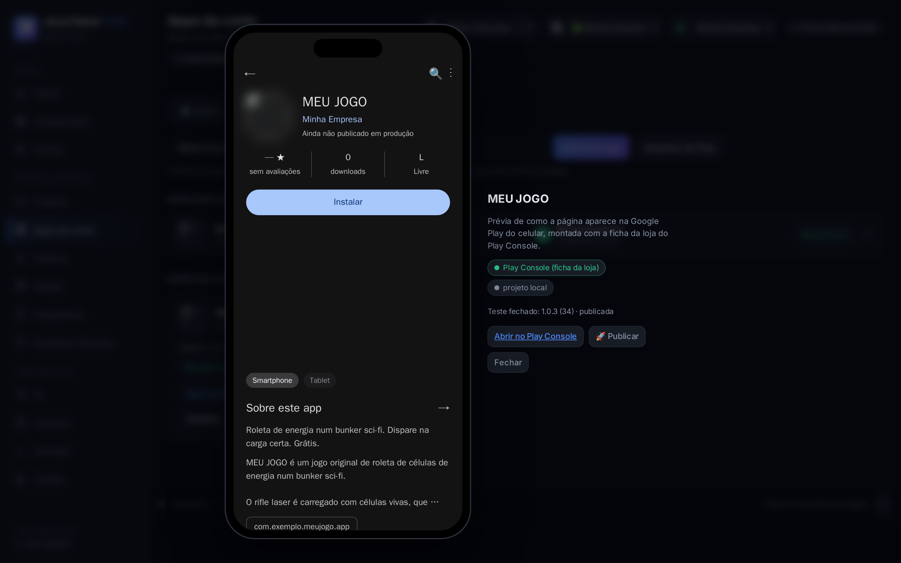</a></td>
</tr>
</table>

## Requirements

| Item | Note |
|---|---|
| Docker Desktop (Windows) or Docker Engine (Linux) | With Compose v2 |
| Disk space | ~20 GB free: image, iOS SDK, Android SDK and builds |
| **iOS** · Xcode 27.x (`.xip`) | Download at [developer.apple.com/download](https://developer.apple.com/download/all/?q=Xcode) |
| **iOS** · Apple ID | Any account works to install on your own iPhone |
| **iOS** · Apple Developer Program | **Required to publish on the App Store**, together with an App Store Connect API key |
| **iOS** · iTunes or Apple Devices (Windows) | Bridges the iPhone over cable or Wi-Fi |
| **Android** · nothing to install | JDK 21, Node 22 and the Android SDK (platform 36, build-tools 36) are already in the image |
| **Android** · Google Play developer account | **Required to publish**, together with a Google Cloud service account with access to the Play Console |
| **Android** · Android 11+ phone | To install over Wi-Fi (wireless debugging), on the same network as the PC |
| **PC** · nothing to install | Electron is downloaded on the first build, which needs internet, and is cached in the container. The default image is about 8 GB and includes ImageMagick |
| **PC** · Wine (optional) | `INSTALL_WINE=1`. Needed for the icon and the `.exe` metadata; adds about 3.9 GB |
| **Steam** · Steamworks partner account | US$ 100 fee per app, paid to Valve. App ID and Depot IDs are created in Steamworks, plus a build user with permission to publish builds |

## Installation

```bash
git clone https://github.com/marco3079/xtool-docker.git
cd xtool-docker
docker compose up -d --build
```

Then open **http://localhost:8080**.

> [!NOTE]
> The first build takes a few minutes, because it compiles `accord` from source code.

## Getting started

1. **iOS SDK:** put `Xcode_27.x.xip` in the Downloads folder. In the panel, go to **Configuração → Instalar SDK** (Setup → Install SDK).
2. **Apple account:** in **Contas → Apple → Nova conta** (Accounts → Apple → New account), sign in with the Apple ID. The 2FA code is requested in the console.
3. **Project:** in **Projetos → Novo projeto** (Projects → New project), choose the GitHub account (register it first, in the **GitHub** menu), the repository name (default: the project name) and whether it is private (default) or public. The panel creates the project and the repository. You can also import a repository in **GitHub → Importar como projeto** (Import as project).
4. **Run on the iPhone:** with the iPhone connected, open **🔨 Build** on the project card, choose 🍎 iOS in **Debug** and check **Instalar e abrir no iPhone** (Install and open on iPhone).
5. **Android:** projects with an `android/` folder (Gradle or Capacitor) show the 🤖 Android label. On the card, open **🔨 Build**, choose 🤖 Android in **Debug** and check **Instalar e abrir no celular Android** (Install and open on Android phone). With the phone paired, see [Run on an Android phone](#run-on-an-android-phone).
6. **Google Play:** in **Contas → Google Play**, upload the service account JSON. Then add the app in **Apps da conta → Google Play** (Account apps → Google Play).
7. **PC:** on the project card, open **⚙ Configurar** to set up the PC (systems, code type and site folder) and **🔨 Build** to generate the app. In **Publicar → 🎮 Steam (PC)** you can also build for Windows, Linux and macOS and upload to Steam.
8. **Steam:** in **Contas → Steam**, register the build account and click **Login**. Type the password and the Steam Guard code in the console. Mark the account as **★ Principal** (★ Main) at the top. Then register the app in **Apps da conta → Steam** and, in **Publicar → 🎮 Steam (PC)**, send the build.
9. **Projects:** on the project card, use **⚙ Configurar → 🔨 Build → 📤 Enviar para a loja**, as described in [Projects: configure, build and submit](#projects-configure-build-and-submit).

## Projects: configure, build and submit

Each project has a card in the **Projetos** tab. The main buttons are **⚙ Configurar**, **🔨 Build** and **📤 Enviar para a loja**. The card also shows **🗄 Banco de dados** (see [Per-project database](#per-project-database)) and **🏪 Gerenciar lojas publicadas** (see [Manage published stores](#manage-published-stores)).

Below the Apple line, the card shows the Google Play app line and the Steam line. In each one, **trocar** (switch) links or swaps the app and the account, and the line shows the status (the Google Play API, or **Conectada** and **Sem login** for Steam). Before each dialog that fetches data (Configurar, Build, Enviar and the links), a loading popup appears.

<p align="center"></p>
<p align="center"><em>Project card, with Configurar, Banco de dados, Build, Enviar para a loja, Gerenciar lojas publicadas and Arquivos.</em></p>

### 1. ⚙ Configurar

Always shown. Opens the full project dialog, with a toggle per platform: **🍎 iPhone (iOS)**, **🤖 Android** and **🖥️ Steam (PC)**. Each one shows **Pronto** (Ready), **Falta configurar** (Missing setup) or **Desativado** (Disabled). With the toggle on, the reason appears if something is missing. The card gets the **⚙ falta configurar** label when an enabled platform is not ready. **Salvar** (Save) saves everything at once.

- **🍎 iPhone (iOS):** the **bundle ID** and the Apple app link (**Vincular / trocar app da Apple** (Link / switch Apple app), with the project's Apple account). It is ready when there is a `Package.swift` (xtool project, with SwiftPM). Without it, the panel explains why: web or Capacitor projects don't become iOS here, because Capacitor iOS requires Xcode on a Mac. Nothing is created.
- **🤖 Android:** the **package name**, the **comando antes do Gradle** (command before Gradle) (empty = detected default, `-` = skip), the Google Play account and the app link (**Vincular / trocar app do Google Play** (Link / switch Google Play app)). It is ready when the `android/` folder (Gradle) is present.
  - If the folder is missing but `capacitor.config` exists, the **Adicionar Android** (Add Android) button runs `npx cap add android`, which installs the dependencies and `@capacitor/android` if they are missing.
  - Without Capacitor, the panel only explains what to install.
- **🖥️ Steam (PC):** the operating systems (Windows, Linux and macOS), the **tipo de código**, the **nome do app** (app name), the **comando antes do build**, the **pasta do site** (site folder), the **versão do Electron** (Electron version), generating **.zip**, the Steam app link (**Vincular / trocar app da Steam**) and the **branch**. It is ready when a code type is set (detected or chosen).
- **Versão do projeto:** **Configurar versão…** (Configure version…) chooses the version source (see [App version](#app-version)).
- **🌐 Idiomas do app:** see [App languages](#app-languages).

### 2. 🔨 Build

Shown when at least one platform is enabled and ready. Only the ready platforms appear in the popup.

The popup lets you:

- **Plataformas** (Platforms): iOS and Android in Debug or Release; PC with Windows, Linux and macOS.
- **Banco de dados** (Database): database selector for the build, when databases are registered (see [Per-project database](#per-project-database)).
- **Versão** (Version): automatic, `package.json`, `xtool.yml`, Gradle, Xcode, git tag or manual. The source is saved per project (see [App version](#app-version)).
- **Enviar para a loja ao terminar** (Send to store when done):
  - iOS: App Store Connect;
  - Android: Google Play, with track and status;
  - PC: Steam, with account, app and branch.

Debug builds don't go to the store. The "O que há de novo" text can be generated with AI. Everything runs in sequence in a single task (order: Android, PC, iOS) and stops at the first failure.

<p align="center"></p>
<p align="center"><em>Build popup: platforms, database, version and store upload.</em></p>

### 3. 📤 Enviar para a loja

Sends an existing release build **without rebuilding**. The button is disabled while there is no release build. The popup lists the ready versions (version, build, type, date and size) for you to choose.

| Platform | File sent |
|---|---|
| iOS | signed `.ipa`, at `xtool/<projeto>-<versão>-<build>.ipa` |
| Android | `.aab` or `.apk` from `xtool/android/`, without `-debug` in the name |
| PC | zip or ready folder, sent to Steam |

> [!NOTE]
> If the project has registered databases, only builds made with the **Produção** database can be sent (see [Per-project database](#per-project-database)).

- A ready build's version does not change. For another version, generate a new build in **🔨 Build**.
- Before sending, the panel checks:
  - on iOS, that the build number does not exist in App Store Connect yet and that the `Info.plist` of the `.ipa` matches the version, build and bundle ID;
  - on Android, that the `versionCode` is higher than the last one on Google Play.

To publish on each store, see [Publish to the App Store](#publish-to-the-app-store), [Publish to Google Play](#publish-to-google-play) and [Publish to Steam](#publish-to-steam). To edit the store listing (texts, images and languages), use **🏪 Gerenciar lojas publicadas**.

## Per-project database

A project can have a **Produção** database and a **Desenvolvimento** database. On the card, the **🗄 Banco de dados** button opens the databases popup. This way each build comes out with the right database, and stores only receive builds made with the production database.

<p align="center"></p>
<p align="center"><em>Banco de dados popup: detected and registered databases, with the role of each one (prod or dev).</em></p>

### Detection and registration

1. **Detecção** (Detection): when the popup opens, the panel searches the code for databases and shows how many it found.
   - **Firebase:** Realtime Database and Firestore, via `google-services.json` (Android), `GoogleService-Info.plist` (iOS) or the configuration in the code.
   - **Supabase, MongoDB, PostgreSQL and MySQL:** via the connection URLs. The password is masked.
   - **SQLite** and other local database files.
   - **`.env`:** connection variables from the `.env` file.
2. **Cadastro manual** (Manual registration): add the databases that detection did not find, including the **Personalizado** (Custom) type.
3. **Papel** (Role): mark which database is **Produção**, which is **Desenvolvimento** and, if you want, **Outro** (Other). Each project has at most one production database and one development database.
4. **Receita** (Recipe): each database has a recipe, detected by the panel and editable:
   - **Comando antes do build** (command before build), run before compiling;
   - **Arquivos a copiar** (files to copy), from the source path to the destination path;
   - **Variáveis de ambiente** (environment variables), set for the build.

   Example (Carga Viva): the production recipe has the command `npm run build:client:prod && npm run native:env -- prod`.

> [!WARNING]
> The development database recipe must have its own command. If it is empty and the project uses the panel's default pre-build, that default prefers the `:prod` scripts, and the development build would come out with the production database.

### Build with database

In the **🔨 Build** dialog, the **Banco de dados** (Database) selector chooses the build's database. The panel applies the recipe before compiling: it copies the files, sets the variables and runs the command as the pre-build. On iOS, only file copying and variables apply. Each build is recorded with the database that generated it.

### Shipping rule

- **Project with registered databases:** only builds made with the **Produção** database can be sent to the App Store, Google Play or Steam.
- **Old build without a database record:** blocked. Rebuild choosing the production database.
- **Project without registered databases:** no restriction.

The server also rejects the upload, not just the screen.

<details>
<summary>Technical details</summary>

- Databases are stored in `~/.config/xtool-panel/projects.json`, under the `databases` and `buildDb` keys.
- Routes: `GET` and `POST /api/project/databases`.
- Detection: `panel/dbdetect.py`. Recipes (command, files and variables): `panel/dbenv.py`. Popup: `panel/static/database.js`.

</details>

## Manage published stores

On the project card, the **🏪 Gerenciar lojas publicadas** button is always visible, right after **📤 Enviar para a loja**. It opens the app listing in three tabs: **App Store** (iOS), **Google Play** (Android) and **Steam** (PC). A loading popup appears before it opens.

The popup reads what is already in the store and saves only the texts and images you change. It does not send builds (for that, use **📤 Enviar para a loja**). It only submits a version for review or promotes an existing release, always with confirmation (see [Submit for review and promote](#submit-for-review-and-promote)).

<p align="center"></p>
<p align="center"><em>App Store tab: store version × latest version, pending version and fields per language.</em></p>

### Tab states

Each tab shows ✓ when the store is ready and ⚠ when something is missing. The starting tab is the first ready one; if none is ready, it is the App Store.

| State | What appears |
|---|---|
| **Pronta** (Ready) | Store version, latest available version and the editable listing |
| **Sem conta** (No account) | The store account or the app link is missing. The notice leads to **Contas** and **⚙ Configurar** |
| **Sem app** (No app) | The app does not exist in the store. The notice leads to **⚙ Configurar** |
| **Não publicada** (Not published) | There is no published version on the App Store and no release on Google Play (in any track, except drafts). The notice leads to **🔨 Build** and **📤 Enviar para a loja** |
| **Erro** (Error) | The store did not respond as expected. The message appears in the popup |

- **Google Play:** the production release counts. If there is none, the newest of the other tracks counts (closed, open or internal test), and the popup shows which track it is.
- **Steam:** "**Não publicada**" (Not published) means no build has been sent yet.

### Store version × latest version

On the App Store and Google Play tabs, the top of the popup shows:

- **Na loja** (In the store): the version, the state (App Store) or the track (Google Play) and the date.
- **Mais recente disponível** (Latest available): the highest version among the local release builds that can be sent (with the database used; see [Per-project database](#per-project-database)). On the App Store, builds already uploaded and processed in App Store Connect (TestFlight) are also included, marked "· no App Store Connect" (in App Store Connect).
- **Selo** (Badge):
  - **✔ Já está publicada** (Already published), when the latest version is the one in the store;
  - **Nova versão disponível para publicar** (New version available to publish), when the local one is higher;
  - the [pending version](#pending-version) card, when the latest version has already been created on the App Store and is waiting to be sent or reviewed.

The **Versão** (Version) selector lists one build per version (the newest of each), from highest to lowest. The version in the store appears with "· na loja" (in the store). Builds that cannot be sent are disabled, with the reason (for example, a build without the production database). When you choose a version, the popup loads its texts.

### Pending version

When the latest version has already been created on the App Store and is still waiting to be sent (for example, **1.0.3 · Preparar para envio** (Prepare for submission)), the top of the popup shows a warning card in place of the **Nova versão disponível para publicar** badge.

- **App Store:** the card says "Criada na loja: falta enviar para a revisão" (Created in the store: still needs to be sent for review) and has:
  - **✏️ Editar** (Edit), which selects that version and loads its texts;
  - **📨 Enviar para revisão** (Submit for review).

  Versions in review, waiting or already approved show only the state label, with no submit button.
- **Google Play:** the card says "Falta promover para produção" (Still needs to be promoted to production), shows the track the release is in (for example, closed test) and has **🚀 Promover para produção** (Promote to production).

App Store state labels:

| State in App Store Connect | Label in the panel |
|---|---|
| `PREPARE_FOR_SUBMISSION` | Preparar para envio |
| `READY_FOR_REVIEW` | Pronta para revisão |
| `WAITING_FOR_REVIEW` | Aguardando revisão |
| `IN_REVIEW` | Em revisão |
| `PENDING_DEVELOPER_RELEASE` | Aprovada, aguardando sua liberação |
| `PENDING_APPLE_RELEASE` | Aprovada, aguardando liberação |
| `PROCESSING_FOR_APP_STORE` | Processando para a App Store |
| `READY_FOR_SALE` | Pronta para distribuição |
| `DEVELOPER_REJECTED` | Rejeitada por você |
| `REJECTED` | Rejeitada pela Apple |
| `METADATA_REJECTED` | Metadados rejeitados |
| `INVALID_BINARY` | Binário inválido |
| `WAITING_FOR_EXPORT_COMPLIANCE` | Aguardando conformidade de exportação |
| `DEVELOPER_REMOVED_FROM_SALE`, `REMOVED_FROM_SALE` | Removida da venda |
| `REPLACED_WITH_NEW_VERSION` | Substituída por versão nova |

A state the panel does not recognize appears as the raw code.

### Fields per store

| Store | Fields and limits (characters) |
|---|---|
| App Store | **O que há de novo** (4000), **Texto promocional** (Promotional text) (170), **Descrição** (Description) (4000) and **Palavras-chave** (Keywords) (100), from the version. **Subtítulo** (Subtitle) (30), from the app information |
| Google Play | **Descrição curta** (Short description) (80) and **Descrição completa** (Full description) (4000), which apply to the whole listing. **O que há de novo** (500), the release notes of the chosen build |
| Steam | No fields |

- Languages appear as chips. Each one shows the text already in the store and can be edited.
- The counter of each field turns red when it goes over the limit. The panel only warns and does not cut the text, so shorten it before updating.
- If the version cannot be edited (for example, already published or in review), a yellow bar explains why, the fields become read-only and the update button is disabled.

### Update on store

The **💾 Atualizar na loja** button stays disabled while there are no changes. Before saving, it shows a summary with the store, the version and the number of fields and languages. Then it saves only the changed, non-empty fields.

- **App Store:** if the version does not exist in the store yet, it is created when you update. If the version is already published or in review, the texts do not change: create a new app version.
- **Google Play:** the listing texts apply to the whole app and are applied on update. The "O que há de novo" notes apply only to the release of the chosen build. If the build is not in any release on the track, the notes are not saved and a warning appears in the popup.
- **It does not send a build or submit for review.** To send a build, use **📤 Enviar para a loja**. To submit the version for App Store review, use **📨 Enviar para revisão**. To promote a release on Google Play, use **🚀 Promover para produção** (see [Submit for review and promote](#submit-for-review-and-promote)). Submission is also still possible through **Publicar** or in App Store Connect.

### Submit for review and promote

Two buttons take real actions on the stores. Both ask for confirmation before acting, and the confirmation applies only to that action.

**App Store: 📨 Enviar para revisão** (next to **💾 Atualizar na loja**, or on the pending card):

- Attaches the highest valid build of the version in App Store Connect (processed and not expired), answers the encryption question as "no encryption" (the panel's default) and submits the version for Apple review.
- It only works when the version already exists on the App Store in an editable state: Preparar para envio, Rejeitada por você, Rejeitada pela Apple, Metadados rejeitados or Binário inválido. If the version does not exist yet, save the texts with **Atualizar na loja** first.
- It needs a processed build of the version. Without one, upload the `.ipa` in **📤 Enviar para a loja** and wait for processing.
- The confirmation states the version and build, for example: "A versão X (build N) será anexada e enviada para a revisão da Apple. Continuar?" (The version X (build N) will be attached and sent for Apple review. Continue?).

**Google Play: 🚀 Promover para produção** (on the pending card and next to **💾 Atualizar na loja**):

- Copies the build's release (by `versionCode`) from the track it is in (for example, closed test) to the destination track, keeping the release notes. It does not send a new build.
- **Destino** (Destination): Produção (Production) (default), teste aberto (open test), teste fechado (closed test) or teste interno (internal test). The source track does not appear in the list.
- **Status:** **Liberar para todos** (Release to everyone) (complete), **Liberação gradual** (Staged rollout) (with the percentage, default 10%) or **Só rascunho** (Draft only).
- The confirmation shows the destination track and the status before promoting.

<p align="center"></p>
<p align="center"><em>Google Play tab: version, track and store listing.</em></p>

### Gerar com IA

The **✨ Gerar com IA** (Generate with AI) button opens a popup where you choose the fields and languages (all come checked) and, if you want, write notes for the AI. The AI uses the default provider (★, in **IA**).

- **Text basis:** the commits since the last store release, the notes and the texts already in the store, to keep the app's identity.
- **Limits:** each text is cut at the field limit. Keywords are cut at the last comma before the limit.
- **Error per language:** if the AI fails on one language, the others continue and the error appears per language. There is a total failure only if all languages fail.
- **Review before saving:** the generated text fills the fields on screen. Nothing is saved to the store until **Atualizar na loja**.
- **No git changes:** to generate "O que há de novo" without new commits, write a summary in the notes.

<p align="center"></p>
<p align="center"><em>Gerar com IA popup: choice of fields and languages.</em></p>

### Imagens

Each language has the listing images, in a grid by type. Click a thumbnail to enlarge it.

- **＋ Adicionar** (Add) uploads one or more images (PNG or JPG, up to 10 MB).
- **✕** deletes an image.
- Each upload and each deletion asks for confirmation and takes effect on the store right away, without waiting for **Atualizar na loja**.
- The browser uploads the file to `<projeto>/xtool/lojas-img/`, and the temporary file is deleted afterwards.

Sizes per store:

- **App Store, by screen type:** iPhone 6.7" (1290×2796), iPhone 6.5" (1242×2688 or 1284×2778), iPhone 5.5" (1242×2208), iPad Pro 12.9" and iPad Pro 12.9" (2nd gen), both 2048×2732. Uploading requires an editable version.
- **Google Play, by type:** icon (512×512), feature graphic (1024×500), phone screenshots (16:9 or 9:16, from 320 to 3840 px) and 7" and 10" tablet screenshots.

### Steam

The Steam tab shows the version sent (**Na Steam** (On Steam)), the branch, the date and the available builds, with the **Enviar para a Steam** (Send to Steam) and **Configurar** buttons.

Steam has no fields: there is no API for the store page. The page texts and images are edited in the Steamworks dashboard. The panel only sends builds.

<p align="center"></p>
<p align="center"><em>Steam tab: version sent, branch, date and available builds.</em></p>

### App languages

In **⚙ Configurar → 🌐 Idiomas do app** (App languages), check the languages the app is available in.

- When opened, **pt-BR** is checked if the project has no saved languages yet. At least one language must be checked.
- These languages appear in the popup and are used in AI generation. Languages that already exist in the store also appear.
- Codes follow the App Store pattern (for example, `pt-BR`, `en-US` and `zh-Hans`). For Google Play, the panel converts them automatically (for example, `es-MX` becomes `es-419` and `zh-Hans` becomes `zh-CN`).

### Routes

<details>
<summary>Route list</summary>

| Route | Purpose |
|---|---|
| `GET /api/lojas/overview?project=` | State of the three stores, languages and versions of the project |
| `GET /api/lojas/fields?project=&store=&version=&build=` | Texts, images and limits of the chosen version |
| `POST /api/lojas/save` | Saves the changed texts (`project`, `store`, `version`, `build`, optional `track` and `data`) |
| `POST /api/lojas/generate` | Generates texts with AI for the chosen fields and languages |
| `POST /api/lojas/image/upload` | Uploads to the store an image already loaded in `<projeto>/xtool/lojas-img/` |
| `POST /api/lojas/image/delete` | Deletes an image from the store |
| `POST /api/lojas/submit` | Submits the version for App Store review (`project`, `store` = `ios`, `version` and optional `build`); only versions in an editable state |
| `POST /api/lojas/promote` | Promotes the build's release to another Google Play track (`project`, `store` = `android`, `version`, required `build`, and optional `to_track`, `status`, `fraction` and `from_track`) |

App languages are saved through the project settings route (`/api/project/settings`, platform `locales`).

</details>

Technical details: the overview and the store links are in `panel/lojas.py`; reading and saving texts and images, submitting for review and promoting between tracks are in `panel/lojas_io.py`; the popup is in `panel/static/lojas.js`; and the AI and images are in `panel/static/lojas2.js`.

## Connect the iPhone

The container uses the Apple service running on Windows, through `USBMUXD_SOCKET_ADDRESS=host.docker.internal:27015`. That is why you don't need usbipd.

1. Leave **iTunes** or **Dispositivos Apple** (Apple Devices) open.
2. Connect the iPhone with the cable once and tap **Confiar** (Trust).
3. To use it wirelessly, in iTunes check **Sincronizar com este iPhone via Wi-Fi** (Sync with this iPhone over Wi-Fi).
4. On the iPhone, enable **Ajustes → Privacidade e Segurança → Modo de Desenvolvedor** (Settings → Privacy & Security → Developer Mode).

The status of each device appears in **Dispositivos** and is refreshed every 5 seconds.

<p align="center"></p>
<p align="center"><sub>Devices: iPhone, Android and PC, with real-time status.</sub></p>

## Publish to the App Store

The panel builds, signs and uploads the iOS app to App Store Connect. To publish, the Apple account needs the Apple Developer Program and an App Store Connect API key.

### Prerequisites (once per account)

1. Create a **team key** at [App Store Connect → Usuários e Acesso → Integrações (Users and Access → Integrations)](https://appstoreconnect.apple.com/access/integrations/api) with the **App Manager** role (or Admin) and download the `.p8`.
2. In the panel, go to **Contas** → Apple, click **🔑 Cadastrar API da Apple** (Register Apple API) on the account card, enter the **Issuer ID**, the **Key ID** and the `.p8` file, and click **Testar** (Test).
3. Create the app record at **App Store Connect → Apps → +**, with the same bundle ID as in `xtool.yml`.
4. For the first version, fill in the screenshots, description, age rating and privacy on Apple's site. The API does not do that part.

> [!IMPORTANT]
> Each Apple account has its own API key.

### Flow

In the **Publicar** (Publish) section, choose the project, check the version (the build is automatic), generate or write the "O que há de novo", and click **🚀 Iniciar** (Start).

<p align="center"></p>
<p align="center"><sub>Publish: App Store, Google Play and Steam.</sub></p>

<details>
<summary>App Store upload steps</summary>

| Step | What happens |
|---|---|
| 1 | Finds the app in App Store Connect and calculates the next build number |
| 2 | Runs `xtool dev build -c release` |
| 3 | Writes the version and the Xcode data (`DTXcode`, `DTSDKName`…) to `Info.plist` and compiles the icons into `Assets.car` with [accord](https://github.com/MiloLug/dine-accord) |
| 4 | Creates or reuses the **Apple Distribution** certificate and the **App Store** profile, and signs with [rcodesign](https://github.com/indygreg/apple-platform-rs) |
| 5 | Uploads the `.ipa` through the official `buildUploads` API and waits for Apple's validation |
| 6 | Waits for processing, creates or updates the version, writes "O que há de novo", links the build and, if checked, submits for review |

</details>

Each step can be turned off. For example, you can generate only the signed `.ipa` or only upload to TestFlight.

## Android and Google Play

The panel recognizes any project with Gradle at the root or in an `android/` folder as Android. **Capacitor** projects are detected by `capacitor.config.*`. The same project can be iOS and Android at the same time, and it appears with both labels in **Projetos**.

On the project card, **⚙ Configurar** shows Android (ready, missing setup or disabled). If there is Capacitor but no `android/` folder, the **Adicionar Android** button runs `npx cap add android`. The APK and AAB come out of **🔨 Build**:

| How | What it does |
|---|---|
| **🔨 Build** · Android · Debug | Generates the debug APK. With **Instalar e abrir no celular Android** checked, installs it on the chosen phone (connected devices) and opens the app |
| **🔨 Build** · Android · Release | Generates the signed AAB. With **Enviar para a loja ao terminar** checked, sends it to Google Play |
| **📤 Enviar para a loja** | Sends a ready release AAB or APK, without rebuilding |

Before Gradle, the panel runs the project's pre-build. For Capacitor, the default is `npm ci && npm run build… && npx cap sync android`, which can be replaced or skipped. The generated files are in `<projeto>/xtool/android/`.

## Run on an Android phone

Installation uses `adb` over Wi-Fi, so no cable or Windows drivers are needed.

1. On the phone (Android 11+), open **Opções do desenvolvedor → Depuração por Wi-Fi → Parear com código** (Developer options → Wireless debugging → Pair with pairing code).
2. In **Publicar → Google Play**, in the **📲 Instalar no celular Android** (Install on Android phone) card, enter the `ip:porta` and the pairing code and click **Parear** (Pair).
3. Enter the connection `ip:porta` and click **Conectar** (Connect). The phone appears in the device list of **🔨 Build** (Android, Debug) and in **Dispositivos → Android**.

The PC and the phone must be on the same network.

> [!NOTE]
> The connection port is different from the pairing port. If the phone does not appear, see [Troubleshooting](#troubleshooting).

## Publish to Google Play

### Prerequisites (once per account)

1. In [Google Cloud](https://console.cloud.google.com/iam-admin/serviceaccounts), create a **service account**, generate a **JSON key** and enable the **Google Play Android Developer API** in the project.
2. In [Play Console → Users and permissions](https://play.google.com/console/users-and-permissions), invite the service account's email with permission to release versions.
3. In the panel, under **Contas** → Google Play, give the account a name, upload the JSON and click **Testar** (Test). You can register several accounts.
4. The app must already exist in the Play Console, because Google's API does not create apps. Add it by package name in **Apps da conta → Google Play**.
5. The first time, generate or import the app's **upload key** in the **🔑 Chave de assinatura** (Signing key) card. Click **Baixar backup** (Download backup) and keep the file.

> [!WARNING]
> Without the upload key you cannot update the app on Google Play. Keep the backup outside the container.

### Flow

In **Publicar → Google Play**, choose the project and the account, check the version, generate or write the release notes (up to 500 characters per language), choose the track and the status, and click **🚀 Iniciar** (Start).

<details>
<summary>Google Play upload steps</summary>

| Step | What happens |
|---|---|
| 1/5 | Reads the version and fetches from Play the highest `versionCode` already uploaded, to use the next one |
| 2/5 | Runs the pre-build of the web project (Capacitor) |
| 3/5 | Builds with Gradle, writes `versionName`/`versionCode` and signs with the upload key |
| 4/5 | Packages the `.aab` and the `.apk` and checks the version written inside them |
| 5/5 | Uploads the AAB through the Google Play Developer API, writes the notes and releases it to the chosen track |

</details>

Available tracks:

| Track | On Play |
|---|---|
| Teste interno | Up to 100 testers, released immediately |
| Teste fechado | Groups of testers (alpha) |
| Teste aberto | Anyone can join (beta) |
| Produção | All users; staged rollout is possible |

With **Enviar para o Google Play** (Send to Google Play) unchecked, the panel only generates the signed files. If the app has never been published, Play only accepts the release as a draft, and the panel warns in the console.

## Build for PC (Electron)

Web and Capacitor projects become a desktop app with **Electron**, for **Windows, Linux and macOS** (x64 architecture). Everything runs inside the container: `@electron/packager` is run with `npx`, which downloads Electron and keeps the cache in `/root/.cache/electron`.

The panel copies the already built site (the `dist/`, `build/`, `www/` or `out/` folder, or the Capacitor `webDir`) into a minimal Electron app at `<projeto>/xtool/pc/app/`. The user's project is not changed. The packages come out at `<projeto>/xtool/pc/out/<Nome>-<plataforma>-x64/` and, if checked, are zipped to `<projeto>/xtool/pc/<Nome>-<versão>-<plataforma>-x64.zip`.

The app opens the site through the internal `app://` protocol (not as a file). This way absolute paths such as `/assets/...` work, and SPA routes fall back to `index.html`.

### Prerequisites (once)

1. Build the site first (or provide a command in **Compilar para PC** (Build for PC)).
2. Have internet access on the first build, because Electron is downloaded then.

### Flow

Under **Publicar → 🎮 Steam (PC)**, in the **2·Compilar para PC** (2·Build for PC) tab:

| Option | What it does |
|---|---|
| Plataformas (Platforms) | Windows, Linux and macOS (any combination) |
| Gerar .zip (Generate .zip) | Zips each generated package into `<projeto>/xtool/pc/` |
| Comando antes do build (Command before build) | Command run before taking the built site |
| Pasta do site (Site folder) | Folder with the built site (`dist/`, `build/`, `www/`, `out/` or the Capacitor `webDir`) |
| Versão do Electron (Electron version) | Electron version used to assemble the app |
| Tipo de código (Code type) | Describes how the site is generated (see the code types table). Fills in the command before build and the site folder, which you can edit afterwards |

The **Tipo de código** is chosen per project and also applies to the **🔨 Build** of the Projects card and to the upload to Steam. It can be **Automático** (Automatic), which detects it from the project and shows "Detectado: <tipo>" (Detected: <type>) with the suggestion.

Before building, the panel runs checks and shows warnings or errors below the selector:

<details>
<summary>Code type checks</summary>

- **TypeScript:** warns if `tsconfig.json` is missing; errors if there is neither a build script nor `tsconfig.json`.
- **JavaScript with build:** errors if `package.json` has no build script (`build`, `build:prod`, `build:client` or `build:client:prod`).
- **JavaScript / plain HTML:** runs no build; looks for `index.html` in the root, `public`, `www`, `src` or `dist`. At the root, `node_modules`, `.git`, `xtool`, `android` and `ios` are left out of the copy.
- **Capacitor:** requires `capacitor.config`; does not run `npx cap sync`, because it is not needed for PC.
- **Next.js:** requires `output: 'export'` in `next.config`; the output goes to `out`.
- **Nuxt:** uses `npx nuxi generate` (or `npm run generate`); the output goes to `.output/public`.
- **SvelteKit:** uses `build` and requires adapter-static.
- **Personalizado** (Custom): you type the command and the folder; if you leave `-`, nothing runs.

</details>

<details>
<summary>Code types and what each one runs</summary>

| Type | What runs | Site folder |
|---|---|---|
| Automático (Automatic) | `npm ci` (or `npm install`) and the first build script among `build:client:prod`, `build:prod`, `build:client` and `build`. The suggested type appears only as a "Detectado: …" hint | Detected folder (`dist`, `build`, `www` or `out`) |
| TypeScript | `tsc`, Vite or Webpack | Build output (`dist/`, `build/`, `www/` or `out/`) |
| JavaScript com build (JavaScript with build) | Vite, Webpack or Parcel (build script) | Build output (`dist/`, `build/`, `www/` or `out/`) |
| JavaScript / HTML puro (JavaScript / plain HTML) | Nothing; copies the folder | Folder with `index.html` (root, `public`, `www`, `src` or `dist`) |
| Capacitor | Only the web build (no `cap sync`) | The Capacitor `webDir` |
| Next.js / Nuxt / SvelteKit / Astro (exporta estático) (static export) | According to the framework (list below) | According to the framework (list below) |
| Personalizado (Custom) | The command you type (`-` runs nothing) | The folder you type |

Static frameworks:

- **Next.js:** `npm run build`; `out` folder (requires `output: 'export'` in `next.config`).
- **Nuxt:** `npm run generate` or `npx nuxi generate`; `.output/public` folder.
- **SvelteKit:** `npm run build`; `build` folder (requires adapter-static).
- **Astro:** `npm run build`; `dist` folder.

</details>

### Icon and `.exe` metadata

On Windows, with Wine installed (`INSTALL_WINE=1`, see [Updating](#updating)), the panel applies the product name, description, company and file name to the `.exe`. The icon is a PNG from the project, searched in this order (the first one that exists is used):

<details>
<summary>Icon search order</summary>

1. `resources/icon.png` or `resources/icon.ico`
2. `public/icon.png`, `public/icons/icon-512x512.png` or `public/icons/icon-512.png`
3. `assets/icon.png` or `icon.png` at the project root
4. Inside the site folder: `icon.png`, `icons/icon-512x512.png`, `icons/icon-512.png`, `favicon.png` or `apple-touch-icon.png`

</details>

The same PNG becomes the window and taskbar icon on all platforms, and it is converted to `.ico` automatically. Without an icon, the `.exe` gets only the metadata and the console warns. Without Wine, the console warns that the `.exe` icon and metadata were not applied. The macOS icon (`.icns`) is not applied.

In **Projetos** (Projects), the **🔨 Build** with the PC platform checked (Windows, Linux and macOS, with .zip according to the saved setting) uses these same options. To send the build to Steam, the app must be registered under **Apps da conta → Steam** (see [Publish to Steam](#publish-to-steam)). The Steam account marked **★ Principal** at the top is the default.

## Publish to Steam

The panel generates the **SteamPipe** files (`app_build_<AppID>.vdf` and `depot_build_<DepotID>.vdf`, in `<projeto>/xtool/steam/`) and runs **steamcmd**, which comes preinstalled in the image, to upload the build to Steam.

### Prerequisites (once)

1. Create a **Steamworks partner account**. Each app has a **US$ 100** fee, paid to Valve.
2. In Steamworks, create the app's **App ID** and a **Depot ID** for each platform (Windows, Linux and macOS).
3. Create a **build user** with permission to publish builds and enable its **Steam Guard**.
4. In the panel, under **Contas** → Steam, register the account (name and build user; the password is not stored) and click **Login**. The password and the Steam Guard code are typed in the console, directly into steamcmd. The login is kept in `/root/Steam`, in the `xtool-home` volume. When the saved login is valid, the account card shows **Conectada** (Connected).
5. Register the app under **Apps da conta → Steam**, with the App ID, the name, the Depot ID of each platform and the default branch. Steamworks has no public API to list apps, so each app is registered by hand. The **Publicar** button on that row opens **Publicar → 🎮 Steam (PC)** with the app already selected.
6. Mark the account with **★ Principal** at the top to use it as the default in the Publicar and Apps da conta screens, while the project does not have its own account.

<p align="center"></p>
<p align="center"><sub>Account apps: the Apple, Google Play and Steam tabs.</sub></p>

### Flow

In **Publicar → 🎮 Steam (PC)**:

1. **Versão** (Version): choose the version source (the same ones as in [App version](#app-version)).
2. **Compilar para PC** (Build for PC): platforms, generate .zip, command before build, site folder and Electron version.
3. **Descrição do build** (Build description): up to 200 characters. It can be generated with AI from the commits.
4. **Compilar e enviar** (Build and send): send to Steam (yes or no), build before sending, and the branch to release.

<details>
<summary>Steam upload steps</summary>

| Step | What happens |
|---|---|
| 1/5 | Checks the account, the app and the depots |
| 2/5 | Builds for PC with Electron |
| 3/5 | Generates the SteamPipe `.vdf` files |
| 4/5 | Runs `steamcmd +login <usuário> +run_app_build` |
| 5/5 | Records the last publication |

</details>

If the branch is left blank, the build is only uploaded, and you release the version on the Steamworks site. The `default` branch cannot be released through steamcmd.

## App version

Each project chooses where the version comes from, for publishing on the App Store and Google Play:

| Source | Where it reads from |
|---|---|
| Automático (Automatic) | Next version after the last one sent to the store |
| `package.json` | `version` field |
| `xtool.yml` | `version` field (when it is not the scheme number) |
| Gradle | `versionName` from the Android `build.gradle` |
| Xcode | `MARKETING_VERSION` of the iOS project |
| Tag do git (Git tag) | Latest tag, such as `v1.2.0` |
| Manual | You type it on every upload |

The build number (`CFBundleVersion` on iOS, `versionCode` on Android) is always calculated to stay above the last one sent.

## AI for release notes

In **IA** (AI), configure one or more providers and mark one as default (★). When publishing to the App Store or Google Play, the panel gathers the commits made since the last publication and asks the AI for a short text, aimed at the end user, in each chosen language. On Google Play, the panel asks for at most 500 characters (the store's limit) and shows a counter for each language. The text can always be reviewed before sending.

| Provider | Type | Default URL |
|---|---|---|
| OpenAI · Gemini · Mistral · Groq · DeepSeek · xAI · OpenRouter · Together | Cloud (OpenAI-compatible) | Filled in automatically |
| Anthropic (Claude) | Cloud (own API) | `https://api.anthropic.com/v1` |
| Ollama | Local | `http://host.docker.internal:11434/v1` |
| LM Studio | Local | `http://host.docker.internal:1234/v1` |
| Outro (Other) | Any OpenAI-compatible API | You enter it |

The **Listar** (List) button fetches the models available directly from the provider's API.

## GitHub

- **Multiple accounts:** sign in through the browser (device code) or with a token.
- **New project:** requires a GitHub repository from a registered account. In the **Novo projeto** (New project) form (Projects tab), choose the account, the repository name (default: the project name) and whether it is private (default) or public. The panel creates the project with `xtool new`, runs `git init` and the first commit, creates the repository with `gh repo create`, pushes for the first time and saves the link to the project. Without a registered account, the button is disabled. Nothing is created if a project with that name already exists in `/work` or a repository with that name exists on GitHub.
- **Import:** clones a repository as a new project in `/work`.
- **Link:** connects an existing project to a repository and creates the repository as private if it does not exist.
- **Automatic pull:** the panel runs `git fetch` for each project linked to GitHub every 2 minutes (the first time, 20 s after the panel opens). It only updates by fast-forward, when the tree is clean and there are no local commits ahead. It never uses pull with merge or rebase, reset or stash.
  - Projects with a task running in the folder are skipped.
  - The fetch has up to 15 minutes, because large repositories take a while. A cancelled download deletes its own leftovers (`tmp_pack_*`).
  - During the download, the card shows a progress bar with the phase (Preparando (Preparing), Compactando no servidor (Compressing on the server), Baixando (Downloading) or Montando (Assembling)), the percentage, the amount downloaded and the speed. Without a percentage, the bar is animated. The bar updates every 2 seconds.
  - With the **Projetos** section open, the card refreshes itself every 2 minutes.
- **Card status:** the card shows **atualizado automaticamente (+N)** (updated automatically (+N)), **baixando atualizações…** (downloading updates…), **em dia** (up to date), **pull automático em espera: há alterações locais** (automatic pull on hold: there are local changes), **divergente: faça o pull à mão** (diverged: pull manually) or **pull automático falhou** (automatic pull failed). The card also shows the short code of the last commit and its sequential number (`#N`, the number of commits on the branch).
- **Push:** there is no push button on the card. To send, use the panel's Terminal or your git client.

<p align="center"></p>
<p align="center"><sub>GitHub: accounts and repositories.</sub></p>

## Architecture

```text
┌───────────────────────── Navegador ─────────────────────────┐
│  painel (HTML + xterm.js)  ⇄  HTTP/JSON  ⇄  console PTY      │
└──────────────────────────────┬──────────────────────────────┘
                               │ 127.0.0.1:8080
┌──────────────── Container (swift:6.4.2) ─────────────────────┐
│ server.py   jobs PTY · contas · aparelhos · rotas             │
│ release.py  build → Info.plist → accord → rcodesign → upload  │
│ asc.py      App Store Connect API (JWT ES256)                 │
│ android.py  pré-build → Gradle → assinatura → AAB/APK → Play  │
│ play.py     Google Play Developer API (JWT RS256)             │
│ pc.py       Electron: site → app → Win/Linux/macOS → .zip     │
│ steam.py    SteamPipe (.vdf) e steamcmd: login e envio        │
│ versions.py versão do app (package.json, Gradle, Xcode, git)  │
│ github.py   gh CLI (várias contas)   ai.py  provedores de IA  │
│ xtool · accord · rcodesign · gh · git · libimobiledevice      │
│ JDK 21 · Node 22 · Android SDK 36 · Gradle · adb              │
└──────┬──────────────────┬──────────────────┬────────────────┘
       │ host.docker.     │ adb por Wi-Fi    │ HTTPS
       │ internal:27015   │                  │
   Serviço Apple do   Celular Android   Apple · Google Play
   Windows ⇄ iPhone                     GitHub · IA · Steam
```

### Files

| File | Purpose |
|---|---|
| `Dockerfile` | Image with xtool, accord (compiled from source), rcodesign, gh, Python, JDK, Node, Android SDK, steamcmd and ImageMagick (Wine optional) |
| `base/` | xtool 1.24.0 zipped (base version, installed at build time without downloading from xtool's GitHub) |
| `docker-compose.yml` | Port, volumes and access to the Apple service |
| `panel/server.py` | HTTP server, PTY tasks, accounts, devices, main accounts, top bar, PC status, Steam, projects, databases, store listings and routes (list below) |
| `panel/release.py` | App Store publishing pipeline, run as a task; with `ipaFile` it uploads a ready release `.ipa`, without compiling |
| `panel/android.py` | Android build (Gradle), upload keys, adb installation and upload to Google Play; with `existing` it uploads a ready release `.aab` or `.apk`, without compiling |
| `panel/play.py` | Google Play Developer API client; listings per language, listing images, release notes and release promotion between tracks (used in Manage published stores) |
| `panel/pc.py` | Electron PC build (Windows, Linux and macOS): copies the site, generates the app and zips it |
| `panel/steam.py` | SteamPipe `.vdf` files and steamcmd calls (login and upload); with `fromZips` it uploads ready PC zips, without recompiling |
| `panel/versions.py` | Reads the app version from each source of the project |
| `panel/asc.py` | App Store Connect API client: versions, localizations, app information, screenshots, builds and submission for review (used in Manage published stores) |
| `panel/github.py` | GitHub accounts and repositories |
| `panel/ai.py` | AI providers, generation of "O que há de novo" and of the store listing texts (`generate_listing`) |
| `panel/store.py` | Saved settings and secrets, including the main accounts (`defaults.json`, no secrets) |
| `panel/builds.py` | Platforms of each project (iOS, Android and PC), build list and the Android `init` script (`npx cap add android`) |
| `panel/dbdetect.py` | Detects databases in the project code (Firebase, Supabase, MongoDB, PostgreSQL, MySQL, SQLite and `.env`) |
| `panel/dbenv.py` | Applies the database recipe to the build: command before build, copied files and environment variables |
| `panel/lojas.py` | Manage published stores: status of each store (App Store, Google Play and Steam), links to account and app, store version × latest version and the project languages |
| `panel/lojas_io.py` | Manage published stores: reads and writes the listing texts and images on the App Store and Google Play; submits the version for review (App Store) and promotes the release between tracks (Google Play) |
| `panel/static/index.html` | Panel interface (single page, with the sections and the top bar) |
| `panel/static/logo.svg` | Panel logo |
| `panel/static/devices.js` | Devices screens: iPhone, Android (adb) and PC (Windows status, Apple service, steamcmd, Node, Electron cache and PC builds) |
| `panel/static/projects.js` | Projects: **⚙ Configurar** and **🔨 Build** dialogs |
| `panel/static/projlinks.js` | Projects: link to the Google Play (Android) and Steam (PC) app, on the line below the Apple line of the card |
| `panel/static/deliver.js` | Projects: **📤 Enviar para a loja** dialog (only ready release builds) |
| `panel/static/database.js` | Projects: **🗄 Banco de dados** popup (detection, registration, Production and Development, recipes) |
| `panel/static/pc.js` | **🎮 Steam (PC)** tab: build the site for PC, build description, Steam accounts and apps, and upload to Steam |
| `panel/static/lojas.js` | **🏪 Gerenciar lojas publicadas** popup: tabs, versions, fields and **Atualizar na loja** |
| `panel/static/lojas2.js` | **✨ Gerar com IA** popup and the listing images section |

<details>
<summary>Routes of <code>panel/server.py</code></summary>

- Top bar: `/api/topbar`, `/api/defaults/set`
- PC status: `/api/pc/status`
- PC build profile of the project type: `/api/pc/profile`
- Steam account connections: `/api/steam/check`
- Project overview and settings: `/api/project/overview`, `/api/project/settings`
- Per-project databases: `/api/project/databases`
- Actions `init.android` and `multi`
- Store listings: `/api/lojas/*` (see [Manage published stores](#manage-published-stores))

</details>

## Data and volumes

| Volume | Path | Contents |
|---|---|---|
| `xtool-home` | `/root` | Logins, keys, accounts, settings and caches (list below) |
| `xtool-work` | `/work` | Projects and builds (`<projeto>/xtool/`) |
| Downloads do Windows (Windows Downloads) | `/downloads` | `Xcode.xip`, `.ipa` and `.apk` |

The `xtool-home` volume stores:

- Apple logins, API keys and Google Play accounts (`.config/xtool-panel/secrets.json`);
- databases and recipes per project (`.config/xtool-panel/projects.json`);
- Android upload keys (`.config/xtool-panel/android-keys/`);
- distribution certificates, GitHub accounts and the iOS SDK;
- xtool versions downloaded by the panel (`.xtool/`);
- Steam accounts and apps (`.config/xtool-panel/steam_accounts.json` and `steam_apps.json`, no passwords);
- main Steam and Google Play accounts (`.config/xtool-panel/defaults.json`, no secrets);
- steamcmd login (`/root/Steam`) and Electron cache (`/root/.cache/electron`).

Inside `xtool-work`, builds are in `<projeto>/xtool/`, Android ones in `<projeto>/xtool/android/`, PC ones in `<projeto>/xtool/pc/`, and the Steam folder in `<projeto>/xtool/steam/`.

> [!IMPORTANT]
> The `xtool-home` volume stores your certificates and the Android upload keys. Losing the upload key prevents you from updating the app on Google Play. Download a backup of each one from the panel and keep it outside the container.

## Security

- The panel **has no login** and runs commands in the container. That is why it only listens on `127.0.0.1`.
- API keys and the Google Play service account JSON files are kept in `secrets.json`, with `600` permissions, and never go back to the browser in full.
- The Android upload keys are kept in `android-keys/`. Their passwords (generated by the panel, or the ones you entered when importing) are kept in `secrets.json` and do not go back to the browser.
- Apple passwords go straight to xtool through the console. The panel does not store them.
- The Steam password is never stored by the panel: it is typed in the console, directly into steamcmd.
- Apple password login uses private Apple APIs. For important accounts, prefer **API Key** mode.

> [!WARNING]
> **Do not expose port 8080 to the network.** The panel has no login and runs commands in the container.

## Known limitations

- **App Store icon:** `Assets.car` is generated by accord, a new project. There has not yet been a real upload proving that Apple accepts this file. If validation rejects the icon, Apple's message appears in the console.
- **First version:** screenshots and mandatory metadata must be filled in on the App Store Connect site.
- **Advanced features:** extensions (widgets), App Groups and other special capabilities may require profiles with extra permissions.
- **Direct USB:** Docker Desktop does not pass USB through. Use Apple's service (recommended) or usbipd. On Android, use adb over Wi-Fi.
- **New apps on Google Play:** Google's API does not create apps or fill in the store listing. Create the app and upload the first version through the Play Console; after that the panel handles the updates.
- **Google Play app list:** the API does not list the account's apps, so each app is added by package name.
- **macOS on PC:** the app ships without signing or notarization and without a `.icns` icon, so Gatekeeper asks for manual approval. On Steam, macOS requires this signing to run properly.
- **`.exe` icon and metadata:** require Wine, which does not come by default (`INSTALL_WINE=1`). Without it, the `.exe` has no icon and no metadata; only the window icon is applied.
- **PC app without Steamworks:** the Electron app is just a window that opens the site. It does not include the Steamworks SDK, achievements or overlay.
- **New apps on Steam:** require Depots and an approved store page on Steamworks. Uploading to Steam has not been tested on a real account yet.

## Troubleshooting

Look up the symptom in the relevant area.

<details>
<summary><b>iPhone/App Store</b></summary>

| Symptom | Solution |
|---|---|
| "Conexão iPhone: desligado" | Open iTunes or Apple Devices on Windows |
| iPhone does not appear | Unlock the screen, tap **Confiar** (Trust) and check Developer Mode |
| `chave da API … não configurada` | Register the key on the account card under **Contas** → Apple |
| "não existe app no App Store Connect" | Create the app with the same bundle ID on Apple's site |
| "máximo de certificados de distribuição" | Revoke an old certificate at developer.apple.com → Certificates |
| "a conta Apple não tem a chave da API do App Store Connect" | Register the key on the account card under **Contas** → Apple (see [Publish to the App Store](#publish-to-the-app-store)) |
| "A versão X já está READY_FOR_SALE" (or another published or in-review state) | The texts of a published or in-review version are read-only. Generate a build with a new version in **🔨 Build** and send it with **📤 Enviar para a loja** |
| "o idioma X ainda não existe nas informações do app" | Add the language in App Store Connect → Informações do app (App Information) and update again |
| "Não há build processado da versão X no App Store Connect" | Upload the `.ipa` in **📤 Enviar para a loja** and wait for Apple to process the build; then click **📨 Enviar para revisão** again |
| "A versão X ainda não existe na App Store" | Save the version's texts with **💾 Atualizar na loja** first; it is created on the App Store when you update, and then you submit it for review |
| "A versão X está em Em revisão e não pode ser enviada de novo" (or another non-editable state) | Only versions in Preparar para envio, Rejeitada por você, Rejeitada pela Apple, Metadados rejeitados or Binário inválido accept submission. In review or approved, follow it in App Store Connect |

</details>

<details>
<summary><b>Android/Google Play</b></summary>

| Symptom | Solution |
|---|---|
| "Google recusou a chave da conta de serviço" | Generate a new service account JSON key and upload it again under **Contas** → Google Play |
| `Google Play 403` / "permission" | Invite the service account's email in the Play Console with permission to release versions, and enable the Google Play Android Developer API |
| `Google Play 404` / "package not found" | The app does not exist in the Play Console yet, or the package name is different |
| Play rejects the `versionCode` | Leave the code on **auto**: the panel uses the next one after the highest already on Play |
| Android phone does not appear | Pair again (the code changes every time), check that you are on the same network and click **Conectar** with the connection port, which is different from the pairing port |
| "Android não configurado" (Android not configured) | The project has no Capacitor, or **⚙ Configurar** has not been run. Without Capacitor, install Capacitor (see [Projects: configure, build and submit](#projects-configure-build-and-submit)); with it, click **Adicionar Android** in **⚙ Configurar** |
| "Android desconectado no topo" (Android disconnected at the top) | Pair or connect the phone over Wi-Fi (adb, see [Run on an Android phone](#run-on-an-android-phone)) and click **Atualizar** (Refresh) |
| "o idioma X ainda não existe na ficha do Google Play" | Add the language to the store listing in the Play Console and update again |
| "esse build ainda não está em nenhuma release da faixa X" | The release notes were not saved (the warning appears in the popup). Check the chosen track and update again once the build is in a release |
| "esse build não está na faixa X" | The chosen build is not on the source track of the pending card. Check the track in the version selector and promote again |

</details>

<details>
<summary><b>PC/Steam</b></summary>

| Symptom | Solution |
|---|---|
| The `.exe` has the default Electron icon | Put a 512x512 PNG at `resources/icon.png` in the project and build the PC app again. If the `.exe` still has no icon, rebuild the image with `INSTALL_WINE=1 docker compose up -d --build` (Wine does not come by default) and check in the console that Wine is installed |
| Project type error before the build | Read the warning or error below the **Tipo de código** (Code type) selector and adjust the type, the command or the site folder |
| "PC desconectado no topo" (PC disconnected at the top) | Docker Desktop must be running on Windows. The name `host.docker.internal` does not exist on Linux without extra configuration |
| `o steamcmd não está instalado` | Rebuild the image with `docker compose up -d --build`, because steamcmd comes in the image |
| "Steam Guard" or password requested | Type the password or the code in the console. If needed, run **Login** again on the Steam account |
| "Conta Steam: Sem login" (Steam account: No login) | Click **Login**, type the password and the Steam Guard code in the console and wait for the pill to turn **Conectada** (Connected) (or click **↻ Verificar**) |
| "Conta Steam: Ocupado…" (Steam account: Busy…) | A steamcmd task is running; wait for it to finish |
| "A Steam não tem página editável pelo painel" | Edit the page in Steamworks. The Steam panel only sends builds |

</details>

<details>
<summary><b>Projetos e lojas</b></summary>

| Symptom | Solution |
|---|---|
| "📤 Enviar para a loja" is disabled | A release build is missing: generate one in **🔨 Build** with the **Release** mode |
| "não há mudanças registradas no git" | Write a summary in **Observações para a IA** (Notes for the AI) before generating "O que há de novo" |
| New build does not appear on the store after **Atualizar na loja** | Expected behavior: the button only saves texts and images. To send a build, use **📤 Enviar para a loja** |

</details>

<details>
<summary><b>Banco de dados</b></summary>

| Symptom | Solution |
|---|---|
| "Só dá para enviar para a loja com o banco prod" | The project has registered databases. Rebuild in **🔨 Build** choosing the **Produção** database |
| "build sem banco registrado: gere de novo escolhendo o banco prod" | Old build, made before the database was registered. Generate a new one in **🔨 Build** choosing the **Produção** database |

</details>

<details>
<summary><b>GitHub</b></summary>

| Symptom | Solution |
|---|---|
| "Pull automático em espera" or "divergente" on the card | There are local changes or local commits: resolve them in the Terminal (`git status`) |
| Pull stuck at "baixando atualizações…" | Large repositories can take up to 15 minutes; the bar shows the phase and speed. If you cancel, the download leftovers are deleted automatically |
| Cannot create a new project | Register a GitHub account (**GitHub** menu) and check whether the project or repository name already exists (in `/work` or on GitHub) |

</details>

<details>
<summary><b>Painel</b></summary>

| Symptom | Solution |
|---|---|
| AI does not connect (Ollama/LM Studio) | Open the app on Windows and check that the local server is running |
| `no configuration file provided` | Run `docker compose` inside the repository folder |

</details>

## Frequently asked questions

<details>
<summary><b>Preciso de um Mac?</b> (Do I need a Mac?)</summary>

No for xtool projects (SwiftUI with `Package.swift`): the build runs in the container, and the iPhone is connected through Windows' Apple service. Capacitor projects do not become iOS here, because Capacitor iOS requires Xcode on a Mac. See [Requirements](#requirements) and [Projects: configure, build and submit](#projects-configure-build-and-submit).

</details>

<details>
<summary><b>Preciso pagar para publicar?</b> (Do I have to pay to publish?)</summary>

It depends on the store. The App Store requires the Apple Developer Program. Google Play requires a developer account. Steam charges US$ 100 per app, paid to Valve. To install on your own iPhone, any Apple ID works. See [Requirements](#requirements).

</details>

<details>
<summary><b>Posso usar sem Docker Desktop?</b> (Can I use it without Docker Desktop?)</summary>

On Windows, the requirement is Docker Desktop. On Linux, Docker Engine with Compose v2 is enough. On Linux, the PC status uses `host.docker.internal`, which does not exist without extra configuration. See [Requirements](#requirements) and [Installation](#installation).

</details>

<details>
<summary><b>Onde ficam minhas senhas e chaves?</b> (Where are my passwords and keys stored?)</summary>

- API keys and the Google Play service account JSON files are kept in `secrets.json`, with `600` permissions.
- Android upload keys are kept in `android-keys/`.
- The Apple password goes straight to xtool through the console, and the Steam password is typed in the steamcmd console. The panel stores neither of them.

See [Security](#security) and [Data and volumes](#data-and-volumes).

</details>

<details>
<summary><b>O que acontece se o container for recriado?</b> (What happens if the container is recreated?)</summary>

The data lives in the `xtool-home` and `xtool-work` volumes, not in the container. They keep logins, keys, certificates, projects and builds. The xtool downloaded by the panel is also kept in the volume and stays available after restarting the container. Even so, keep a backup of the Android upload key outside the container. See [Data and volumes](#data-and-volumes).

</details>

<details>
<summary><b>Por que a Steam não pede senha?</b> (Why doesn't Steam ask for a password?)</summary>

When registering a Steam account, no password is requested: the panel only stores the name and the build user. The password and the Steam Guard code are typed in the console when you click **Login**, directly into steamcmd. See [Publish to Steam](#publish-to-steam).

</details>

<details>
<summary><b>O que significa builds sem banco ficarem bloqueados?</b> (What does it mean when builds without a database are blocked?)</summary>

When the project has registered databases, only builds made with the **Produção** database can be sent to the stores. An old build, made before the database was registered, is blocked. Generate a new one in **🔨 Build** choosing the Production database. A project without registered databases has no such restriction. See [Per-project database](#per-project-database).

</details>

<details>
<summary><b>Por que o botão Atualizar na loja não envia o build?</b> (Why doesn't the Update on store button send the build?)</summary>

Because it only saves texts and images. To send a build, use **📤 Enviar para a loja**. To submit a version for App Store review, use **📨 Enviar para revisão**. To promote a release on Google Play, use **🚀 Promover para produção**. See [Submit for review and promote](#submit-for-review-and-promote) and [Manage published stores](#manage-published-stores).

</details>

<details>
<summary><b>O pull automático pode apagar ou sobrescrever o meu trabalho?</b> (Can automatic pull delete or overwrite my work?)</summary>

No. The panel only updates by fast-forward, and only when the tree is clean and there are no local commits ahead. It never uses pull with merge or rebase, reset or stash, and it skips projects with a task running in the folder. See [GitHub](#github).

</details>

<details>
<summary><b>A IA precisa de internet?</b> (Does the AI need internet access?)</summary>

Cloud providers need internet. Ollama and LM Studio are local: they run on your computer and the container reaches them through `host.docker.internal`. See [AI for release notes](#ai-for-release-notes).

</details>

<details>
<summary><b>Posso acessar o painel de outro computador?</b> (Can I access the panel from another computer?)</summary>

Not by default. The panel only listens on `127.0.0.1` and has no login. Do not expose port 8080 to the network. See [Security](#security).

</details>

<details>
<summary><b>Por que a primeira build demora?</b> (Why does the first build take so long?)</summary>

The first time, the container compiles `accord` from source, which takes a few minutes. See [Installation](#installation).

</details>

## Updating

**xtool:** the **base** version (1.24.0) comes from the repository, in `base/`, and is installed when the image is built, without accessing xtool's GitHub. With internet access, the panel checks the [xtool Releases](https://github.com/xtool-org/xtool/releases) every hour. When a new version comes out, the **xtool** card shows **⬆ Atualizar** (Update). The downloaded version appears as **xtool-org**, is kept in `/root/.xtool` in the volume, and stays available after restarting the container. Without internet, the panel keeps using the base version.

**Whole panel** (image, tools and interface):

```bash
git pull
docker compose up -d --build
```

Versions are pinned in the `Dockerfile`: `XTOOL_VERSION`, `RCODESIGN_VERSION`, `ACCORD_VERSION`, `NODE_VERSION`, `ANDROID_PLATFORM`, `ANDROID_BUILD_TOOLS`, `STEAMCMD_URL` and `INSTALL_WINE`.

- The default image is about 8 GB and includes ImageMagick.
- Wine does not come by default. For the `.exe` icon and metadata, rebuild with `INSTALL_WINE=1 docker compose up -d --build`. In PowerShell: `$env:INSTALL_WINE=1; docker compose up -d --build`. You can also write `INSTALL_WINE=1` in a `.env` file next to `docker-compose.yml`.
- Wine adds about 3.9 GB (the image grows to about 11.8 GB), and the first build with Wine takes a few minutes longer.

The page is served with `Cache-Control: no-cache`: after updating the image, just reload the browser tab.

## Changelog

### 1.5.0

- **Versão pendente** (Pending version): when the version has already been created on the App Store and is waiting to be sent, the popup shows the card "Criada na loja: falta enviar para a revisão" (with **✏️ Editar**) instead of the new-version badge
- **📨 Enviar para revisão (App Store):** attaches the highest processed build of the version, answers "sem criptografia" (no encryption) and submits it for review, always with confirmation
- **🚀 Promover para produção (Google Play):** copies the build's release from one track to the destination track, with status (release to everyone, staged rollout or draft) and confirmation
- Portuguese labels for the App Store states (for example, "Preparar para envio" and "Em revisão")
- Routes `/api/lojas/submit` and `/api/lojas/promote`
- **Atualizar na loja** still saves only texts and images, without sending a build or submitting for review

### 1.4.0

- **Gerenciar lojas publicadas** (Manage published stores): the 🏪 button on the project card opens the app listing on the App Store, Google Play and Steam, with the status of each store and what is still missing
- Listing texts per language (App Store and Google Play), read from the store, with character limits and saving only the changed fields
- **✨ Gerar com IA** (Generate with AI) for the listing: choose the fields and languages and review before updating
- Listing images: upload and delete (App Store screenshots by screen type; Google Play icon, feature graphic, screenshots and tablets)
- Store version × latest available version, with the published or new-version badge
- **⚙ Configurar → 🌐 Idiomas do app** sets the project's languages
- Steam: tab with the version sent and the builds; the store page is still managed in Steamworks

### 1.3.0

- **Banco de dados por projeto** (Per-project database): the 🗄 Banco de dados button on the card detects databases in the code (Firebase, Supabase, MongoDB, PostgreSQL, MySQL, SQLite and `.env`), with manual registration and the Personalizado type
- Production and Development database per project, with an editable recipe (command before build, files to copy and environment variables)
- **Build:** Banco de dados selector that applies the recipe and records which database generated each build
- **Envio para a loja** (Store upload): with registered databases, only Produção builds; the rule also applies on the server

### 1.2.0

- Single **Contas** menu, with Apple, Google Play and Steam tabs
- Official platform icons instead of emojis
- **Compilar para PC** (Build for PC): web and Capacitor projects become Electron apps for Windows, Linux and macOS (x64), with an option to generate .zip
- **Contas e apps Steam** (Steam accounts and apps): registration of build accounts (password not stored) and login through the steamcmd console
- Steam accounts show whether they are connected (checked with the saved steamcmd login), and the top selector shows 🟢/⚪
- Top bar with the main Steam and Google Play accounts, and Android and PC connected indicators
- Devices in tabs: 📱 iPhone (iOS), 🤖 Android (adb over Wi-Fi) and 🖥️ PC (Windows status, Apple service, steamcmd and Electron cache)
- Labels in Projects: 🍎 iOS, 🤖 Android, 🖥️ PC and 🎮 Steam
- Page served without cache (`no-cache`): after updating the image, just reload the tab
- Steam apps in **Apps da conta → Steam** (like Apple and Google Play); Steam accounts only for accounts
- **Publicar na Steam** (Publish to Steam): SteamPipe files (.vdf) and upload through steamcmd, with branch and a record of the last publication
- Build description with AI, generated from the commits
- steamcmd installed in the Docker image
- The PC app opens the site through `app://` (absolute paths work)
- PC app window icon; `.exe` icon and metadata with optional Wine (`INSTALL_WINE=1`)
- Code type in the PC build, with checks before building: 7 types: Automatic, TypeScript, JavaScript with build, JavaScript / plain HTML, Capacitor, static frameworks (Next.js, Nuxt, SvelteKit, Astro) and Custom
- **Projetos** (Projects): ⚙ Configurar shows what is missing on each platform (iOS, Android and PC) and adds Android to Capacitor; 🔨 Build compiles the checked platforms in a single task
- **Enviar para a loja** (Send to store): sends a ready release build (iOS, Android or PC), without rebuilding, with version and build checks
- The project card shows the last commit (code and number) and does automatic pull (fast-forward only, with a clean tree); push button removed
- Progress bar for the automatic pull and fetch of up to 15 minutes (leaving no download leftovers)
- New project requires a GitHub repository (created automatically in the chosen account)

### 1.1.0

- **Android:** APK and AAB build with Gradle (including Capacitor), in debug or signed with the upload key
- Upload key per app: generate, import and download the backup
- Install and open the app on the Android phone over adb Wi-Fi (**▶ Rodar no Android**, Run on Android)
- **Google Play:** multiple accounts (service account), apps per account with the tracks, and publishing to internal, closed, open or production test
- Google Play page preview with the Play Console listing (icon, screenshots, feature graphic, description, what's new and contact)
- App version chosen per project: automatic, `package.json`, `xtool.yml`, Gradle, Xcode, git tag or manual
- Menu reorganized: **Apps da conta** and **Publicar**, with Apple / Google Play tabs
- xtool 1.24.0 inside the repository (`base/`), identified in the panel as **base**; downloaded versions appear as **xtool-org**
- Light theme, new scrollbars and draggable screenshots in the store previews
- xtool development IDs (`XTL-…`) hidden from the app list

### 1.0.0

- Web panel with interactive console, tasks, files and terminal
- Multiple Apple accounts and multiple devices, with real-time connection status
- iPhone connection through Windows' Apple service (cable or Wi-Fi)
- Registration of apps from all accounts, with the owning account and whether it has Apple API access
- Apple API key registered on each account card
- Projects linked to an account app (defines the account and bundle ID used for publishing)
- App icon and App Store page preview (published and next version)
- App Store publishing: build, icons, distribution signing, upload, "O que há de novo" and review
- GitHub integration (multiple accounts, import, link, pull and push)
- AI for release notes with 11 providers, including local ones
- Notice of new xtool version and one-click update

## Contributing

- Only the repository owner commits, pushes or merges to `main`.
- Each contributor works on branches under their own login: `<seu-login>/<nome>` (for example, `WasDevFullStack/nova-tela`), and opens a pull request to `main`.
- Open an issue describing the problem or change before starting.
- Write commits in Portuguese, and keep the README and the changelog up to date when the change affects usage.
- Test the change in the container (`docker compose up -d --build`).

The [Guarda das branches (Branch guard)](.github/workflows/guarda-branches.yml) Action checks every push: if someone who is not the owner changes `main` or a branch that is not theirs, the push is reverted immediately. The commits are not lost: they stay on a `bloqueado/<login>-<commit>` branch, and an issue reports what happened.

Details in [CONTRIBUTING.md](CONTRIBUTING.md).

## License

This project is distributed under the [MIT](LICENSE) license, © marco3079.

> [!NOTE]
> The `base/` directory contains xtool 1.24.0, a third-party project with its own license, from the original project.

## Credits

- [xtool](https://github.com/xtool-org/xtool), by kabiroberai and contributors
- [accord / dine-accord](https://github.com/MiloLug/dine-accord), asset catalog compiler for Linux
- [apple-codesign (rcodesign)](https://github.com/indygreg/apple-platform-rs), by Gregory Szorc
- [xterm.js](https://xtermjs.org) and [GitHub CLI](https://cli.github.com)
- [Android SDK](https://developer.android.com/tools), [Gradle](https://gradle.org) and [Google Play Developer API](https://developers.google.com/android-publisher)

<div align="center">

---

**xtool Painel 1.5.0** · By [marco3079](https://github.com/marco3079)

</div>
