<div align="center">


# xtool Painel

**Desenvolva, instale e publique apps iOS e Android sem Mac, direto pelo navegador.**

[](#changelog)
[](https://github.com/xtool-org/xtool)
[](https://swift.org)
[](#android-e-google-play)
[](#publicar-no-google-play)
[](#compilar-para-pc-electron)
[](#publicar-na-steam)
[](#instalação)
[](#requisitos)

By **[marco3079](https://github.com/marco3079)**

[Instalação](#instalação) · [Primeiros passos](#primeiros-passos) · [Solução de problemas](#solução-de-problemas) · [Changelog](#changelog)

🇧🇷 Português · 🇺🇸 [Read in English](README.en.md)

<p align="center"></p>
<p align="center"><sub>Painel: versões, conta Apple, SDK do iOS, Android, disco e iPhone.</sub></p>

</div>

---

## Sumário

**Começar:** [Visão geral](#visão-geral) · [Destaques](#destaques) · [Recursos](#recursos) · [Telas](#telas) · [Requisitos](#requisitos) · [Instalação](#instalação) · [Primeiros passos](#primeiros-passos)

**Usar:** [Projetos: configurar, compilar e enviar](#projetos-configurar-compilar-e-enviar) · [Banco de dados por projeto](#banco-de-dados-por-projeto) · [Gerenciar lojas publicadas](#gerenciar-lojas-publicadas) · [Conectar o iPhone](#conectar-o-iphone) · [Android e Google Play](#android-e-google-play) · [Rodar no celular Android](#rodar-no-celular-android) · [Versão do app](#versão-do-app) · [IA para notas de versão](#ia-para-notas-de-versão) · [GitHub](#github)

**Publicar:** [Publicar na App Store](#publicar-na-app-store) · [Publicar no Google Play](#publicar-no-google-play) · [Compilar para PC (Electron)](#compilar-para-pc-electron) · [Publicar na Steam](#publicar-na-steam)

**Referência:** [Arquitetura](#arquitetura) · [Dados e volumes](#dados-e-volumes) · [Segurança](#segurança) · [Limitações conhecidas](#limitações-conhecidas) · [Solução de problemas](#solução-de-problemas) · [Perguntas frequentes](#perguntas-frequentes) · [Atualização](#atualização) · [Changelog](#changelog) · [Como contribuir](#como-contribuir) · [Licença](#licença) · [Créditos](#créditos)

## Visão geral

O **xtool Painel** coloca o [xtool](https://github.com/xtool-org/xtool) (uma alternativa ao Xcode que roda em qualquer sistema) e o **SDK do Android** dentro de um container Docker e adiciona um painel web completo. No navegador você gerencia todo o ciclo de um app:

- **iOS:** contas Apple, iPhones, compilação, assinatura, envio ao App Store Connect e publicação na App Store.
- **Android:** contas do Google Play, compilação de APK e AAB com Gradle, chave de assinatura, instalação no celular por Wi-Fi e publicação nas faixas da Google Play.
- **PC:** projetos web e Capacitor viram app desktop com Electron (Windows, Linux e macOS), e o build pode ser enviado para a Steam.
- **Em comum:** projetos (inclusive um mesmo projeto Capacitor com iOS e Android), repositórios do GitHub, versão do app tirada do próprio projeto e notas de versão escritas por IA.

Depois de subir o container, o painel fica em:

```text
http://localhost:8080
```

### Por que usar

- **Sem Mac:** o xtool roda no container, e o painel cuida do build, da assinatura e do envio ao App Store Connect.
- **Um lugar só:** contas, dispositivos, bancos de dados, builds e lojas ficam no mesmo painel.
- **Terminal real:** os comandos rodam num terminal real (PTY). O código 2FA, a senha e o caminho do Xcode.xip são respondidos no console do painel.
- **Ambiente pronto:** o xtool 1.24.0 vem dentro do repositório (`base/`), e o JDK 21, o Node 22 e o SDK do Android já vêm na imagem. O painel funciona sem depender do GitHub do xtool.

## Destaques

### Projetos

Cada projeto tem um card com **⚙ Configurar**, **🔨 Build** e **📤 Enviar para a loja**. Configure as plataformas, compile em debug ou release e envie um build que já existe para a loja, sem recompilar. Detalhes em [Projetos: configurar, compilar e enviar](#projetos-configurar-compilar-e-enviar).

<p align="center">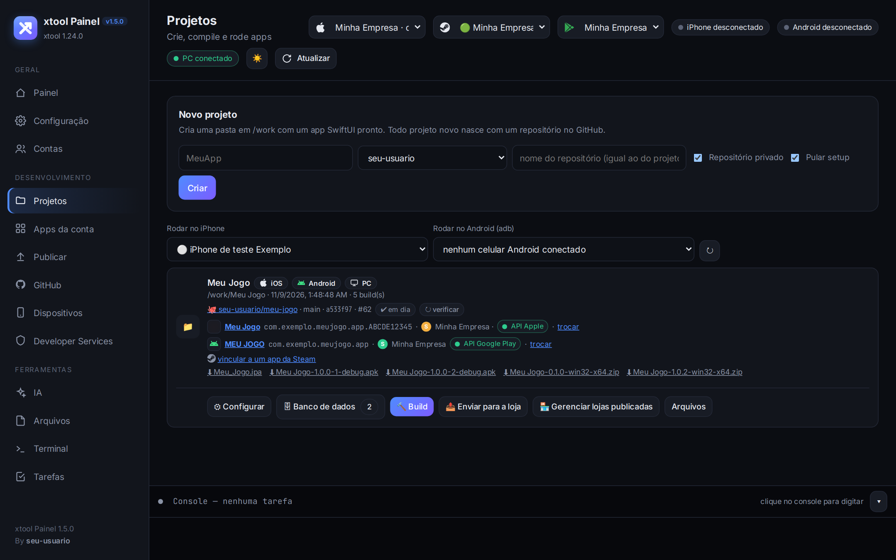</p>
<p align="center"><sub>Card do projeto com Configurar, Build, Enviar para a loja, Gerenciar lojas publicadas e Arquivos.</sub></p>

### Bancos de produção e desenvolvimento

Cadastre bancos de **Produção** e **Desenvolvimento** em cada projeto. Cada build usa a receita do banco escolhido, e as lojas só recebem builds feitos com o banco de produção. Detalhes em [Banco de dados por projeto](#banco-de-dados-por-projeto).

<p align="center">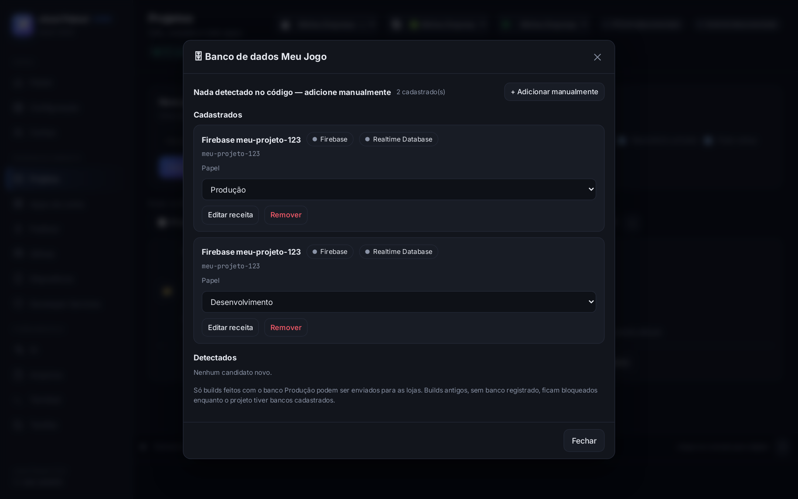</p>
<p align="center"><sub>Popup Banco de dados: bancos detectados e cadastrados, com o papel de cada um.</sub></p>

### Lojas publicadas

Edite a ficha do app nas abas App Store e Google Play, com contador de limites, idiomas e imagens. Envie uma versão para revisão na App Store ou promova uma release no Google Play, sempre com confirmação. Detalhes em [Gerenciar lojas publicadas](#gerenciar-lojas-publicadas).

<p align="center">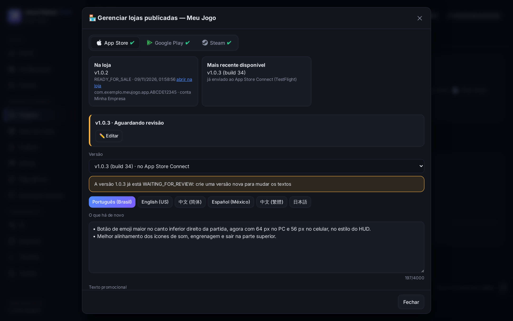</p>
<p align="center"><sub>Gerenciar lojas publicadas, aba App Store: versão na loja, versão mais recente e campos por idioma.</sub></p>

### Textos da ficha com IA

Gere os textos da ficha com IA a partir dos commits desde o último lançamento e dos textos que já estão na loja. Você revisa antes: nada é gravado na loja até **💾 Atualizar na loja**. Detalhes em [Gerenciar lojas publicadas](#gerenciar-lojas-publicadas).

<p align="center">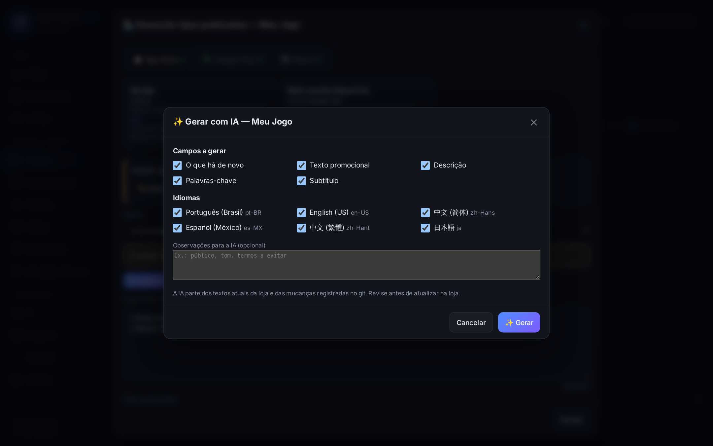</p>
<p align="center"><sub>Popup Gerar com IA: escolha dos campos e dos idiomas.</sub></p>

## Recursos

| Área | O que faz |
|---|---|
| **Painel** | Versões do xtool e do Swift, conta Apple em uso, SDK do iOS, Android, disco e conexão com o iPhone. Avisa quando sai uma versão nova do xtool e atualiza com um clique. Avisa quando há uma versão nova do próprio painel no GitHub e atualiza com confirmação. |
| **Contas** | Contas Apple, Google Play e Steam, na aba correspondente do menu **Contas**. |
| **Apps da conta** | Apps registrados em cada loja, com versões, faixas, bundle IDs e prévias. |
| **Barra do topo** | Seletores da conta Steam e da conta Google Play, e indicadores de iPhone, Android e PC. |
| **Projetos** | Apps SwiftUI, Android e Capacitor, com build, arquivos gerados e envio às lojas. |
| **Publicar** | Envio para a App Store, o Google Play e a Steam. |
| **GitHub** | Várias contas, importação de repositórios e pull automático pelo card do projeto. |
| **IA** | Provedores para as notas de versão e para os textos das lojas. |
| **Dispositivos** | iPhone, Android e PC, com status em tempo real. Instala, abre e remove apps. |
| **Configuração** | `xtool setup` e SDK do iOS a partir do `Xcode.xip`. |
| **Arquivos** | Navega em `/work` e nos Downloads do Windows; envia, baixa e apaga arquivos. |
| **Terminal** | Shell interativo dentro do container. |
| **Tarefas** | Histórico de todos os comandos, com a saída completa. |
| **Tema** | Escuro ou claro, no botão do topo. |

Os ícones oficiais das plataformas (Apple, Google Play, Steam e Android) aparecem em todo o painel.

<details>
<summary><b>Painel</b></summary>

- Versões do xtool: `base` (do repositório) ou `xtool-org` (baixada pelo painel), além do Swift.
- Android: JDK, Node e SDK.
- Espaço em disco e conexão com o iPhone.
- Aviso de versão nova do xtool, com atualização em um clique.
- Atualização do próprio painel pelo GitHub, com confirmação (veja [Atualização](#atualização)).

</details>

<details>
<summary><b>Contas</b></summary>

- **Apple:** cadastra várias contas, cada uma com o próprio login, e troca a conta em uso com um clique.
- **Google Play:** cadastra várias contas (chave JSON de conta de serviço) e testa a conexão.
- **Steam:** cadastra contas (nome e usuário de build do Steamworks, sem senha) e faz o login pelo console do steamcmd. Cada conta mostra **Conectada**, **Sem login**, **Ocupado…** ou **Não verificado**. A checagem usa o login salvo e o botão **↻ Verificar**. O botão **★ Principal** define a conta do topo.

</details>

<details>
<summary><b>Apps da conta</b></summary>

- **Apple:** registro de todos os apps de todas as contas, apps do App Store Connect com o estado de cada versão, bundle IDs com ícone e prévia da página da App Store num iPhone.
- **Google Play:** apps de cada conta, versões por faixa (interno, fechado, aberto e produção) e prévia da página com a ficha do Play Console.
- **Steam:** apps registrados (de todas as contas), com App ID, Depot IDs por plataforma e branch padrão. Mostra os apps da conta selecionada e o botão **Publicar**, que abre Publicar → 🎮 Steam (PC) com o app escolhido.

</details>

<details>
<summary><b>Barra do topo</b></summary>

- Seletores da **conta Steam** (🎮) e da **conta Google Play** (▶). A escolha vira a conta principal salva, usada como padrão nas telas de Publicar e Apps da conta quando o projeto ainda não tem conta própria.
- Três indicadores clicáveis, que abrem a aba correspondente de Dispositivos e se atualizam a cada 5 segundos:
  - **iPhone:** conectado, desconectado ou "abra o iTunes" quando o serviço Apple do Windows está desligado. A dica lista os aparelhos e se estão por cabo ou Wi-Fi.
  - **Android:** conectado ou desconectado, pelo `adb devices`.
  - **PC:** conectado ou desconectado, pelo `host.docker.internal`. A dica mostra também se o serviço Apple está ativo.
- O aparelho iPhone padrão é escolhido em **Dispositivos** (★).
- Em telas com menos de 860 px, o topo esconde esses seletores e indicadores.

</details>

<details>
<summary><b>Projetos</b></summary>

- Cria apps SwiftUI, com repositório do GitHub criado na hora (veja [GitHub](#github)), e reconhece projetos Android e Capacitor.
- Compila em debug ou release, gera `.ipa` e `.apk`, roda no iPhone e no celular Android e gera o projeto Xcode.
- Bancos de dados por projeto, com Produção e Desenvolvimento, que definem o build e liberam o envio à loja (veja [Banco de dados por projeto](#banco-de-dados-por-projeto)).
- Etiquetas em **Projetos**:
  - 🍎 iOS e 🤖 Android;
  - 🖥️ PC (projetos com `package.json`), com os botões ⚙ Configurar, 🔨 Build, 📤 Enviar para a loja, 🏪 Gerenciar lojas publicadas e Arquivos;
  - 🎮 Steam, quando o projeto está vinculado a um app Steam.
- O **Tipo de código** (automático ou escolhido) do build de PC é salvo por projeto.
- No card, as linhas do app do Google Play e da Steam mostram a conta e o estado, com a opção de vincular ou trocar.
- A ficha das lojas (textos, imagens e IA) fica em **🏪 Gerenciar lojas publicadas** (veja [Gerenciar lojas publicadas](#gerenciar-lojas-publicadas)).

Mais detalhes em [Projetos: configurar, compilar e enviar](#projetos-configurar-compilar-e-enviar).

</details>

<details>
<summary><b>Publicar</b></summary>

- **App Store:** compila em release, gera o ícone (`Assets.car`), assina para distribuição, envia ao App Store Connect, preenche "O que há de novo" e submete para revisão.
- **Google Play:** gera APK ou AAB assinado com a chave de upload, escreve as notas da versão e envia para a faixa escolhida.
- **🎮 Steam (PC):** compila o site para Windows, Linux e macOS com Electron, escreve a descrição do build e envia para a Steam pelo steamcmd. O **Tipo de código** do card 2 preenche o comando e a pasta do site.

</details>

<details>
<summary><b>Dispositivos</b></summary>

- **📱 iPhone (iOS):** cadastra vários aparelhos, com status em tempo real (cabo, Wi-Fi ou desconectado). Instala, abre e remove apps.
- **🤖 Android:** celulares do `adb`, com pareamento por Wi-Fi, conexão, status, instalação de APK e abertura do app.
- **🖥️ PC:** status do Windows alcançado pelo container, serviço Apple, steamcmd, Node/npx, cache do Electron e os builds de PC dos projetos.
- Card **Instalar .apk** (também na Home): arraste um `.apk` ou escolha um de `/work`, escolha o celular e instale por adb.

</details>

## Telas

> [!NOTE]
> Dados pessoais (e-mails, nomes, IDs, chaves e aparelhos) aparecem borrados. Clique numa imagem para ver em tamanho real.

<table>
<tr>
<td width="50%" valign="top"><b>Painel</b><br><sub>Versões do xtool e do Swift, conta Apple, SDK do iOS, disco, conexão com o iPhone e Android.</sub><br><a href="docs/telas/01-painel.png"></a></td>
<td width="50%" valign="top"><b>Painel no tema claro</b><br><sub>Tema claro, alternado no botão do topo.</sub><br><a href="docs/telas/02-painel-claro.png">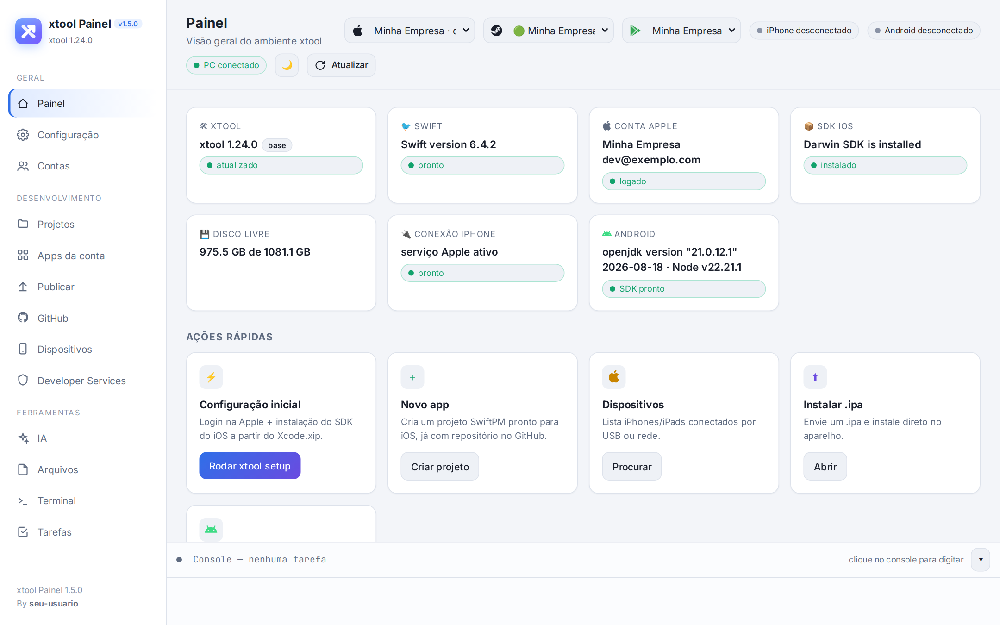</a></td>
</tr>
<tr>
<td width="50%" valign="top"><b>Configuração</b><br><sub><code>xtool setup</code> e SDK do iOS a partir do <code>Xcode.xip</code>.</sub><br><a href="docs/telas/03-configuracao.png">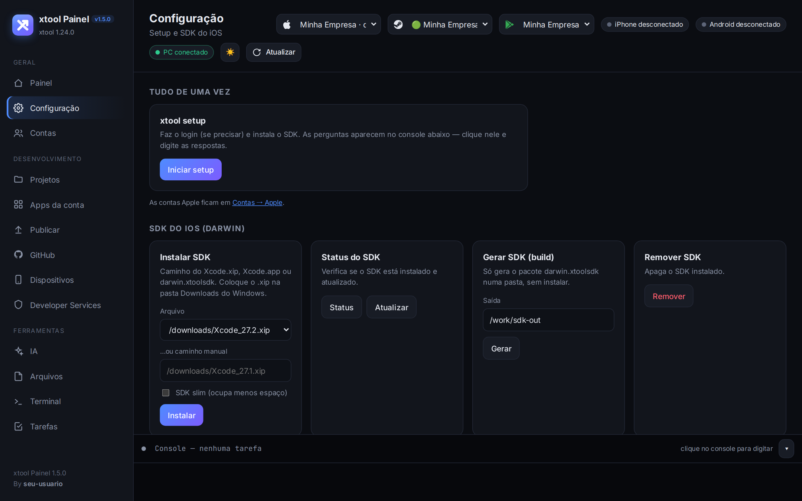</a></td>
<td width="50%" valign="top"><b>Contas · Apple</b><br><sub>Várias contas Apple, cada uma com o próprio login.</sub><br><a href="docs/telas/04-contas-apple.png">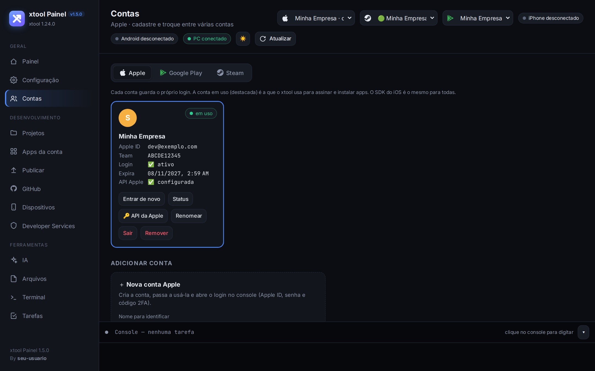</a></td>
</tr>
<tr>
<td width="50%" valign="top"><b>Contas · Google Play</b><br><sub>Contas de serviço do Google Play, com chave JSON.</sub><br><a href="docs/telas/05-contas-google-play.png">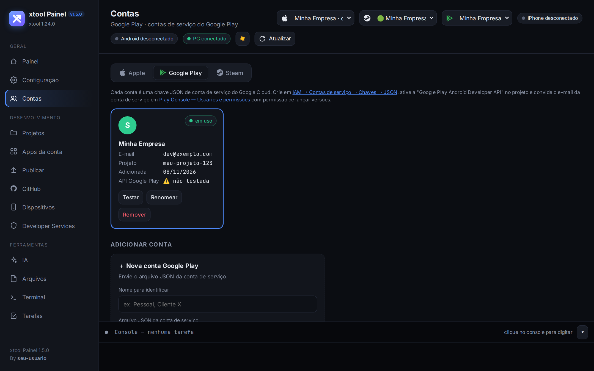</a></td>
<td width="50%" valign="top"><b>Contas · Steam</b><br><sub>Contas de build do Steamworks e login pelo steamcmd.</sub><br><a href="docs/telas/06-contas-steam.png">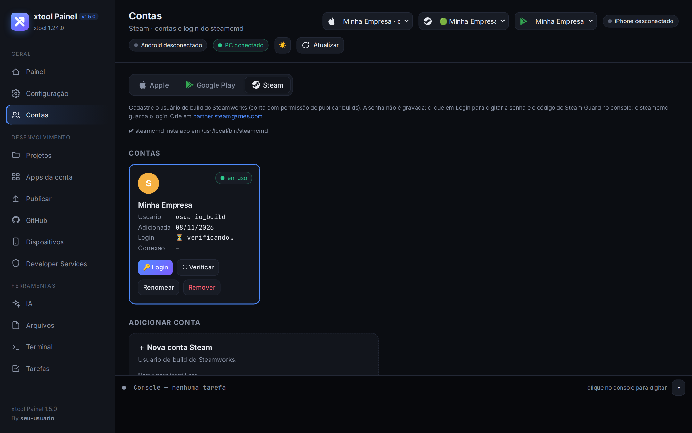</a></td>
</tr>
<tr>
<td width="50%" valign="top"><b>Projetos</b><br><sub>Compilar, gerar .ipa/.apk e rodar no iPhone ou no Android.</sub><br><a href="docs/telas/07-projetos.png"></a></td>
<td width="50%" valign="top"><b>Banco de dados</b><br><sub>Bancos detectados e cadastrados, com o papel de cada um.</sub><br><a href="docs/telas/08-banco-de-dados.png"></a></td>
</tr>
<tr>
<td width="50%" valign="top"><b>Build</b><br><sub>Plataformas, banco, versão e envio para a loja.</sub><br><a href="docs/telas/09-build.png">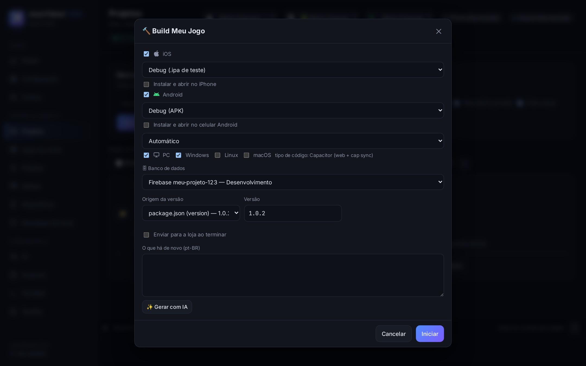</a></td>
<td width="50%" valign="top"><b>Gerenciar lojas · App Store</b><br><sub>Versão na loja, versão mais recente e campos por idioma.</sub><br><a href="docs/telas/10-lojas-app-store.png"></a></td>
</tr>
<tr>
<td width="50%" valign="top"><b>Gerenciar lojas · Google Play</b><br><sub>Ficha do app na Google Play, com a faixa da release.</sub><br><a href="docs/telas/11-lojas-google-play.png">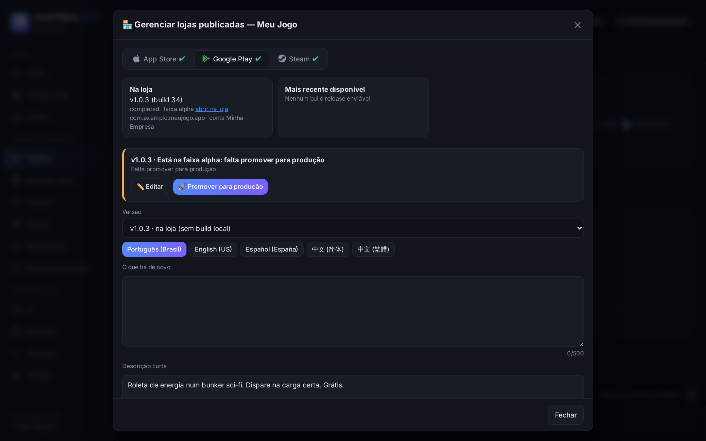</a></td>
<td width="50%" valign="top"><b>Gerenciar lojas · Steam</b><br><sub>Versão enviada à Steam, branch e builds disponíveis.</sub><br><a href="docs/telas/12-lojas-steam.png">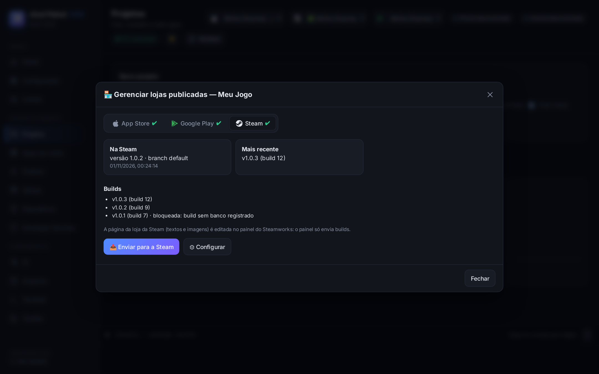</a></td>
</tr>
<tr>
<td width="50%" valign="top"><b>Gerar com IA</b><br><sub>Escolha dos campos e dos idiomas.</sub><br><a href="docs/telas/13-gerar-com-ia.png"></a></td>
<td width="50%" valign="top"><b>Apps da conta</b><br><sub>Apps registrados em cada conta.</sub><br><a href="docs/telas/14-apps-da-conta.png">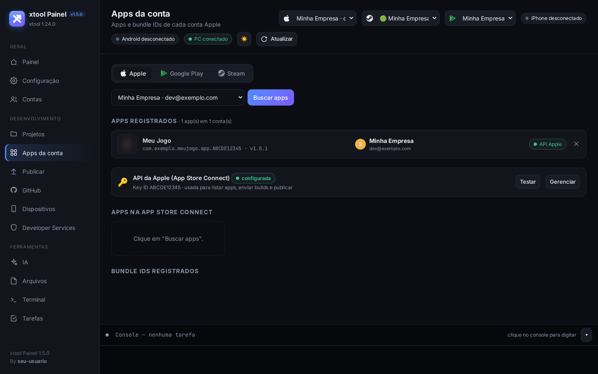</a></td>
</tr>
<tr>
<td width="50%" valign="top"><b>Publicar</b><br><sub>App Store, Google Play e Steam.</sub><br><a href="docs/telas/15-publicar.png">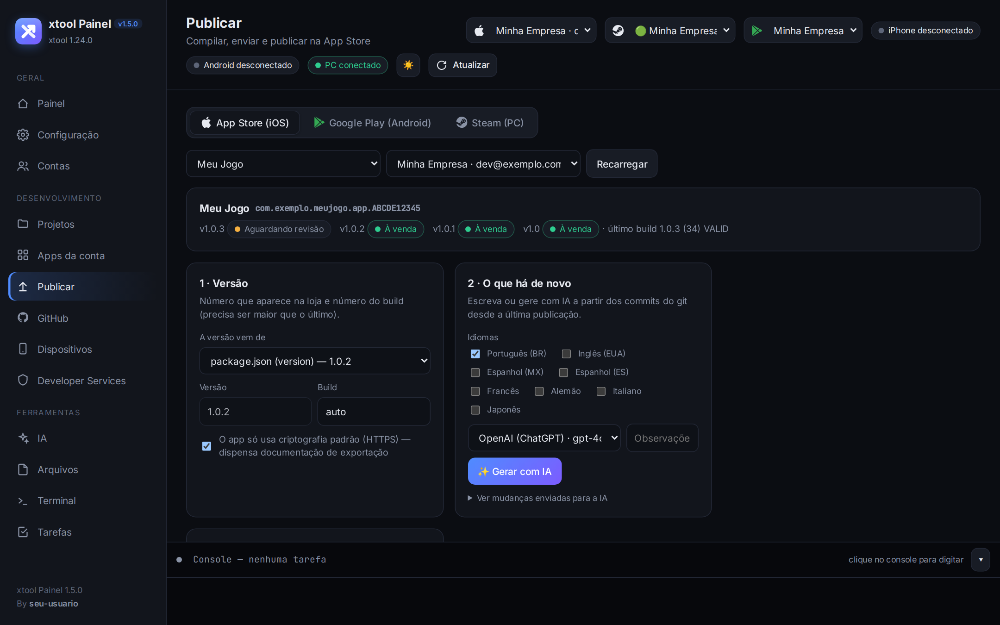</a></td>
<td width="50%" valign="top"><b>GitHub</b><br><sub>Contas, repositórios e vínculo com projetos.</sub><br><a href="docs/telas/16-github.png">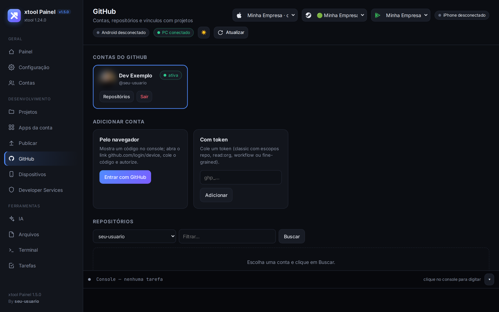</a></td>
</tr>
<tr>
<td width="50%" valign="top"><b>Dispositivos</b><br><sub>Aparelhos com status em tempo real; instala, abre e remove apps.</sub><br><a href="docs/telas/17-dispositivos.png">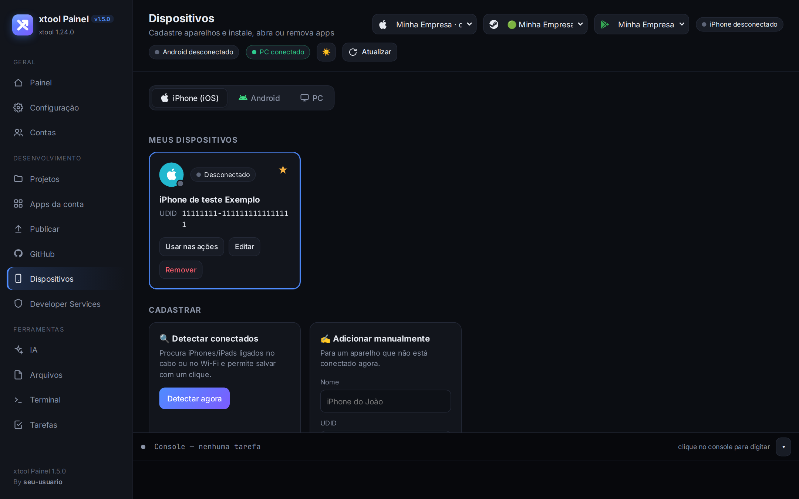</a></td>
<td width="50%" valign="top"><b>Developer Services</b><br><sub>Times, certificados, bundle IDs, aparelhos e perfis.</sub><br><a href="docs/telas/18-developer-services.png">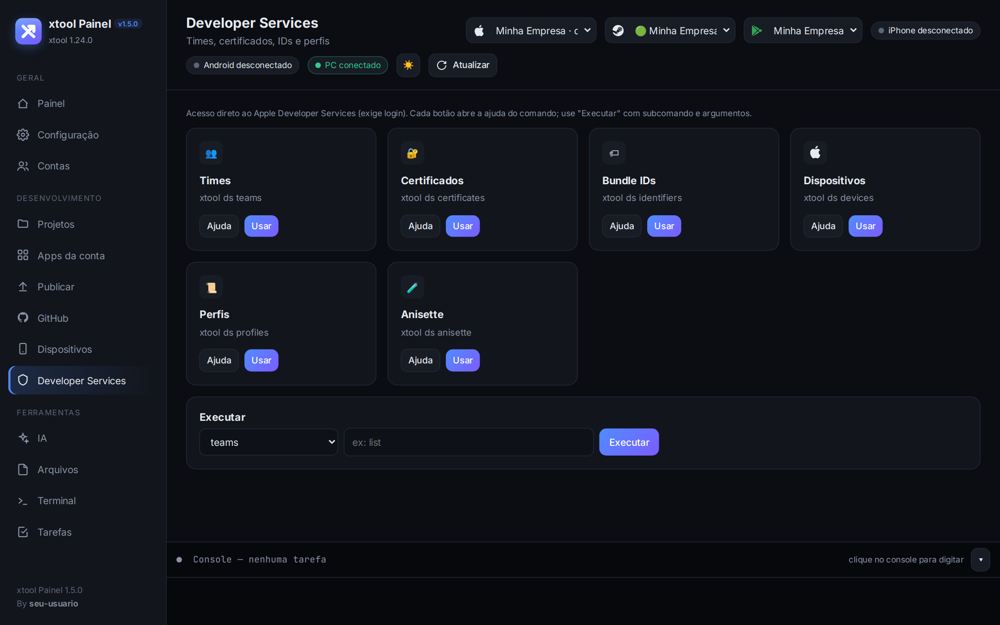</a></td>
</tr>
<tr>
<td width="50%" valign="top"><b>IA</b><br><sub>Provedores para escrever as notas de versão.</sub><br><a href="docs/telas/19-ia.png">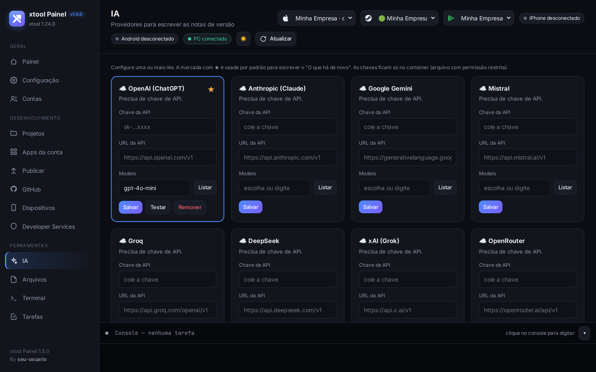</a></td>
<td width="50%" valign="top"><b>Arquivos</b><br><sub>Navega em /work e nos Downloads; envia, baixa e apaga.</sub><br><a href="docs/telas/20-arquivos.png">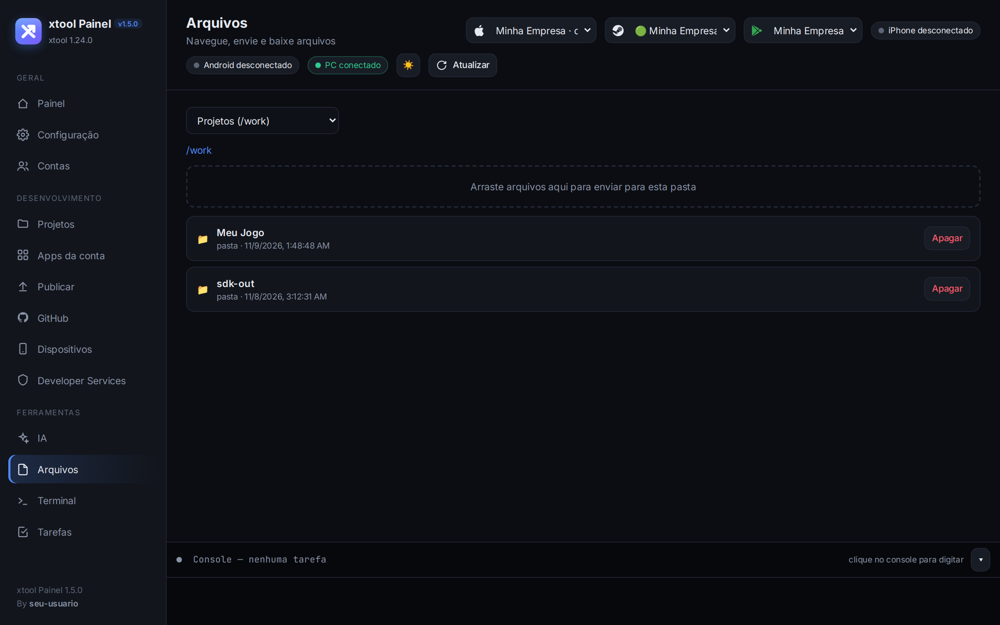</a></td>
</tr>
<tr>
<td width="50%" valign="top"><b>Terminal</b><br><sub>Shell interativo dentro do container.</sub><br><a href="docs/telas/21-terminal.png">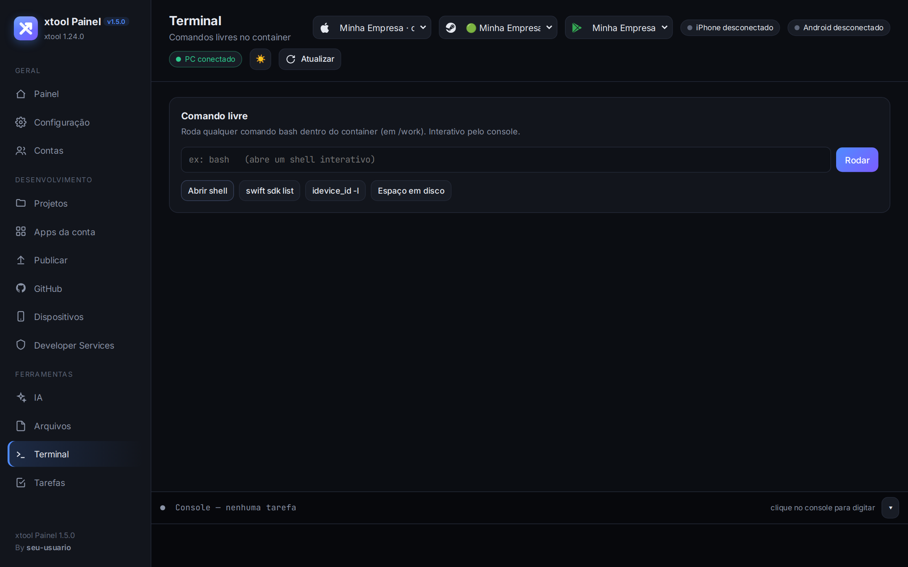</a></td>
<td width="50%" valign="top"><b>Tarefas</b><br><sub>Histórico de todos os comandos, com a saída completa.</sub><br><a href="docs/telas/22-tarefas.png">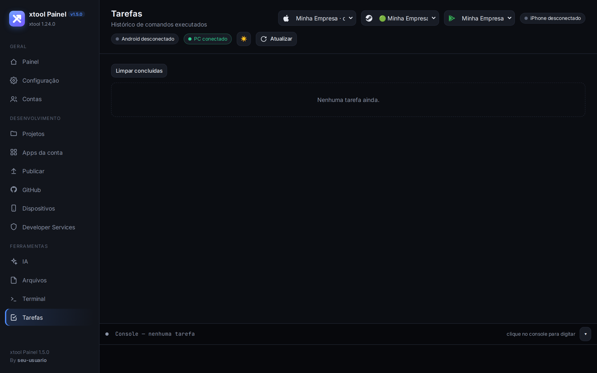</a></td>
</tr>
<tr>
<td width="50%" valign="top"><b>Prévia da App Store</b><br><sub>Como a página do app aparece na App Store do iPhone.</sub><br><a href="docs/telas/23-previa-app-store.png">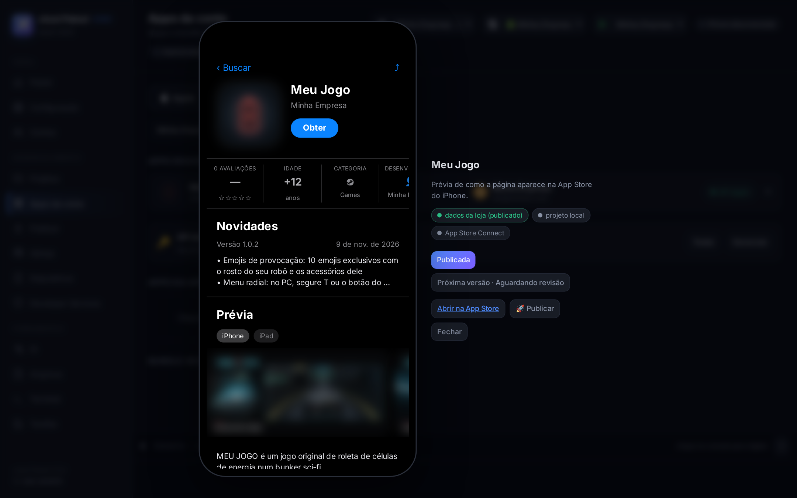</a></td>
<td width="50%" valign="top"><b>Prévia da Google Play</b><br><sub>Como a página do app aparece na Google Play, com a ficha do Play Console.</sub><br><a href="docs/telas/24-previa-google-play.png">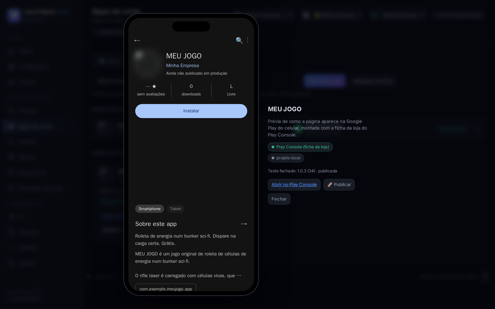</a></td>
</tr>
</table>

## Requisitos

| Item | Observação |
|---|---|
| Docker Desktop (Windows) ou Docker Engine (Linux) | Com o Compose v2 |
| Espaço em disco | ~20 GB livres: imagem, SDK do iOS, SDK do Android e builds |
| **iOS** · Xcode 27.x (`.xip`) | Baixe em [developer.apple.com/download](https://developer.apple.com/download/all/?q=Xcode) |
| **iOS** · Apple ID | Qualquer conta serve para instalar no próprio iPhone |
| **iOS** · Apple Developer Program | **Necessário para publicar na App Store**, junto com uma chave da API do App Store Connect |
| **iOS** · iTunes ou Dispositivos Apple (Windows) | Faz a ponte com o iPhone por cabo ou Wi-Fi |
| **Android** · nada a instalar | JDK 21, Node 22 e o SDK do Android (plataforma 36, build-tools 36) já vêm na imagem |
| **Android** · Conta de desenvolvedor Google Play | **Necessária para publicar**, junto com uma conta de serviço do Google Cloud com acesso ao Play Console |
| **Android** · Celular com Android 11+ | Para instalar por Wi-Fi (depuração sem fio), na mesma rede do PC |
| **PC** · nada a instalar | O Electron é baixado no primeiro build, que precisa de internet, e fica em cache no container. A imagem padrão tem cerca de 8 GB e inclui ImageMagick |
| **PC** · Wine (opcional) | `INSTALL_WINE=1`. Necessário para o ícone e os metadados do `.exe`; adiciona cerca de 3,9 GB |
| **Steam** · conta de parceiro Steamworks | Taxa de US$ 100 por app, paga à Valve. App ID e Depot IDs criados no Steamworks, e um usuário de build com permissão de publicar builds |

## Instalação

```bash
git clone https://github.com/marco3079/xtool-docker.git
cd xtool-docker
docker compose up -d --build
```

Depois abra **http://localhost:8080**.

> [!NOTE]
> O primeiro build demora alguns minutos, porque compila o `accord` a partir do código-fonte.

## Primeiros passos

1. **SDK do iOS:** coloque o `Xcode_27.x.xip` na pasta Downloads. No painel, vá em **Configuração → Instalar SDK**.
2. **Conta Apple:** em **Contas → Apple → Nova conta**, entre com o Apple ID. O código 2FA é pedido no console.
3. **Projeto:** em **Projetos → Novo projeto**, escolha a conta do GitHub (cadastre antes, no menu **GitHub**), o nome do repositório (padrão: o nome do projeto) e se ele é privado (padrão) ou público. O painel cria o projeto e o repositório. Também é possível importar um repositório em **GitHub → Importar como projeto**.
4. **Rodar no iPhone:** com o iPhone conectado, no card do projeto abra **🔨 Build**, escolha 🍎 iOS em **Debug** e marque **Instalar e abrir no iPhone**.
5. **Android:** projetos com pasta `android/` (Gradle ou Capacitor) aparecem com a etiqueta 🤖 Android. No card, abra **🔨 Build**, escolha 🤖 Android em **Debug** e marque **Instalar e abrir no celular Android**. Com o celular pareado, veja [Rodar no celular Android](#rodar-no-celular-android).
6. **Google Play:** em **Contas → Google Play**, envie o JSON da conta de serviço. Depois adicione o app em **Apps da conta → Google Play**.
7. **PC:** no card do projeto, abra **⚙ Configurar** para definir o PC (sistemas, tipo de código e pasta do site) e **🔨 Build** para gerar o app. Em **Publicar → 🎮 Steam (PC)** você também compila para Windows, Linux e macOS e envia à Steam.
8. **Steam:** em **Contas → Steam**, cadastre a conta de build e clique em **Login**. Digite a senha e o código do Steam Guard no console. Marque a conta como **★ Principal** no topo. Depois cadastre o app em **Apps da conta → Steam** e, em **Publicar → 🎮 Steam (PC)**, envie o build.
9. **Projetos:** no card do projeto, use **⚙ Configurar → 🔨 Build → 📤 Enviar para a loja**, como descrito em [Projetos: configurar, compilar e enviar](#projetos-configurar-compilar-e-enviar).

## Projetos: configurar, compilar e enviar

Cada projeto tem um card na aba **Projetos**. Os botões principais são **⚙ Configurar**, **🔨 Build** e **📤 Enviar para a loja**. O card também traz **🗄 Banco de dados** (veja [Banco de dados por projeto](#banco-de-dados-por-projeto)) e **🏪 Gerenciar lojas publicadas** (veja [Gerenciar lojas publicadas](#gerenciar-lojas-publicadas)).

Abaixo da linha da Apple, o card mostra a linha do app do Google Play e a da Steam. Em cada uma, **trocar** vincula ou troca o app e a conta, e a linha mostra o estado (a API do Google Play, ou **Conectada** e **Sem login** na Steam). Antes de cada diálogo que busca dados (Configurar, Build, Enviar e os vínculos), aparece um popup de carregamento.

<p align="center"></p>
<p align="center"><em>Card do projeto, com Configurar, Banco de dados, Build, Enviar para a loja, Gerenciar lojas publicadas e Arquivos.</em></p>

### 1. ⚙ Configurar

Sempre aparece. Abre o diálogo completo do projeto, com um interruptor por plataforma: **🍎 iPhone (iOS)**, **🤖 Android** e **🖥️ Steam (PC)**. Cada uma mostra **Pronto**, **Falta configurar** ou **Desativado**. Com o interruptor ligado, o motivo aparece se algo faltar. O card ganha a etiqueta **⚙ falta configurar** quando uma plataforma ativada não está pronta. **Salvar** grava tudo de uma vez.

- **🍎 iPhone (iOS):** o **bundle ID** e o vínculo do app da Apple (**Vincular / trocar app da Apple**, com a conta Apple do projeto). Fica pronto quando há `Package.swift` (projeto xtool, com SwiftPM). Sem ele, o painel explica o motivo: projeto web ou Capacitor não vira iOS aqui, porque o Capacitor iOS exige Xcode num Mac. Nada é criado.
- **🤖 Android:** o **package name**, o **comando antes do Gradle** (vazio = padrão detectado, `-` = pular), a conta do Google Play e o vínculo do app (**Vincular / trocar app do Google Play**). Fica pronto quando há a pasta `android/` (Gradle).
  - Se não há a pasta, mas existe `capacitor.config`, o botão **Adicionar Android** roda `npx cap add android`, que instala as dependências e o `@capacitor/android` se faltarem.
  - Sem Capacitor, o painel só explica o que instalar.
- **🖥️ Steam (PC):** os sistemas operacionais (Windows, Linux e macOS), o **tipo de código**, o **nome do app**, o **comando antes do build**, a **pasta do site**, a **versão do Electron**, gerar **.zip**, o vínculo do app da Steam (**Vincular / trocar app da Steam**) e a **branch**. Fica pronto quando há um tipo de código (o detectado ou o escolhido).
- **Versão do projeto:** **Configurar versão…** escolhe a origem da versão (veja [Versão do app](#versão-do-app)).
- **🌐 Idiomas do app:** veja [Idiomas do app](#idiomas-do-app).

### 2. 🔨 Build

Aparece quando há ao menos uma plataforma ativada e pronta. Só as plataformas prontas aparecem no popup.

O popup permite:

- **Plataformas:** iOS e Android em Debug ou Release; PC com Windows, Linux e macOS.
- **Banco de dados:** seletor do banco do build, quando há bancos cadastrados (veja [Banco de dados por projeto](#banco-de-dados-por-projeto)).
- **Versão:** automática, `package.json`, `xtool.yml`, Gradle, Xcode, tag do git ou manual. A origem fica salva por projeto (veja [Versão do app](#versão-do-app)).
- **Enviar para a loja ao terminar:**
  - iOS: App Store Connect;
  - Android: Google Play, com faixa e status;
  - PC: Steam, com conta, app e branch.

O debug não vai para a loja. O texto "O que há de novo" pode ser gerado com IA. Tudo roda em sequência numa única tarefa (ordem: Android, PC, iOS) e para na primeira falha.

<p align="center"></p>
<p align="center"><em>Popup Build: plataformas, banco de dados, versão e envio para a loja.</em></p>

### 3. 📤 Enviar para a loja

Envia um build release que já existe, **sem recompilar**. O botão fica desabilitado enquanto não houver nenhum build release. O popup lista as versões prontas (versão, build, tipo, data e tamanho) para você escolher.

| Plataforma | Arquivo enviado |
|---|---|
| iOS | `.ipa` assinado, em `xtool/<projeto>-<versão>-<build>.ipa` |
| Android | `.aab` ou `.apk` de `xtool/android/`, sem `-debug` no nome |
| PC | zip ou pasta pronta, enviados à Steam |

> [!NOTE]
> Se o projeto tem bancos cadastrados, só builds feitos com o banco de **Produção** podem ser enviados (veja [Banco de dados por projeto](#banco-de-dados-por-projeto)).

- A versão de um build pronto não muda. Para outra versão, gere um novo em **🔨 Build**.
- Antes de enviar, o painel confere:
  - no iOS, que o número do build ainda não existe no App Store Connect e que o `Info.plist` do `.ipa` bate com a versão, o build e o bundle ID;
  - no Android, que o `versionCode` é maior que o último na Google Play.

Para publicar em cada loja, veja [Publicar na App Store](#publicar-na-app-store), [Publicar no Google Play](#publicar-no-google-play) e [Publicar na Steam](#publicar-na-steam). Para editar a ficha do app em cada loja (textos, imagens e idiomas), use **🏪 Gerenciar lojas publicadas**.

## Banco de dados por projeto

Um projeto pode ter um banco de **Produção** e outro de **Desenvolvimento**. No card, o botão **🗄 Banco de dados** abre o popup de bancos. Assim, cada build sai com o banco certo, e as lojas só recebem builds feitos com o banco de produção.

<p align="center"></p>
<p align="center"><em>Popup Banco de dados: bancos detectados e cadastrados, com o papel de cada um (prod ou dev).</em></p>

### Detecção e cadastro

1. **Detecção:** ao abrir o popup, o painel procura os bancos no código e mostra quantos achou.
   - **Firebase:** Realtime Database e Firestore, pelo `google-services.json` (Android), pelo `GoogleService-Info.plist` (iOS) ou pela configuração no código.
   - **Supabase, MongoDB, PostgreSQL e MySQL:** pelas URLs de conexão. A senha aparece mascarada.
   - **SQLite** e outros arquivos de banco locais.
   - **`.env`:** variáveis de conexão do arquivo `.env`.
2. **Cadastro manual:** adicione os bancos que a detecção não achou, inclusive o tipo **Personalizado**.
3. **Papel:** marque qual banco é **Produção**, qual é **Desenvolvimento** e, se quiser, **Outro**. Cada projeto tem no máximo um banco de produção e um de desenvolvimento.
4. **Receita:** cada banco tem uma receita, detectada pelo painel e editável:
   - **Comando antes do build**, rodado antes da compilação;
   - **Arquivos a copiar**, do caminho de origem para o de destino;
   - **Variáveis de ambiente**, definidas para o build.

   Exemplo (Carga Viva): a receita de produção tem o comando `npm run build:client:prod && npm run native:env -- prod`.

> [!WARNING]
> A receita do banco de desenvolvimento deve ter o próprio comando. Se ela ficar vazia e o projeto usar o pré-build padrão do painel, esse padrão prefere os scripts `:prod`, e o build de desenvolvimento sairia com o banco de produção.

### Build com banco

No diálogo **🔨 Build**, o seletor **Banco de dados** escolhe o banco do build. O painel aplica a receita antes de compilar: copia os arquivos, define as variáveis e roda o comando como pré-build. No iOS, valem só a cópia de arquivos e as variáveis. Cada build fica registrado com o banco que o gerou.

### Regra de envio

- **Projeto com bancos cadastrados:** só builds feitos com o banco de **Produção** podem ser enviados à App Store, ao Google Play ou à Steam.
- **Build antigo, sem registro do banco:** fica bloqueado. Refaça o build escolhendo o banco de produção.
- **Projeto sem bancos cadastrados:** não há restrição.

O servidor também recusa o envio, não só a tela.

<details>
<summary>Detalhes técnicos</summary>

- Os bancos ficam em `~/.config/xtool-panel/projects.json`, nas chaves `databases` e `buildDb`.
- Rotas: `GET` e `POST /api/project/databases`.
- Detecção: `panel/dbdetect.py`. Receitas (comando, arquivos e variáveis): `panel/dbenv.py`. Popup: `panel/static/database.js`.

</details>

## Gerenciar lojas publicadas

No card do projeto, o botão **🏪 Gerenciar lojas publicadas** fica sempre visível, logo depois de **📤 Enviar para a loja**. Ele abre a ficha do app em três abas: **App Store** (iOS), **Google Play** (Android) e **Steam** (PC). Antes de abrir, aparece um popup de carregamento.

O popup lê o que já está na loja e grava só os textos e imagens que você alterar. Ele não envia builds (para isso existe **📤 Enviar para a loja**). Ele só envia uma versão para revisão ou promove uma release que já existe, sempre com confirmação (veja [Enviar para revisão e promover](#enviar-para-revisão-e-promover)).

<p align="center"></p>
<p align="center"><em>Aba App Store: versão na loja × mais recente, versão pendente e campos por idioma.</em></p>

### Estados das abas

Cada aba mostra ✓ quando a loja está pronta e ⚠ quando falta algo. A aba inicial é a primeira pronta; se nenhuma estiver, é a App Store.

| Estado | O que aparece |
|---|---|
| Pronta | Versão na loja, versão mais recente disponível e a ficha editável |
| Sem conta | Falta a conta da loja ou o vínculo do app. O aviso leva a **Contas** e a **⚙ Configurar** |
| Sem app | O app não existe na loja. O aviso leva a **⚙ Configurar** |
| Não publicada | Não há versão publicada na App Store nem release no Google Play (em nenhuma faixa, exceto rascunhos). O aviso leva a **🔨 Build** e **📤 Enviar para a loja** |
| Erro | A loja não respondeu como esperado. A mensagem aparece no popup |

- **Google Play:** vale a release de produção. Se não houver, vale a mais nova das outras faixas (teste fechado, aberto ou interno), e o popup mostra qual faixa é.
- **Steam:** "Não publicada" quer dizer que nenhum build foi enviado ainda.

### Versão na loja × mais recente

Nas abas App Store e Google Play, o topo do popup mostra:

- **Na loja:** a versão, o estado (App Store) ou a faixa (Google Play) e a data.
- **Mais recente disponível:** a maior versão entre os builds release locais que podem ser enviados (com o banco usado; veja [Banco de dados por projeto](#banco-de-dados-por-projeto)). Na App Store, entram também os builds já enviados e processados no App Store Connect (TestFlight), marcados "· no App Store Connect".
- **Selo:**
  - **✔ Já está publicada**, quando a mais recente é a que está na loja;
  - **Nova versão disponível para publicar**, quando a local é maior;
  - o cartão de [versão pendente](#versão-pendente), quando a mais recente já foi criada na App Store e espera envio ou revisão.

O seletor **Versão** lista um build por versão (o mais novo de cada uma), da maior para a menor. A versão da loja aparece com "· na loja". Builds que não podem ser enviados ficam desabilitados, com o motivo (por exemplo, um build sem o banco de produção). Ao escolher uma versão, o popup carrega os textos dela.

### Versão pendente

Quando a versão mais recente já foi criada na App Store e ainda espera o envio (por exemplo, **1.0.3 · Preparar para envio**), o topo do popup mostra um cartão de aviso no lugar do selo **Nova versão disponível para publicar**.

- **App Store:** o cartão diz "Criada na loja: falta enviar para a revisão" e tem:
  - **✏️ Editar**, que seleciona essa versão e carrega os textos dela;
  - **📨 Enviar para revisão**.

  Versões em revisão, aguardando ou já aprovadas mostram só o rótulo do estado, sem botão de envio.
- **Google Play:** o cartão diz "Falta promover para produção", mostra a faixa em que a release está (por exemplo, teste fechado) e tem **🚀 Promover para produção**.

Rótulos dos estados da App Store:

| Estado na App Store Connect | Rótulo no painel |
|---|---|
| `PREPARE_FOR_SUBMISSION` | Preparar para envio |
| `READY_FOR_REVIEW` | Pronta para revisão |
| `WAITING_FOR_REVIEW` | Aguardando revisão |
| `IN_REVIEW` | Em revisão |
| `PENDING_DEVELOPER_RELEASE` | Aprovada, aguardando sua liberação |
| `PENDING_APPLE_RELEASE` | Aprovada, aguardando liberação |
| `PROCESSING_FOR_APP_STORE` | Processando para a App Store |
| `READY_FOR_SALE` | Pronta para distribuição |
| `DEVELOPER_REJECTED` | Rejeitada por você |
| `REJECTED` | Rejeitada pela Apple |
| `METADATA_REJECTED` | Metadados rejeitados |
| `INVALID_BINARY` | Binário inválido |
| `WAITING_FOR_EXPORT_COMPLIANCE` | Aguardando conformidade de exportação |
| `DEVELOPER_REMOVED_FROM_SALE`, `REMOVED_FROM_SALE` | Removida da venda |
| `REPLACED_WITH_NEW_VERSION` | Substituída por versão nova |

Estado que o painel não conhece aparece como o próprio código.

### Campos por loja

| Loja | Campos e limites (caracteres) |
|---|---|
| App Store | **O que há de novo** (4000), **Texto promocional** (170), **Descrição** (4000) e **Palavras-chave** (100), da versão. **Subtítulo** (30), das informações do app |
| Google Play | **Descrição curta** (80) e **Descrição completa** (4000), que valem para a ficha inteira. **O que há de novo** (500), as notas da release do build escolhido |
| Steam | Nenhum campo |

- Os idiomas aparecem como chips. Cada um mostra o texto que já está na loja e pode ser editado.
- O contador de cada campo fica vermelho quando passa do limite. O painel só avisa e não corta o texto, então encurte antes de atualizar.
- Se a versão não pode ser editada (por exemplo, já publicada ou em revisão), uma faixa amarela explica o motivo, os campos ficam só para leitura e o botão de atualizar fica desabilitado.

### Atualizar na loja

O botão **💾 Atualizar na loja** fica desabilitado enquanto não há alterações. Antes de gravar, mostra um resumo com a loja, a versão e a quantidade de campos e idiomas. Depois grava só os campos alterados e não vazios.

- **App Store:** se a versão ainda não existe na loja, ela é criada ao atualizar. Se a versão já está publicada ou em revisão, os textos não mudam: crie uma versão nova do app.
- **Google Play:** os textos da ficha valem para o app inteiro e são aplicados ao atualizar. As notas "O que há de novo" valem só para a release do build escolhido. Se o build não estiver em nenhuma release da faixa, as notas não são gravadas e o aviso aparece no popup.
- **Não envia build e não submete para revisão.** Para enviar um build, use **📤 Enviar para a loja**. Para submeter a versão à revisão da App Store, use **📨 Enviar para revisão**. Para promover uma release no Google Play, use **🚀 Promover para produção** (veja [Enviar para revisão e promover](#enviar-para-revisão-e-promover)). A submissão também continua possível pelo **Publicar** ou no App Store Connect.

### Enviar para revisão e promover

Dois botões fazem ações reais nas lojas. Os dois pedem confirmação antes de agir, e a confirmação vale só para aquela ação.

**App Store: 📨 Enviar para revisão** (ao lado de **💾 Atualizar na loja**, ou no cartão pendente):

- Anexa o maior build válido da versão no App Store Connect (processado e não expirado), responde a pergunta de criptografia como "sem criptografia" (o padrão do painel) e envia a versão para a revisão da Apple.
- Só vale se a versão já existe na App Store em estado editável: Preparar para envio, Rejeitada por você, Rejeitada pela Apple, Metadados rejeitados ou Binário inválido. Se a versão ainda não existe, grave os textos em **Atualizar na loja** antes.
- Precisa de um build processado da versão. Sem ele, envie o `.ipa` em **📤 Enviar para a loja** e espere o processamento.
- A confirmação diz a versão e o build, por exemplo: "A versão X (build N) será anexada e enviada para a revisão da Apple. Continuar?".

**Google Play: 🚀 Promover para produção** (no cartão pendente e ao lado de **💾 Atualizar na loja**):

- Copia a release do build (pelo `versionCode`) da faixa em que ela está (por exemplo, teste fechado) para a faixa de destino, mantendo as notas da release. Não envia build novo.
- **Destino:** Produção (padrão), teste aberto, teste fechado ou teste interno. A faixa de origem não aparece na lista.
- **Status:** **Liberar para todos** (completa), **Liberação gradual** (com a porcentagem, padrão 10%) ou **Só rascunho**.
- A confirmação mostra a faixa de destino e o status antes de promover.

<p align="center"></p>
<p align="center"><em>Aba Google Play: versão, faixa e ficha da loja.</em></p>

### Gerar com IA

O botão **✨ Gerar com IA** abre um popup em que você escolhe os campos e os idiomas (todos vêm marcados) e, se quiser, escreve observações para a IA. A IA usa o provedor padrão (★, em **IA**).

- **Base do texto:** os commits desde o último lançamento na loja, as observações e os textos que já estão na loja, para manter a identidade do app.
- **Limites:** cada texto é cortado no limite do campo. Palavras-chave são cortadas na última vírgula antes do limite.
- **Erro por idioma:** se a IA falhar num idioma, os outros continuam e o erro aparece por idioma. Só há falha total se todos os idiomas falharem.
- **Revise antes:** o texto gerado preenche os campos na tela. Nada é gravado na loja até **Atualizar na loja**.
- **Sem mudanças no git:** para gerar "O que há de novo" sem commits novos, escreva um resumo nas observações.

<p align="center"></p>
<p align="center"><em>Popup Gerar com IA: escolha dos campos e dos idiomas.</em></p>

### Imagens

Cada idioma tem as imagens da ficha, em grade por tipo. Clique numa miniatura para ampliá-la.

- **＋ Adicionar** envia uma ou mais imagens (PNG ou JPG, até 10 MB).
- **✕** apaga uma imagem.
- Cada envio e cada exclusão pedem confirmação e valem na loja na hora, sem esperar **Atualizar na loja**.
- O navegador envia o arquivo para `<projeto>/xtool/lojas-img/`, e o arquivo temporário é apagado depois.

Tamanhos por loja:

- **App Store, por tipo de tela:** iPhone 6,7" (1290×2796), iPhone 6,5" (1242×2688 ou 1284×2778), iPhone 5,5" (1242×2208), iPad Pro 12,9" e iPad Pro 12,9" (2ª geração), ambos 2048×2732. Enviar exige a versão editável.
- **Google Play, por tipo:** ícone (512×512), gráfico de recursos (1024×500), capturas de celular (16:9 ou 9:16, de 320 a 3840 px) e capturas de tablet de 7" e de 10".

### Steam

A aba Steam mostra a versão enviada (**Na Steam**), a branch, a data e os builds disponíveis, com os botões **Enviar para a Steam** e **Configurar**.

A Steam não tem campos: não há API para a página da loja. Textos e imagens da página são editados no painel do Steamworks. O painel só envia builds.

<p align="center"></p>
<p align="center"><em>Aba Steam: versão enviada, branch, data e builds disponíveis.</em></p>

### Idiomas do app

Em **⚙ Configurar → 🌐 Idiomas do app**, marque os idiomas em que o app está disponível.

- Ao abrir, **pt-BR** vem marcado se o projeto ainda não tem idiomas salvos. É preciso marcar ao menos um.
- Esses idiomas aparecem no popup e entram na geração com IA. Os idiomas que já existem na loja também aparecem.
- Os códigos seguem o padrão da App Store (por exemplo, `pt-BR`, `en-US` e `zh-Hans`). Para o Google Play, o painel converte sozinho (por exemplo, `es-MX` vira `es-419` e `zh-Hans` vira `zh-CN`).

### Rotas

<details>
<summary>Lista de rotas</summary>

| Rota | Função |
|---|---|
| `GET /api/lojas/overview?project=` | Estado das três lojas, idiomas e versões do projeto |
| `GET /api/lojas/fields?project=&store=&version=&build=` | Textos, imagens e limites da versão escolhida |
| `POST /api/lojas/save` | Grava os textos alterados (`project`, `store`, `version`, `build`, `track` opcional e `data`) |
| `POST /api/lojas/generate` | Gera textos com IA para os campos e idiomas escolhidos |
| `POST /api/lojas/image/upload` | Envia para a loja uma imagem já carregada em `<projeto>/xtool/lojas-img/` |
| `POST /api/lojas/image/delete` | Apaga uma imagem da loja |
| `POST /api/lojas/submit` | Envia a versão para revisão na App Store (`project`, `store` = `ios`, `version` e `build` opcional); só versões em estado editável |
| `POST /api/lojas/promote` | Promove a release do build para outra faixa do Google Play (`project`, `store` = `android`, `version`, `build` obrigatório, e `to_track`, `status`, `fraction` e `from_track` opcionais) |

Os idiomas do app são gravados pela rota de configurações do projeto (`/api/project/settings`, plataforma `locales`).

</details>

Detalhes técnicos: a visão geral e os vínculos com as lojas ficam em `panel/lojas.py`; a leitura e a gravação de textos e imagens, o envio para revisão e a promoção entre faixas, em `panel/lojas_io.py`; o popup, em `panel/static/lojas.js`; e a IA e as imagens, em `panel/static/lojas2.js`.

## Conectar o iPhone

O container usa o serviço da Apple que roda no Windows, por meio de `USBMUXD_SOCKET_ADDRESS=host.docker.internal:27015`. Por isso não é preciso usar o usbipd.

1. Deixe o **iTunes** ou o **Dispositivos Apple** aberto.
2. Conecte o iPhone pelo cabo uma vez e toque em **Confiar**.
3. Para usar sem fio, no iTunes marque **Sincronizar com este iPhone via Wi-Fi**.
4. No iPhone, ative **Ajustes → Privacidade e Segurança → Modo de Desenvolvedor**.

O status de cada aparelho aparece em **Dispositivos** e é atualizado a cada 5 segundos.

<p align="center"></p>
<p align="center"><sub>Dispositivos: iPhone, Android e PC, com status em tempo real.</sub></p>

## Publicar na App Store

O painel compila, assina e envia o app iOS ao App Store Connect. Para publicar, a conta Apple precisa do Apple Developer Program e de uma chave da API do App Store Connect.

### Pré-requisitos (uma vez por conta)

1. Crie uma **chave de equipe** em [App Store Connect → Usuários e Acesso → Integrações](https://appstoreconnect.apple.com/access/integrations/api) com a função **App Manager** (ou Admin) e baixe o `.p8`.
2. No painel, vá em **Contas** → Apple, clique em **🔑 Cadastrar API da Apple** no cartão da conta, informe o **Issuer ID**, o **Key ID** e o arquivo `.p8`, e clique em **Testar**.
3. Crie o registro do app em **App Store Connect → Apps → +**, com o mesmo bundle ID do `xtool.yml`.
4. Na primeira versão, preencha no site da Apple as capturas de tela, a descrição, a classificação etária e a privacidade. A API não faz essa parte.

> [!IMPORTANT]
> Cada conta Apple tem a sua própria chave da API.

### Fluxo

Na seção **Publicar**, escolha o projeto, confira a versão (o build é automático), gere ou escreva o "O que há de novo" e clique em **🚀 Iniciar**.

<p align="center"></p>
<p align="center"><sub>Publicar: App Store, Google Play e Steam.</sub></p>

<details>
<summary>Etapas do envio para a App Store</summary>

| Etapa | O que acontece |
|---|---|
| 1 | Localiza o app no App Store Connect e calcula o próximo número de build |
| 2 | Roda `xtool dev build -c release` |
| 3 | Grava no `Info.plist` a versão e os dados do Xcode (`DTXcode`, `DTSDKName`…) e compila os ícones em `Assets.car` com o [accord](https://github.com/MiloLug/dine-accord) |
| 4 | Cria ou reaproveita o certificado **Apple Distribution** e o perfil **App Store**, e assina com o [rcodesign](https://github.com/indygreg/apple-platform-rs) |
| 5 | Envia o `.ipa` pela API oficial `buildUploads` e espera a validação da Apple |
| 6 | Espera o processamento, cria ou atualiza a versão, grava "O que há de novo", vincula o build e, se marcado, envia para revisão |

</details>

Cada etapa pode ser desligada. Por exemplo, dá para só gerar o `.ipa` assinado ou só enviar para o TestFlight.

## Android e Google Play

O painel reconhece como Android qualquer projeto com Gradle na raiz ou numa pasta `android/`. Projetos **Capacitor** são detectados pelo `capacitor.config.*`. Um mesmo projeto pode ser iOS e Android ao mesmo tempo e aparece com as duas etiquetas em **Projetos**.

No card do projeto, o **⚙ Configurar** mostra o Android (pronto, falta configurar ou desativado). Se há Capacitor mas não há a pasta `android/`, o botão **Adicionar Android** roda `npx cap add android`. O APK e o AAB saem pelo **🔨 Build**:

| Como | O que faz |
|---|---|
| **🔨 Build** · Android · Debug | Gera o APK de debug. Com **Instalar e abrir no celular Android** marcado, instala no celular escolhido (aparelhos conectados) e abre o app |
| **🔨 Build** · Android · Release | Gera o AAB assinado. Com **Enviar para a loja ao terminar** marcado, envia para o Google Play |
| **📤 Enviar para a loja** | Envia um AAB ou APK de release já pronto, sem recompilar |

Antes do Gradle, o painel roda o pré-build do projeto. Para Capacitor, o padrão é `npm ci && npm run build… && npx cap sync android`, que dá para trocar ou pular. Os arquivos gerados ficam em `<projeto>/xtool/android/`.

## Rodar no celular Android

A instalação usa o `adb` por Wi-Fi, então não precisa de cabo nem de drivers no Windows.

1. No celular (Android 11+), abra **Opções do desenvolvedor → Depuração por Wi-Fi → Parear com código**.
2. Em **Publicar → Google Play**, no card **📲 Instalar no celular Android**, informe o `ip:porta` e o código de pareamento e clique em **Parear**.
3. Informe o `ip:porta` de conexão e clique em **Conectar**. O celular aparece na lista de aparelhos do **🔨 Build** (Android, Debug) e em **Dispositivos → Android**.

O PC e o celular precisam estar na mesma rede.

> [!NOTE]
> A porta de conexão é diferente da porta de pareamento. Se o celular não aparecer, veja [Solução de problemas](#solução-de-problemas).

## Publicar no Google Play

### Pré-requisitos (uma vez por conta)

1. No [Google Cloud](https://console.cloud.google.com/iam-admin/serviceaccounts), crie uma **conta de serviço**, gere uma **chave JSON** e ative a **Google Play Android Developer API** no projeto.
2. No [Play Console → Usuários e permissões](https://play.google.com/console/users-and-permissions), convide o e-mail da conta de serviço com permissão para lançar versões.
3. No painel, em **Contas** → Google Play, dê um nome à conta, envie o JSON e clique em **Testar**. Dá para cadastrar várias contas.
4. O app precisa já existir no Play Console, porque a API do Google não cria apps. Adicione-o pelo package name em **Apps da conta → Google Play**.
5. Na primeira vez, gere ou importe a **chave de upload** do app no card **🔑 Chave de assinatura**. Clique em **Baixar backup** e guarde o arquivo.

> [!WARNING]
> Sem a chave de upload não dá para atualizar o app na Play. Guarde o backup fora do container.

### Fluxo

Na seção **Publicar → Google Play**, escolha o projeto e a conta, confira a versão, gere ou escreva as notas da versão (até 500 caracteres por idioma), escolha a faixa e o status e clique em **🚀 Iniciar**.

<details>
<summary>Etapas do envio para o Google Play</summary>

| Etapa | O que acontece |
|---|---|
| 1/5 | Lê a versão e busca na Play o maior `versionCode` já enviado, para usar o próximo |
| 2/5 | Roda o pré-build do projeto web (Capacitor) |
| 3/5 | Compila com Gradle, grava `versionName`/`versionCode` e assina com a chave de upload |
| 4/5 | Junta o `.aab` e o `.apk` e confere a versão gravada dentro deles |
| 5/5 | Envia o AAB pela Google Play Developer API, grava as notas e lança na faixa escolhida |

</details>

Faixas disponíveis:

| Faixa | Na Play |
|---|---|
| Teste interno | Até 100 testadores, liberado na hora |
| Teste fechado | Grupos de testadores (alpha) |
| Teste aberto | Qualquer pessoa pode entrar (beta) |
| Produção | Todos os usuários; dá para fazer lançamento gradual |

Com **Enviar para o Google Play** desmarcado, o painel só gera os arquivos assinados. Se o app nunca foi publicado, a Play só aceita o lançamento como rascunho, e o painel avisa no console.

## Compilar para PC (Electron)

Projetos web e Capacitor viram um app desktop com **Electron**, para **Windows, Linux e macOS** (arquitetura x64). Tudo roda dentro do container: o `@electron/packager` é executado com `npx`, que baixa o Electron e guarda o cache em `/root/.cache/electron`.

O painel copia o site já compilado (a pasta `dist/`, `build/`, `www/` ou `out/`, ou o `webDir` do Capacitor) para um app Electron mínimo em `<projeto>/xtool/pc/app/`. O projeto do usuário não é alterado. Os pacotes saem em `<projeto>/xtool/pc/out/<Nome>-<plataforma>-x64/` e, se marcado, são zipados em `<projeto>/xtool/pc/<Nome>-<versão>-<plataforma>-x64.zip`.

O app abre o site pelo protocolo interno `app://` (e não por arquivo). Assim, caminhos absolutos como `/assets/...` funcionam, e as rotas de SPA caem no `index.html`.

### Pré-requisitos (uma vez)

1. Compile o site antes (ou informe um comando em **Compilar para PC**).
2. Tenha internet no primeiro build, porque é nele que o Electron é baixado.

### Fluxo

Em **Publicar → 🎮 Steam (PC)**, na aba **2·Compilar para PC**:

| Opção | O que faz |
|---|---|
| Plataformas | Windows, Linux e macOS (qualquer combinação) |
| Gerar .zip | Zipa cada pacote gerado em `<projeto>/xtool/pc/` |
| Comando antes do build | Comando rodado antes de pegar o site compilado |
| Pasta do site | Pasta com o site já compilado (`dist/`, `build/`, `www/`, `out/` ou o `webDir` do Capacitor) |
| Versão do Electron | Versão do Electron usada para montar o app |
| Tipo de código | Diz como o site é gerado (veja a tabela de tipos). Preenche o comando antes do build e a pasta do site, que você pode editar depois |

O **Tipo de código** é escolhido por projeto e vale também para o **🔨 Build** do card de Projetos e para o envio à Steam. Ele pode ser **Automático**, que detecta pelo projeto e mostra "Detectado: <tipo>" com a sugestão.

Antes de compilar, o painel faz verificações e mostra avisos ou erros embaixo do seletor:

<details>
<summary>Verificações do tipo de código</summary>

- **TypeScript:** avisa se falta `tsconfig.json`; dá erro se não há script de build nem `tsconfig.json`.
- **JavaScript com build:** dá erro se o `package.json` não tem script de build (`build`, `build:prod`, `build:client` ou `build:client:prod`).
- **JavaScript / HTML puro:** não roda build; procura o `index.html` na raiz, em `public`, `www`, `src` ou `dist`. Na raiz, `node_modules`, `.git`, `xtool`, `android` e `ios` ficam de fora da cópia.
- **Capacitor:** exige `capacitor.config`; não roda `npx cap sync`, porque não é preciso para o PC.
- **Next.js:** precisa de `output: 'export'` no `next.config`; a saída fica em `out`.
- **Nuxt:** usa `npx nuxi generate` (ou `npm run generate`); a saída fica em `.output/public`.
- **SvelteKit:** usa `build` e precisa do adapter-static.
- **Personalizado:** você digita o comando e a pasta; se deixar `-`, não roda nada.

</details>

<details>
<summary>Tipos de código e o que cada um roda</summary>

| Tipo | O que roda | Pasta do site |
|---|---|---|
| Automático | `npm ci` (ou `npm install`) e o primeiro script de build entre `build:client:prod`, `build:prod`, `build:client` e `build`. O tipo sugerido aparece só como dica "Detectado: …" | Pasta detectada (`dist`, `build`, `www` ou `out`) |
| TypeScript | `tsc`, Vite ou Webpack | Saída do build (`dist/`, `build/`, `www/` ou `out/`) |
| JavaScript com build | Vite, Webpack ou Parcel (script de build) | Saída do build (`dist/`, `build/`, `www/` ou `out/`) |
| JavaScript / HTML puro | Nada; copia a pasta | Pasta com o `index.html` (raiz, `public`, `www`, `src` ou `dist`) |
| Capacitor | Só o build web (sem `cap sync`) | O `webDir` do Capacitor |
| Next.js / Nuxt / SvelteKit / Astro (exporta estático) | Conforme o framework (lista abaixo) | Conforme o framework (lista abaixo) |
| Personalizado | O comando que você digitar (`-` não roda nada) | A pasta que você digitar |

Frameworks estáticos:

- **Next.js:** `npm run build`; pasta `out` (exige `output: 'export'` no `next.config`).
- **Nuxt:** `npm run generate` ou `npx nuxi generate`; pasta `.output/public`.
- **SvelteKit:** `npm run build`; pasta `build` (exige adapter-static).
- **Astro:** `npm run build`; pasta `dist`.

</details>

### Ícone e metadados do `.exe`

No Windows, com o Wine instalado (`INSTALL_WINE=1`, veja [Atualização](#atualização)), o painel aplica o nome do produto, a descrição, a empresa e o nome do arquivo ao `.exe`. O ícone é um PNG do projeto, procurado nesta ordem (vale o primeiro que existir):

<details>
<summary>Ordem de busca do ícone</summary>

1. `resources/icon.png` ou `resources/icon.ico`
2. `public/icon.png`, `public/icons/icon-512x512.png` ou `public/icons/icon-512.png`
3. `assets/icon.png` ou `icon.png` na raiz do projeto
4. Dentro da pasta do site: `icon.png`, `icons/icon-512x512.png`, `icons/icon-512.png`, `favicon.png` ou `apple-touch-icon.png`

</details>

O mesmo PNG vira o ícone da janela e da barra de tarefas em todas as plataformas, e é convertido para `.ico` automaticamente. Sem ícone, o `.exe` leva só os metadados e o console avisa. Sem Wine, o console avisa que ícone e metadados do `.exe` não foram aplicados. O ícone do macOS (`.icns`) não é aplicado.

Em **Projetos**, o **🔨 Build** com a plataforma PC marcada (Windows, Linux e macOS, com .zip conforme a configuração salva) usa essas mesmas opções. Para enviar o build à Steam, o app precisa estar cadastrado em **Apps da conta → Steam** (veja [Publicar na Steam](#publicar-na-steam)). A conta Steam marcada como **★ Principal** no topo é a padrão.

## Publicar na Steam

O painel gera os arquivos do **SteamPipe** (`app_build_<AppID>.vdf` e `depot_build_<DepotID>.vdf`, em `<projeto>/xtool/steam/`) e roda o **steamcmd**, que já vem instalado na imagem, para enviar o build à Steam.

### Pré-requisitos (uma vez)

1. Crie uma **conta de parceiro Steamworks**. Cada app paga uma taxa de **US$ 100**, paga à Valve.
2. No Steamworks, crie o **App ID** do app e um **Depot ID** para cada plataforma (Windows, Linux e macOS).
3. Crie um **usuário de build** com permissão de publicar builds e ative o **Steam Guard** dele.
4. No painel, em **Contas** → Steam, cadastre a conta (nome e usuário de build; a senha não é gravada) e clique em **Login**. A senha e o código do Steam Guard são digitados no console, direto no steamcmd. O login fica em `/root/Steam`, no volume `xtool-home`. Quando o login salvo vale, o card da conta mostra **Conectada**.
5. Cadastre o app em **Apps da conta → Steam**, com o App ID, o nome, o Depot ID de cada plataforma e a branch padrão. O Steamworks não tem API pública para listar apps, então cada app é cadastrado à mão. O botão **Publicar** dessa linha abre **Publicar → 🎮 Steam (PC)** já com o app escolhido.
6. Marque a conta com **★ Principal** no topo para usá-la como padrão nas telas de Publicar e Apps da conta, enquanto o projeto não tiver conta própria.

<p align="center"></p>
<p align="center"><sub>Apps da conta: as abas Apple, Google Play e Steam.</sub></p>

### Fluxo

Na seção **Publicar → 🎮 Steam (PC)**:

1. **Versão:** escolha a origem da versão (as mesmas de [Versão do app](#versão-do-app)).
2. **Compilar para PC:** plataformas, gerar .zip, comando antes do build, pasta do site e versão do Electron.
3. **Descrição do build:** até 200 caracteres. Pode ser gerada com IA a partir dos commits.
4. **Compilar e enviar:** enviar para a Steam (sim ou não), compilar antes de enviar e a branch a liberar.

<details>
<summary>Etapas do envio para a Steam</summary>

| Etapa | O que acontece |
|---|---|
| 1/5 | Confere a conta, o app e os depots |
| 2/5 | Compila para PC com Electron |
| 3/5 | Gera os arquivos `.vdf` do SteamPipe |
| 4/5 | Roda `steamcmd +login <usuário> +run_app_build` |
| 5/5 | Registra a última publicação |

</details>

Se a branch ficar em branco, o build só é enviado, e você libera a versão no site do Steamworks. A branch `default` não pode ser liberada pelo steamcmd.

## Versão do app

Cada projeto escolhe de onde vem a versão, na publicação da App Store e no Google Play:

| Origem | De onde lê |
|---|---|
| Automático | Próxima versão depois da última enviada para a loja |
| `package.json` | Campo `version` |
| `xtool.yml` | Campo `version` (quando não é o número do esquema) |
| Gradle | `versionName` do `build.gradle` do Android |
| Xcode | `MARKETING_VERSION` do projeto iOS |
| Tag do git | Última tag, como `v1.2.0` |
| Manual | Você digita a cada envio |

O número do build (`CFBundleVersion` no iOS, `versionCode` no Android) é sempre calculado para ficar acima do último enviado.

## IA para notas de versão

Em **IA**, configure um ou mais provedores e marque um como padrão (★). Ao publicar na App Store ou no Google Play, o painel junta os commits feitos desde a última publicação e pede à IA um texto curto, voltado ao usuário final, em cada idioma escolhido. No Google Play, o painel pede no máximo 500 caracteres (o limite da loja) e mostra um contador em cada idioma. O texto sempre pode ser revisado antes de enviar.

| Provedor | Tipo | URL padrão |
|---|---|---|
| OpenAI · Gemini · Mistral · Groq · DeepSeek · xAI · OpenRouter · Together | Nuvem (compatível com OpenAI) | Preenchida automaticamente |
| Anthropic (Claude) | Nuvem (API própria) | `https://api.anthropic.com/v1` |
| Ollama | Local | `http://host.docker.internal:11434/v1` |
| LM Studio | Local | `http://host.docker.internal:1234/v1` |
| Outro | Qualquer API compatível com OpenAI | Você informa |

O botão **Listar** busca os modelos disponíveis direto na API do provedor.

## GitHub

- **Várias contas:** entre pelo navegador (código de dispositivo) ou com um token.
- **Novo projeto:** exige um repositório do GitHub de uma conta cadastrada. No formulário **Novo projeto** (aba Projetos), escolha a conta, o nome do repositório (padrão: o nome do projeto) e se ele é privado (padrão) ou público. O painel cria o projeto com `xtool new`, faz `git init` e o primeiro commit, cria o repositório com `gh repo create`, faz o primeiro push e grava o vínculo no projeto. Sem conta cadastrada, o botão fica desabilitado. Nada é criado se já existir um projeto com esse nome em `/work` ou um repositório com esse nome no GitHub.
- **Importar:** clona um repositório como novo projeto em `/work`.
- **Vincular:** liga um projeto existente a um repositório e cria o repositório como privado se ele não existir.
- **Pull automático:** o painel faz `git fetch` de cada projeto vinculado ao GitHub a cada 2 minutos (na primeira vez, 20 s depois de abrir o painel). Ele só atualiza por fast-forward, quando a árvore está limpa e não há commits locais à frente. Nunca usa pull com merge ou rebase, reset nem stash.
  - Projetos com tarefa rodando na pasta são pulados.
  - O fetch tem até 15 minutos, porque repositórios grandes demoram. Um download cancelado apaga os próprios restos (`tmp_pack_*`).
  - Durante o download, o card mostra uma barra de progresso com a fase (Preparando, Compactando no servidor, Baixando ou Montando), o percentual, o volume baixado e a velocidade. Sem percentual, a barra fica animada. A barra é atualizada a cada 2 segundos.
  - Com a seção **Projetos** aberta, o card se atualiza sozinho a cada 2 minutos.
- **Estado no card:** o card mostra **atualizado automaticamente (+N)**, **baixando atualizações…**, **em dia**, **pull automático em espera: há alterações locais**, **divergente: faça o pull à mão** ou **pull automático falhou**. O card também mostra o código curto do último commit e o número sequencial dele (`#N`, a quantidade de commits da branch).
- **Push:** não há botão de push no card. Para enviar, use o Terminal do painel ou o seu cliente git.

<p align="center"></p>
<p align="center"><sub>GitHub: contas e repositórios.</sub></p>

## Arquitetura

```text
┌───────────────────────── Navegador ─────────────────────────┐
│  painel (HTML + xterm.js)  ⇄  HTTP/JSON  ⇄  console PTY      │
└──────────────────────────────┬──────────────────────────────┘
                               │ 127.0.0.1:8080
┌──────────────── Container (swift:6.4.2) ─────────────────────┐
│ server.py   jobs PTY · contas · aparelhos · rotas             │
│ release.py  build → Info.plist → accord → rcodesign → upload  │
│ asc.py      App Store Connect API (JWT ES256)                 │
│ android.py  pré-build → Gradle → assinatura → AAB/APK → Play  │
│ play.py     Google Play Developer API (JWT RS256)             │
│ pc.py       Electron: site → app → Win/Linux/macOS → .zip     │
│ steam.py    SteamPipe (.vdf) e steamcmd: login e envio        │
│ versions.py versão do app (package.json, Gradle, Xcode, git)  │
│ github.py   gh CLI (várias contas)   ai.py  provedores de IA  │
│ xtool · accord · rcodesign · gh · git · libimobiledevice      │
│ JDK 21 · Node 22 · Android SDK 36 · Gradle · adb              │
└──────┬──────────────────┬──────────────────┬────────────────┘
       │ host.docker.     │ adb por Wi-Fi    │ HTTPS
       │ internal:27015   │                  │
   Serviço Apple do   Celular Android   Apple · Google Play
   Windows ⇄ iPhone                     GitHub · IA · Steam
```

### Arquivos

| Arquivo | Função |
|---|---|
| `Dockerfile` | Imagem com xtool, accord (compilado a partir do código), rcodesign, gh, Python, JDK, Node, SDK do Android, steamcmd e ImageMagick (Wine opcional) |
| `base/` | xtool 1.24.0 zipado (versão base, instalada no build sem baixar do GitHub do xtool) |
| `docker-compose.yml` | Porta, volumes e acesso ao serviço da Apple |
| `panel/server.py` | Servidor HTTP, tarefas em PTY, contas, aparelhos, contas principais, barra do topo, status do PC, Steam, projetos, bancos de dados, ficha das lojas, atualização do painel e rotas (lista abaixo) |
| `panel/release.py` | Pipeline de publicação na App Store, executado como tarefa; com `ipaFile` envia um `.ipa` de release pronto, sem compilar |
| `panel/android.py` | Build Android (Gradle), chaves de upload, instalação por adb e envio ao Google Play; com `existing` envia um `.aab` ou `.apk` de release pronto, sem compilar |
| `panel/play.py` | Cliente da Google Play Developer API; fichas por idioma, imagens da ficha, notas de release e promoção de release entre faixas (usados em Gerenciar lojas publicadas) |
| `panel/pc.py` | Build Electron para PC (Windows, Linux e macOS): copia o site, gera o app e zipa |
| `panel/steam.py` | Arquivos `.vdf` do SteamPipe e chamadas ao steamcmd (login e envio); com `fromZips` envia zips de PC já prontos, sem recompilar |
| `panel/versions.py` | Lê a versão do app de cada origem do projeto |
| `panel/asc.py` | Cliente da API do App Store Connect: versões, localizações, informações do app, capturas de tela, builds e envio para revisão (usados em Gerenciar lojas publicadas) |
| `panel/github.py` | Contas e repositórios do GitHub |
| `panel/ai.py` | Provedores de IA, geração do "O que há de novo" e dos textos da ficha das lojas (`generate_listing`) |
| `panel/store.py` | Configurações e segredos salvos, inclusive as contas principais (`defaults.json`, sem segredos) |
| `panel/builds.py` | Plataformas de cada projeto (iOS, Android e PC), lista de builds e script de `init` do Android (`npx cap add android`) |
| `panel/dbdetect.py` | Detecta bancos no código do projeto (Firebase, Supabase, MongoDB, PostgreSQL, MySQL, SQLite e `.env`) |
| `panel/dbenv.py` | Aplica a receita do banco no build: comando antes do build, arquivos copiados e variáveis de ambiente |
| `panel/lojas.py` | Gerenciar lojas publicadas: estado de cada loja (App Store, Google Play e Steam), vínculos com conta e app, versão na loja × mais recente e idiomas do projeto |
| `panel/lojas_io.py` | Gerenciar lojas publicadas: lê e grava textos e imagens da ficha na App Store e no Google Play; envia a versão para revisão (App Store) e promove a release entre faixas (Google Play) |
| `panel/selfupdate.py` | Atualização do painel: consulta o último commit de `marco3079/xtool-docker` no GitHub, lista os arquivos de `panel/` que mudam e aplica a atualização com backup e reinício |
| `panel/static/index.html` | Interface do painel (página única, com as seções e a barra do topo) |
| `panel/static/logo.svg` | Logo do painel |
| `panel/static/devices.js` | Telas de Dispositivos: iPhone, Android (adb) e PC (status do Windows, serviço Apple, steamcmd, Node, cache do Electron e builds de PC) |
| `panel/static/projects.js` | Projetos: diálogos **⚙ Configurar** e **🔨 Build** |
| `panel/static/projlinks.js` | Projetos: vínculo com o app do Google Play (Android) e da Steam (PC), na linha abaixo da Apple do card |
| `panel/static/deliver.js` | Projetos: diálogo **📤 Enviar para a loja** (só builds release já prontos) |
| `panel/static/database.js` | Projetos: popup **🗄 Banco de dados** (detecção, cadastro, Produção e Desenvolvimento, receitas) |
| `panel/static/pc.js` | Aba **🎮 Steam (PC)**: compilar o site para PC, descrição do build, contas e apps da Steam e envio à Steam |
| `panel/static/lojas.js` | Popup **🏪 Gerenciar lojas publicadas**: abas, versões, campos e **Atualizar na loja** |
| `panel/static/lojas2.js` | Popup **✨ Gerar com IA** e seção de imagens da ficha das lojas |
| `panel/static/update.js` | Atualização do painel: botão no rodapé, card em **Configuração** e diálogo de confirmação |

<details>
<summary>Rotas do <code>panel/server.py</code></summary>

- Barra do topo: `/api/topbar`, `/api/defaults/set`
- Status do PC: `/api/pc/status`
- Perfil do tipo de projeto do build de PC: `/api/pc/profile`
- Conexão das contas Steam: `/api/steam/check`
- Visão geral e configuração dos projetos: `/api/project/overview`, `/api/project/settings`
- Bancos de dados por projeto: `/api/project/databases`
- Ações `init.android` e `multi`
- Ficha das lojas: `/api/lojas/*` (veja [Gerenciar lojas publicadas](#gerenciar-lojas-publicadas))
- Atualização do painel: `/api/update/check` e `/api/update/apply`

</details>

## Dados e volumes

| Volume | Caminho | Conteúdo |
|---|---|---|
| `xtool-home` | `/root` | Logins, chaves, contas, configurações e caches (lista abaixo) |
| `xtool-work` | `/work` | Projetos e builds (`<projeto>/xtool/`) |
| Downloads do Windows | `/downloads` | `Xcode.xip`, `.ipa` e `.apk` |

O volume `xtool-home` guarda:

- logins Apple, chaves das APIs e contas do Google Play (`.config/xtool-panel/secrets.json`);
- bancos e receitas por projeto (`.config/xtool-panel/projects.json`);
- chaves de upload do Android (`.config/xtool-panel/android-keys/`);
- certificados de distribuição, contas do GitHub e SDK do iOS;
- versões do xtool baixadas pelo painel (`.xtool/`);
- contas e apps Steam (`.config/xtool-panel/steam_accounts.json` e `steam_apps.json`, sem senhas);
- contas principais Steam e Google Play (`.config/xtool-panel/defaults.json`, sem segredos);
- login do steamcmd (`/root/Steam`) e cache do Electron (`/root/.cache/electron`).

Dentro do `xtool-work`, os builds ficam em `<projeto>/xtool/`, os do Android em `<projeto>/xtool/android/`, os de PC em `<projeto>/xtool/pc/` e a pasta da Steam em `<projeto>/xtool/steam/`.

> [!IMPORTANT]
> O volume `xtool-home` guarda os seus certificados e as chaves de upload do Android. Perder a chave de upload impede de atualizar o app na Google Play. Baixe o backup de cada uma pelo painel e guarde fora do container.

## Segurança

- O painel **não tem login** e executa comandos no container. Por isso ele só escuta em `127.0.0.1`.
- As chaves de API e os JSON das contas de serviço do Google Play ficam em `secrets.json`, com permissão `600`, e nunca voltam completos para o navegador.
- As chaves de upload do Android ficam em `android-keys/`. As senhas delas (geradas pelo painel, ou as que você informou ao importar) ficam no `secrets.json` e não voltam para o navegador.
- As senhas Apple vão direto para o xtool pelo console. O painel não as grava.
- A senha da Steam nunca é gravada pelo painel: é digitada no console, direto no steamcmd.
- O login Apple por senha usa APIs privadas da Apple. Para contas importantes, prefira o modo **API Key**.

> [!WARNING]
> **Não exponha a porta 8080 na rede.** O painel não tem login e executa comandos no container.

## Limitações conhecidas

- **Ícone para a App Store:** o `Assets.car` é gerado pelo accord, um projeto novo. Ainda não houve um envio de verdade que comprove que a Apple aceita esse arquivo. Se a validação recusar o ícone, a mensagem da Apple aparece no console.
- **Primeira versão:** as capturas de tela e os metadados obrigatórios precisam ser preenchidos no site do App Store Connect.
- **Recursos avançados:** extensões (widgets), App Groups e outras capacidades especiais podem exigir perfis com permissões extras.
- **USB direto:** o Docker Desktop não repassa USB. Use o serviço da Apple (recomendado) ou o usbipd. No Android, use o adb por Wi-Fi.
- **Apps novos na Google Play:** a API do Google não cria apps nem preenche a ficha da loja. Crie o app e envie a primeira versão pelo Play Console; depois o painel cuida das atualizações.
- **Lista de apps do Google Play:** a API não lista os apps da conta, então cada app é adicionado pelo package name.
- **macOS no PC:** o app sai sem assinatura nem notarização e sem ícone `.icns`, então o Gatekeeper pede liberação manual. Na Steam, o macOS exige essa assinatura para rodar bem.
- **Ícone e metadados do `.exe`:** precisam do Wine, que não vem por padrão (`INSTALL_WINE=1`). Sem ele, o `.exe` sai sem ícone e sem metadados; só o ícone da janela é aplicado.
- **App de PC sem Steamworks:** o app Electron é só uma janela que abre o site. Não inclui o Steamworks SDK, conquistas nem overlay.
- **Apps novos na Steam:** precisam de Depots e da página da loja aprovada no Steamworks. O envio para a Steam ainda não foi testado numa conta real.

## Solução de problemas

Procure pelo sintoma na área correspondente.

<details>
<summary><b>iPhone/App Store</b></summary>

| Sintoma | Solução |
|---|---|
| "Conexão iPhone: desligado" | Abra o iTunes ou o Dispositivos Apple no Windows |
| iPhone não aparece | Desbloqueie a tela, toque em **Confiar** e confira o Modo de Desenvolvedor |
| `chave da API … não configurada` | Cadastre a chave no cartão da conta em **Contas** → Apple |
| "não existe app no App Store Connect" | Crie o app com o mesmo bundle ID no site da Apple |
| "máximo de certificados de distribuição" | Revogue um certificado antigo em developer.apple.com → Certificates |
| "a conta Apple não tem a chave da API do App Store Connect" | Cadastre a chave no cartão da conta em **Contas** → Apple (veja [Publicar na App Store](#publicar-na-app-store)) |
| "A versão X já está READY_FOR_SALE" (ou outro estado de publicada ou em revisão) | Os textos de uma versão publicada ou em revisão ficam só para leitura. Gere um build com versão nova em **🔨 Build** e envie em **📤 Enviar para a loja** |
| "o idioma X ainda não existe nas informações do app" | Adicione o idioma em App Store Connect → Informações do app e atualize de novo |
| "Não há build processado da versão X no App Store Connect" | Envie o `.ipa` em **📤 Enviar para a loja** e espere a Apple processar o build; depois clique em **📨 Enviar para revisão** de novo |
| "A versão X ainda não existe na App Store" | Grave os textos da versão em **💾 Atualizar na loja** antes; ela é criada na App Store ao atualizar, e depois você envia para revisão |
| "A versão X está em Em revisão e não pode ser enviada de novo" (ou outro estado que não é editável) | Só versões em Preparar para envio, Rejeitada por você, Rejeitada pela Apple, Metadados rejeitados ou Binário inválido aceitam o envio. Em revisão ou aprovada, acompanhe a Apple no App Store Connect |

</details>

<details>
<summary><b>Android/Google Play</b></summary>

| Sintoma | Solução |
|---|---|
| "Google recusou a chave da conta de serviço" | Gere uma chave JSON nova da conta de serviço e envie de novo em **Contas** → Google Play |
| `Google Play 403` / "permission" | Convide o e-mail da conta de serviço no Play Console com permissão para lançar versões e ative a Google Play Android Developer API |
| `Google Play 404` / "package not found" | O app ainda não existe no Play Console, ou o package name está diferente |
| A Play recusa o `versionCode` | Deixe o código em **auto**: o painel usa o próximo depois do maior que já está na Play |
| Celular Android não aparece | Pareie de novo (o código muda a cada vez), confira a mesma rede e clique em **Conectar** com a porta de conexão, que é diferente da de pareamento |
| "Android não configurado" | O projeto não tem Capacitor ou falta rodar **⚙ Configurar**. Sem Capacitor, instale-o (veja [Projetos: configurar, compilar e enviar](#projetos-configurar-compilar-e-enviar)); com ele, clique em **Adicionar Android** no **⚙ Configurar** |
| "Android desconectado no topo" | Pareie ou conecte o celular por Wi-Fi (adb, veja [Rodar no celular Android](#rodar-no-celular-android)) e clique em **Atualizar** |
| "o idioma X ainda não existe na ficha do Google Play" | Adicione o idioma na ficha da loja no Play Console e atualize de novo |
| "esse build ainda não está em nenhuma release da faixa X" | As notas de versão não foram gravadas (o aviso aparece no popup). Confira a faixa escolhida e atualize de novo quando o build estiver numa release |
| "esse build não está na faixa X" | O build escolhido não está na faixa de origem do cartão pendente. Confira a faixa no seletor de versões e promova de novo |

</details>

<details>
<summary><b>PC/Steam</b></summary>

| Sintoma | Solução |
|---|---|
| O `.exe` está com o ícone padrão do Electron | Coloque um PNG de 512x512 em `resources/icon.png` do projeto e gere o build de PC de novo. Se o `.exe` continuar sem o ícone, reconstrua a imagem com `INSTALL_WINE=1 docker compose up -d --build` (o Wine não vem por padrão) e confira no console se o Wine está instalado |
| Erro do tipo de projeto antes do build | Leia o aviso ou o erro embaixo do seletor **Tipo de código** e ajuste o tipo, o comando ou a pasta do site |
| "PC desconectado no topo" | O Docker Desktop precisa estar rodando no Windows. O nome `host.docker.internal` não existe em Linux sem configuração extra |
| `o steamcmd não está instalado` | Reconstrua a imagem com `docker compose up -d --build`, porque o steamcmd vem na imagem |
| "Steam Guard" ou senha pedida | Digite a senha ou o código no console. Se for preciso, rode **Login** de novo na conta Steam |
| "Conta Steam: Sem login" | Clique em **Login**, digite a senha e o Steam Guard no console e espere a pill virar **Conectada** (ou clique em **↻ Verificar**) |
| "Conta Steam: Ocupado…" | Há uma tarefa do steamcmd rodando; espere terminar |
| "A Steam não tem página editável pelo painel" | Edite a página no Steamworks. O painel da Steam só envia builds |

</details>

<details>
<summary><b>Projetos e lojas</b></summary>

| Sintoma | Solução |
|---|---|
| "📤 Enviar para a loja" está travado | Falta um build release: gere um em **🔨 Build** com o modo **Release** |
| "não há mudanças registradas no git" | Escreva um resumo em **Observações para a IA** antes de gerar "O que há de novo" |
| Build novo não aparece na loja depois de **Atualizar na loja** | Comportamento esperado: o botão só grava textos e imagens. Para enviar um build, use **📤 Enviar para a loja** |

</details>

<details>
<summary><b>Banco de dados</b></summary>

| Sintoma | Solução |
|---|---|
| "Só dá para enviar para a loja com o banco prod" | O projeto tem bancos cadastrados. Refaça o build em **🔨 Build** escolhendo o banco de **Produção** |
| "build sem banco registrado: gere de novo escolhendo o banco prod" | Build antigo, feito antes do registro do banco. Gere um novo em **🔨 Build** escolhendo o banco de **Produção** |

</details>

<details>
<summary><b>GitHub</b></summary>

| Sintoma | Solução |
|---|---|
| "Pull automático em espera" ou "divergente" no card | Há alterações locais ou commits locais: resolva no Terminal (`git status`) |
| Pull parado em "baixando atualizações…" | Repositórios grandes podem levar até 15 minutos; a barra mostra a fase e a velocidade. Se cancelar, os restos do download são apagados sozinhos |
| Não consigo criar um projeto novo | Cadastre uma conta do GitHub (menu **GitHub**) e confira se o nome do projeto ou do repositório já existe (em `/work` ou no GitHub) |

</details>

<details>
<summary><b>Painel</b></summary>

| Sintoma | Solução |
|---|---|
| A IA não conecta (Ollama/LM Studio) | Abra o app no Windows e confira se o servidor local está ligado |
| `no configuration file provided` | Rode o `docker compose` dentro da pasta do repositório |

</details>

## Perguntas frequentes

<details>
<summary><b>Preciso de um Mac?</b></summary>

Não para os projetos xtool (SwiftUI com `Package.swift`): o build roda no container, e o iPhone é ligado pelo serviço da Apple do Windows. Projetos Capacitor não viram iOS aqui, porque o Capacitor iOS exige Xcode num Mac. Veja [Requisitos](#requisitos) e [Projetos: configurar, compilar e enviar](#projetos-configurar-compilar-e-enviar).

</details>

<details>
<summary><b>Preciso pagar para publicar?</b></summary>

Depende da loja. A App Store exige o Apple Developer Program. A Google Play exige uma conta de desenvolvedor. A Steam cobra US$ 100 por app, paga à Valve. Para instalar no próprio iPhone, qualquer Apple ID serve. Veja [Requisitos](#requisitos).

</details>

<details>
<summary><b>Posso usar sem Docker Desktop?</b></summary>

No Windows, o requisito é o Docker Desktop. No Linux, basta o Docker Engine com o Compose v2. Em Linux, o status do PC usa `host.docker.internal`, que não existe sem configuração extra. Veja [Requisitos](#requisitos) e [Instalação](#instalação).

</details>

<details>
<summary><b>Onde ficam minhas senhas e chaves?</b></summary>

- As chaves de API e os JSON das contas de serviço do Google Play ficam em `secrets.json`, com permissão `600`.
- As chaves de upload do Android ficam em `android-keys/`.
- A senha da Apple vai direto para o xtool pelo console, e a da Steam é digitada no console do steamcmd. O painel não grava nenhuma das duas.

Veja [Segurança](#segurança) e [Dados e volumes](#dados-e-volumes).

</details>

<details>
<summary><b>O que acontece se o container for recriado?</b></summary>

Os dados ficam nos volumes `xtool-home` e `xtool-work`, e não no container. Eles guardam logins, chaves, certificados, projetos e builds. O xtool baixado pelo painel também fica no volume e continua valendo depois de reiniciar o container. Ainda assim, guarde fora do container o backup da chave de upload do Android. Veja [Dados e volumes](#dados-e-volumes).

</details>

<details>
<summary><b>Por que a Steam não pede senha?</b></summary>

No cadastro da conta Steam, a senha não é pedida: o painel guarda só o nome e o usuário de build. A senha e o código do Steam Guard são digitados no console, ao clicar em **Login**, direto no steamcmd. Veja [Publicar na Steam](#publicar-na-steam).

</details>

<details>
<summary><b>O que significa builds sem banco ficarem bloqueados?</b></summary>

Quando o projeto tem bancos cadastrados, só builds feitos com o banco de **Produção** podem ser enviados às lojas. Um build antigo, feito antes do registro do banco, fica bloqueado. Gere um novo em **🔨 Build** escolhendo o banco de Produção. Projeto sem bancos cadastrados não tem essa restrição. Veja [Banco de dados por projeto](#banco-de-dados-por-projeto).

</details>

<details>
<summary><b>Por que o botão Atualizar na loja não envia o build?</b></summary>

Porque ele grava só textos e imagens. Para enviar um build, use **📤 Enviar para a loja**. Para submeter uma versão à revisão da App Store, use **📨 Enviar para revisão**. Para promover uma release no Google Play, use **🚀 Promover para produção**. Veja [Enviar para revisão e promover](#enviar-para-revisão-e-promover) e [Gerenciar lojas publicadas](#gerenciar-lojas-publicadas).

</details>

<details>
<summary><b>O pull automático pode apagar ou sobrescrever o meu trabalho?</b></summary>

Não. O painel só atualiza por fast-forward, e só quando a árvore está limpa e não há commits locais à frente. Ele nunca usa pull com merge ou rebase, reset nem stash, e pula projetos com tarefa rodando na pasta. Veja [GitHub](#github).

</details>

<details>
<summary><b>A IA precisa de internet?</b></summary>

Os provedores de nuvem precisam de internet. Ollama e LM Studio são locais: rodam no seu computador e o container os acessa por `host.docker.internal`. Veja [IA para notas de versão](#ia-para-notas-de-versão).

</details>

<details>
<summary><b>Posso acessar o painel de outro computador?</b></summary>

Não por padrão. O painel só escuta em `127.0.0.1` e não tem login. Não exponha a porta 8080 na rede. Veja [Segurança](#segurança).

</details>

<details>
<summary><b>Por que a primeira build demora?</b></summary>

Na primeira vez, o container compila o `accord` a partir do código-fonte, o que leva alguns minutos. Veja [Instalação](#instalação).

</details>

## Atualização

**xtool:** a versão **base** (1.24.0) vem do repositório, em `base/`, e é instalada no build da imagem sem acessar o GitHub do xtool. Com internet, o painel consulta a cada hora os [Releases do xtool](https://github.com/xtool-org/xtool/releases). Quando sai uma versão nova, o card **xtool** mostra **⬆ Atualizar**. A versão baixada aparece como **xtool-org**, fica em `/root/.xtool`, no volume, e continua valendo depois de reiniciar o container. Sem internet, o painel segue com a versão base.

### Pelo painel

- O painel consulta o último commit de `marco3079/xtool-docker` (branch `main`) ao abrir e a cada 6 horas. **Verificar agora** força a consulta.
- Quando há commit novo, aparece **⬆ Atualização disponível** no rodapé da barra lateral. O card **Atualização do painel**, em **Configuração**, mostra a versão instalada, a do GitHub e a lista de arquivos que mudam.
- **⬆ Atualizar** mostra o que muda e pede confirmação. Só os arquivos de `panel/` são aplicados, e o painel reinicia sozinho, sem reiniciar o container.
- O painel atual vai para `/root/.xtool-panel-backup` (são mantidos os 3 backups mais recentes).
- A atualização fica bloqueada enquanto houver tarefas rodando.
- Mudanças fora de `panel/` (Dockerfile, `base/`, `docker-compose.yml`) não entram pelo painel: ele avisa, e nesse caso rode `docker compose up -d --build`.

### Pela imagem (rebuild)

**Painel inteiro** (imagem, ferramentas e interface):

```bash
git pull
docker compose up -d --build
```

As versões ficam fixas no `Dockerfile`: `XTOOL_VERSION`, `RCODESIGN_VERSION`, `ACCORD_VERSION`, `NODE_VERSION`, `ANDROID_PLATFORM`, `ANDROID_BUILD_TOOLS`, `STEAMCMD_URL` e `INSTALL_WINE`.

- A imagem padrão tem cerca de 8 GB e inclui ImageMagick.
- O Wine não vem por padrão. Para o ícone e os metadados do `.exe`, reconstrua com `INSTALL_WINE=1 docker compose up -d --build`. No PowerShell: `$env:INSTALL_WINE=1; docker compose up -d --build`. Também dá para escrever `INSTALL_WINE=1` num arquivo `.env` ao lado do `docker-compose.yml`.
- O Wine adiciona cerca de 3,9 GB (a imagem vai a cerca de 11,8 GB), e o primeiro build com Wine demora alguns minutos a mais.

A página é servida com `Cache-Control: no-cache`: depois de atualizar a imagem, basta recarregar a aba do navegador.

## Changelog

### 1.6.0

- **⬆ Atualizar o painel:** botão no rodapé da barra lateral e card **Atualização do painel** em **Configuração**. Verifica o último commit de `marco3079/xtool-docker` (branch `main`) ao abrir o painel e a cada 6 horas, e mostra os arquivos que mudam antes de pedir confirmação
- Aplica só os arquivos de `panel/`, com backup em `/root/.xtool-panel-backup` (os 3 mais recentes) e reinício do painel sem reiniciar o container
- Bloqueado enquanto houver tarefas rodando
- Avisa quando mudam arquivos fora de `panel/` (Dockerfile, `base/`, `docker-compose.yml`): nesse caso, rode `docker compose up -d --build`
- Rotas `/api/update/check` e `/api/update/apply`

### 1.5.0

- **Versão pendente:** quando a versão já foi criada na App Store e espera o envio, o popup mostra o cartão "Criada na loja: falta enviar para a revisão" (com **✏️ Editar**) em vez do selo de nova versão
- **📨 Enviar para revisão (App Store):** anexa o maior build processado da versão, responde "sem criptografia" e envia para a revisão, sempre com confirmação
- **🚀 Promover para produção (Google Play):** copia a release do build de uma faixa para a faixa de destino, com status (liberar para todos, liberação gradual ou rascunho) e confirmação
- Rótulos em português para os estados da App Store (por exemplo, "Preparar para envio" e "Em revisão")
- Rotas `/api/lojas/submit` e `/api/lojas/promote`
- **Atualizar na loja** continua gravando só textos e imagens, sem enviar build nem submeter para revisão

### 1.4.0

- **Gerenciar lojas publicadas:** botão 🏪 no card do projeto abre a ficha do app na App Store, no Google Play e na Steam, com o estado de cada loja e o que falta configurar
- Textos da ficha por idioma (App Store e Google Play), lidos da loja, com limites de caracteres e gravação só dos campos alterados
- **✨ Gerar com IA** para a ficha: escolha os campos e os idiomas e revise antes de atualizar
- Imagens da ficha: enviar e apagar (capturas da App Store por tipo de tela; ícone, gráfico de recursos, capturas e tablets do Google Play)
- Versão na loja × versão mais recente disponível, com selo de publicada ou de nova versão
- **⚙ Configurar → 🌐 Idiomas do app** define os idiomas do projeto
- Steam: aba com a versão enviada e os builds; a página da loja segue no Steamworks

### 1.3.0

- **Banco de dados por projeto:** botão 🗄 Banco de dados no card detecta bancos no código (Firebase, Supabase, MongoDB, PostgreSQL, MySQL, SQLite e `.env`), com cadastro manual e tipo Personalizado
- Banco de Produção e de Desenvolvimento por projeto, com receita editável (comando antes do build, arquivos a copiar e variáveis de ambiente)
- **Build:** seletor de Banco de dados que aplica a receita e registra qual banco gerou cada build
- **Envio para a loja:** com bancos cadastrados, só builds de Produção; a regra também vale no servidor

### 1.2.0

- Menu Contas único, com abas Apple, Google Play e Steam
- Ícones oficiais das plataformas no lugar dos emojis
- **Compilar para PC:** projetos web e Capacitor viram app com Electron para Windows, Linux e macOS (x64), com opção de gerar .zip
- **Contas e apps Steam:** cadastro de contas de build (sem gravar a senha) e login pelo console do steamcmd
- Contas Steam mostram se estão conectadas (verificação com o login salvo do steamcmd) e o seletor do topo mostra 🟢/⚪
- Barra do topo com conta Steam e conta Google Play principais, e indicadores de Android e PC conectados
- Dispositivos em abas: 📱 iPhone (iOS), 🤖 Android (adb por Wi-Fi) e 🖥️ PC (status do Windows, serviço Apple, steamcmd e cache do Electron)
- Etiquetas em Projetos: 🍎 iOS, 🤖 Android, 🖥️ PC e 🎮 Steam
- Página servida sem cache (`no-cache`): depois de atualizar a imagem, basta recarregar a aba
- Apps da Steam em Apps da conta → Steam (como Apple e Google Play); Contas Steam só com contas
- **Publicar na Steam:** arquivos do SteamPipe (.vdf) e envio pelo steamcmd, com branch e registro da última publicação
- Descrição do build com IA, a partir dos commits
- steamcmd instalado na imagem Docker
- App de PC abre o site por `app://` (caminhos absolutos funcionam)
- Ícone da janela do app de PC; ícone e metadados do `.exe` com Wine opcional (`INSTALL_WINE=1`)
- Tipo de código no build de PC, com verificações antes do build: 7 tipos: Automático, TypeScript, JavaScript com build, JavaScript / HTML puro, Capacitor, frameworks estáticos (Next.js, Nuxt, SvelteKit, Astro) e Personalizado
- **Projetos:** ⚙ Configurar mostra o que falta em cada plataforma (iOS, Android e PC) e adiciona o Android ao Capacitor; 🔨 Build compila as plataformas marcadas numa única tarefa
- **Enviar para a loja:** envia um build release pronto (iOS, Android ou PC), sem recompilar, com conferência de versão e build
- Card do projeto mostra o último commit (código e número) e faz pull automático (só fast-forward com árvore limpa); botão push removido
- Barra de progresso do pull automático e fetch de até 15 minutos (sem deixar restos de download)
- Novo projeto exige um repositório do GitHub (criado automaticamente na conta escolhida)

### 1.1.0

- **Android:** build de APK e AAB com Gradle (inclusive Capacitor), em debug ou assinado com a chave de upload
- Chave de upload por app: gerar, importar e baixar o backup
- Instalar e abrir o app no celular Android por adb Wi-Fi (**▶ Rodar no Android**)
- **Google Play:** várias contas (conta de serviço), apps por conta com as faixas e publicação em teste interno, fechado, aberto ou produção
- Prévia da página da Google Play com a ficha do Play Console (ícone, capturas, recurso gráfico, descrição, novidades e contato)
- Versão do app escolhida por projeto: automática, `package.json`, `xtool.yml`, Gradle, Xcode, tag do git ou manual
- Menu reorganizado: **Apps da conta** e **Publicar** com abas Apple / Google Play
- xtool 1.24.0 dentro do repositório (`base/`), identificado no painel como **base**; versões baixadas aparecem como **xtool-org**
- Tema claro, barras de rolagem novas e capturas de tela arrastáveis nas prévias das lojas
- IDs de desenvolvimento do xtool (`XTL-…`) escondidos da lista de apps

### 1.0.0

- Painel web com console interativo, tarefas, arquivos e terminal
- Várias contas Apple e vários dispositivos, com status de conexão em tempo real
- Conexão com o iPhone pelo serviço da Apple do Windows (cabo ou Wi-Fi)
- Registro de apps de todas as contas, com a conta dona e se ela tem API da Apple
- Chave da API da Apple cadastrada no cartão de cada conta
- Projetos vinculados a um app da conta (define a conta e o bundle ID usados na publicação)
- Ícone dos apps e prévia da página da App Store (publicada e próxima versão)
- Publicação na App Store: build, ícones, assinatura de distribuição, envio, "O que há de novo" e revisão
- Integração com GitHub (várias contas, importar, vincular, pull e push)
- IA para notas de versão com 11 provedores, inclusive locais
- Aviso de nova versão do xtool e atualização com um clique

## Como contribuir

- Só o dono do repositório faz commit, push ou merge na `main`.
- Cada colaborador trabalha em branches com o próprio login na frente: `<seu-login>/<nome>` (ex.: `WasDevFullStack/nova-tela`), e abre um pull request para a `main`.
- Abra uma issue descrevendo o problema ou a mudança antes de começar.
- Escreva os commits em português e mantenha o README e o changelog atualizados quando a mudança afetar o uso.
- Teste a mudança no container (`docker compose up -d --build`).

A Action [Guarda das branches](.github/workflows/guarda-branches.yml) confere cada push: se alguém que não é o dono mexer na `main` ou numa branch que não é a dele, o push é desfeito na hora. Os commits não se perdem: ficam numa branch `bloqueado/<login>-<commit>`, e uma issue avisa o que aconteceu.

Detalhes no arquivo [CONTRIBUTING.md](CONTRIBUTING.md).

## Licença

Este projeto é distribuído sob a licença [MIT](LICENSE), © marco3079.

> [!NOTE]
> O diretório `base/` traz o xtool 1.24.0, de terceiros, que tem licença própria, do projeto original.

## Créditos

- [xtool](https://github.com/xtool-org/xtool), de kabiroberai e colaboradores
- [accord / dine-accord](https://github.com/MiloLug/dine-accord), compilador de asset catalogs para Linux
- [apple-codesign (rcodesign)](https://github.com/indygreg/apple-platform-rs), de Gregory Szorc
- [xterm.js](https://xtermjs.org) e [GitHub CLI](https://cli.github.com)
- [Android SDK](https://developer.android.com/tools), [Gradle](https://gradle.org) e [Google Play Developer API](https://developers.google.com/android-publisher)

<div align="center">

---

**xtool Painel 1.6.0** · By [marco3079](https://github.com/marco3079)

</div>
